# DPI — Design Platform Interface

**Componenti moderni già pronti per le interfacce delle tue applicazioni.** Pulsanti, moduli, tabelle, navigazione, finestre, notifiche, calendario e molto altro: si scrive HTML normale con classi `dpi-*` e attributi `data-dpi-*`, e aspetto, animazioni e comportamenti da tastiera arrivano già fatti. Basta un foglio di stile e uno script: nessuna build, nessuna dipendenza da installare, con qualunque backend o senza.

**[Documentazione interattiva](https://davideprioreschi.github.io/dpi-framework/site/index.html)** ·
**[Componenti](docs/README.md)** ·
**[Guida](docs/guida.md)** ·
**[Esempio di pagina completa](https://davideprioreschi.github.io/dpi-framework/docs/esempi/pagina-completa.html)**

| Tema chiaro | Tema scuro |
| --- | --- |
| 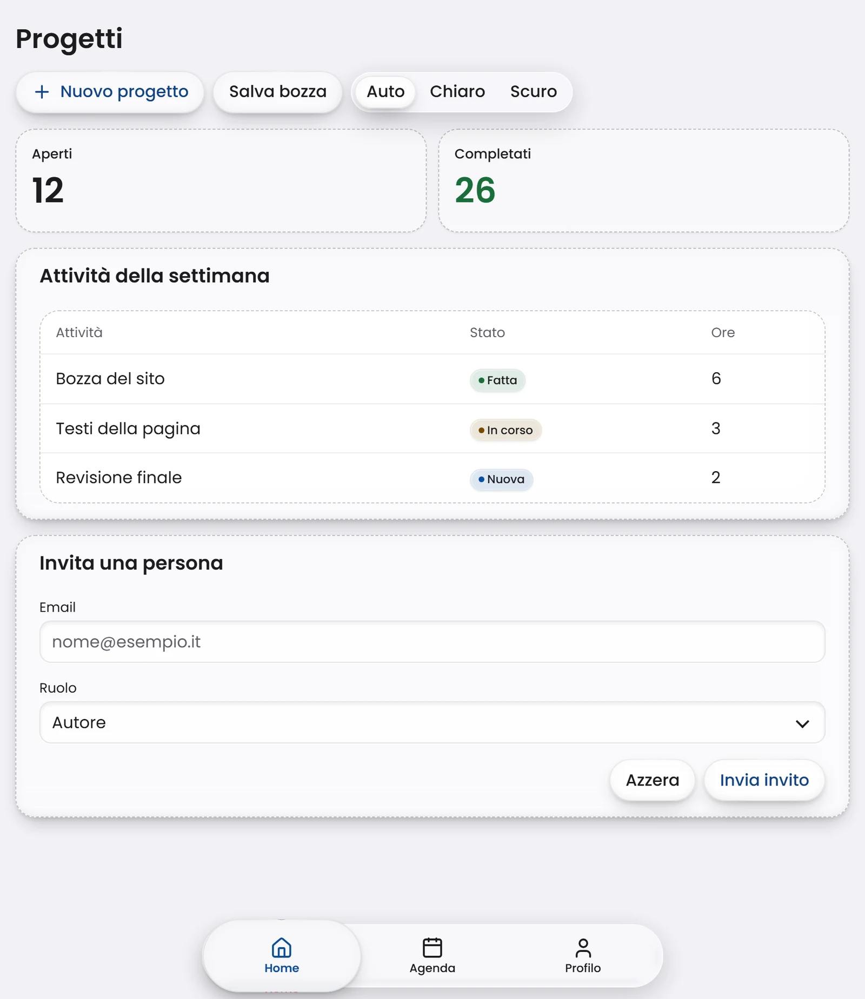 | 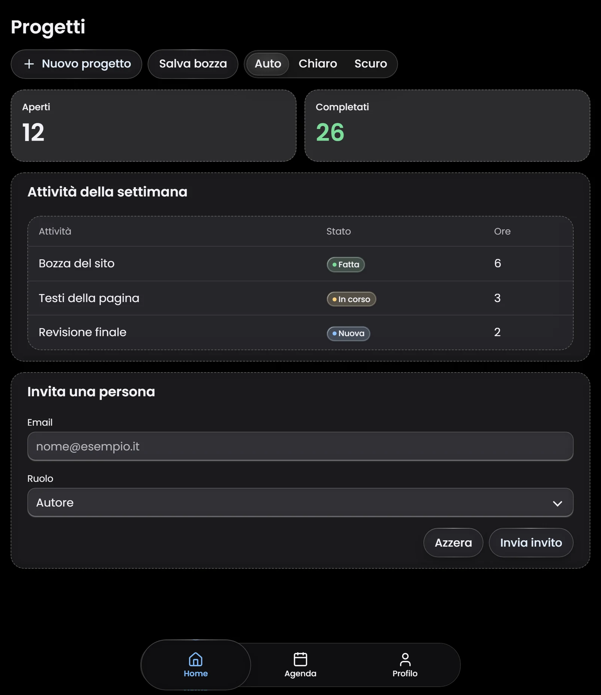 |

Le immagini sono catturate in Chromium dalla pagina [`docs/esempi/pagina-completa.html`](docs/esempi/pagina-completa.html) e dalle pagine della documentazione in [`site/`](site/).

## A cosa serve

A costruire l'interfaccia di un'applicazione senza ridisegnare ogni volta gli stessi pezzi: gestionali, pannelli di amministrazione, aree riservate, strumenti interni, siti e web app. Si parte da componenti coerenti tra loro, già responsivi e con tema chiaro e scuro, e si personalizzano con le variabili CSS.

| Esigenza | Cosa fa DPI |
| --- | --- |
| Un'interfaccia curata su un sito statico o su un backend esistente (PHP, Python, Java, …) | Un foglio di stile e uno script classico: nessun npm, bundler o runtime lato server. |
| Dialog, menu, selettori di data e notifiche senza scrivere ogni volta il codice | Si attivano con attributi dichiarativi; focus, Escape e frecce sono gestiti. |
| Tema chiaro e scuro | I colori sono variabili `--dpi-*`; il tema segue il sistema o la scelta salvata dell'utente. |
| Un'interfaccia utilizzabile su telefono | Bottom bar, sheet, tabelle che diventano schede, pannelli a tutta larghezza. |
| Nessuna richiesta a terze parti | Font, icone e motore ottico sono nel pacchetto. Le risorse esterne sono solo quelle che aggiungi tu (per esempio le tessere di una mappa). |

DPI si occupa dell'interfaccia: non ha router, gestione dello stato, accesso ai dati o autenticazione, che restano nella tua applicazione.

## Caratteristiche principali

- **Materiale a vetro** per pulsanti, barre e controlli, applicato automaticamente a pulsanti e schede.
- **Componenti** per layout, contenuti e dati, moduli, azioni, navigazione, sovrapposizioni, attesa, calendario e mappe ([indice](docs/README.md)).
- **Interazioni dichiarative** (`data-dpi-dialog-open`, `data-dpi-toast`, `data-dpi-confirm`, …) e un'API JavaScript facoltativa.
- **Tema** automatico, chiaro o scuro, con due palette alternative (`violet`, `forest`).
- **Accessibilità di base**: elementi HTML nativi, focus visibile, rispetto di `prefers-reduced-motion`, `prefers-reduced-transparency` e `forced-colors`.
- **Nessun gestore inline** e nessun `eval`.

| Dialog | Conferma | Chatbot |
| --- | --- | --- |
| 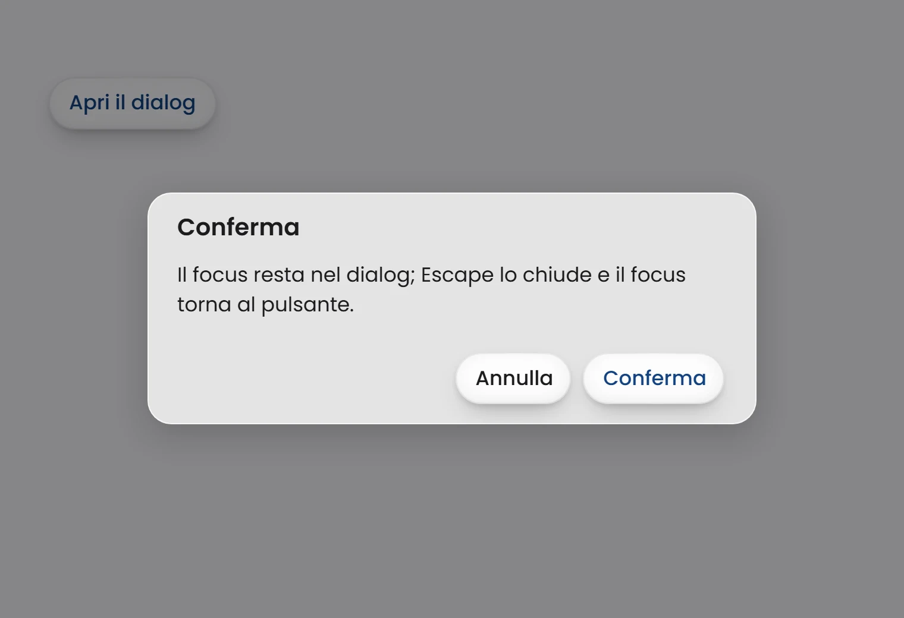 | 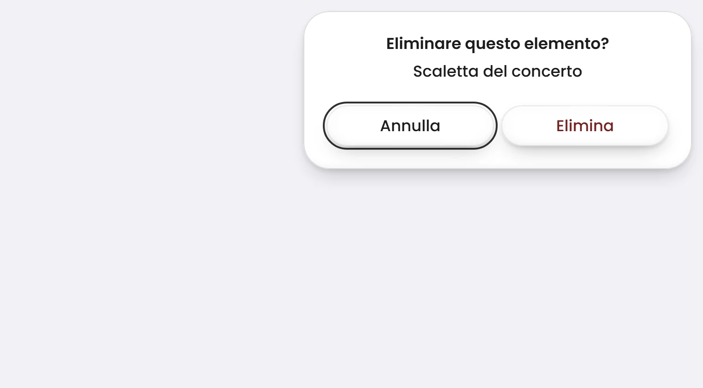 | 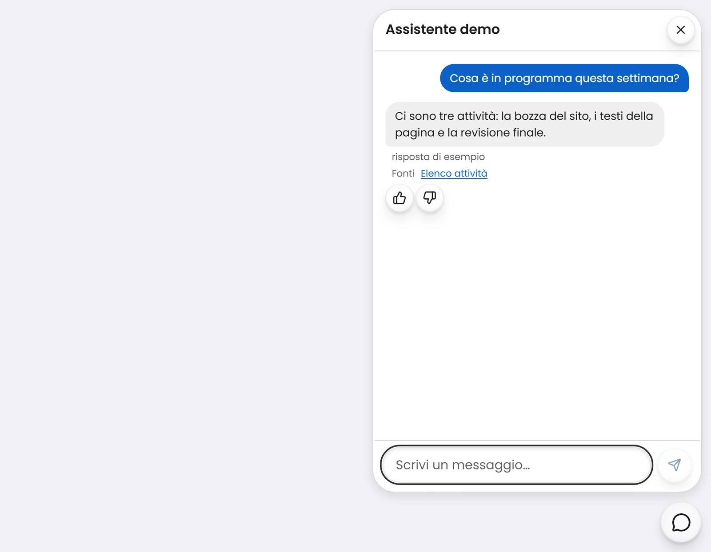 |

### Su telefono

| Pagina (chiaro) | Pagina (scuro) | Bottom sheet | Chatbot |
| --- | --- | --- | --- |
| 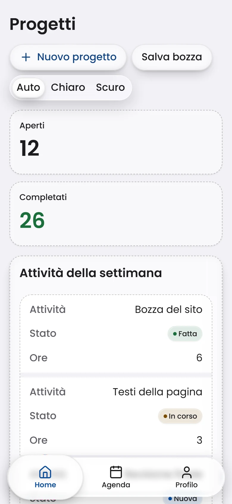 | 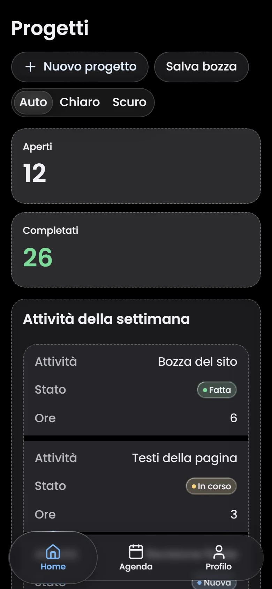 | 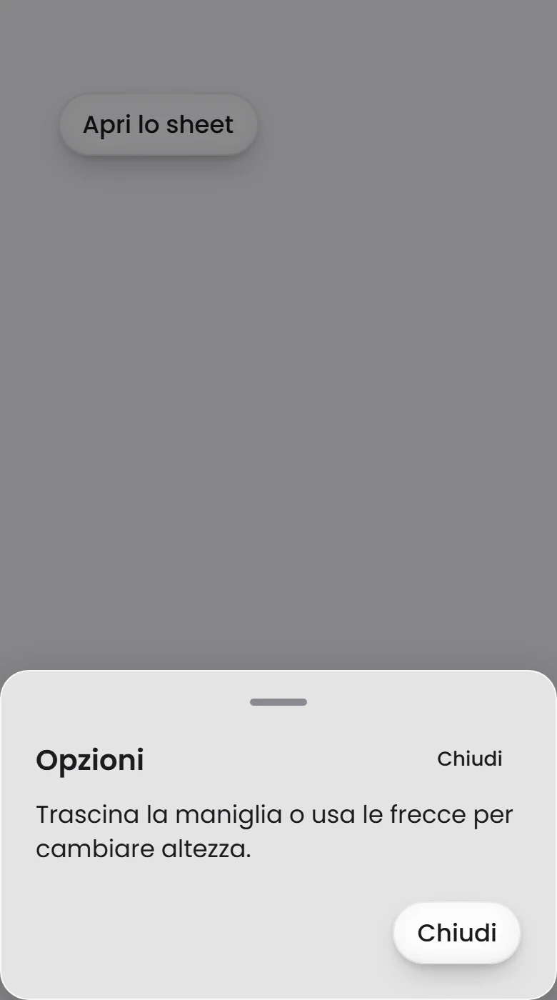 | 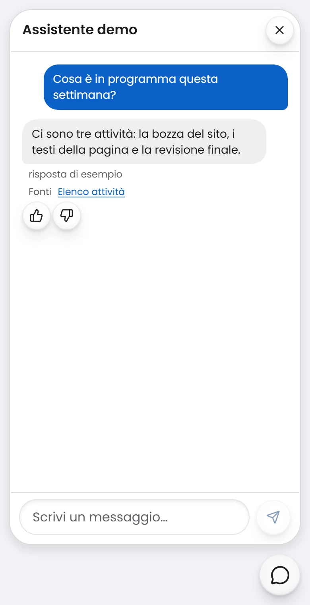 |

## Avvio rapido

### Dal web

Nell'`<head>`, in quest'ordine:

```html
<script src="https://davideprioreschi.github.io/dpi-framework/dpi/theme-init.js"></script>
<link rel="stylesheet" href="https://davideprioreschi.github.io/dpi-framework/dpi/dpi.css">
<link rel="stylesheet" href="https://davideprioreschi.github.io/dpi-framework/dpi/css/reset.css">
<script src="https://davideprioreschi.github.io/dpi-framework/dpi/dpi.js" defer></script>
```

E sul `<body>` (o sul contenitore che deve usare la tipografia DPI):

```html
<body class="dpi-root">
```

- `theme-init.js` è facoltativo: ripristina il tema salvato prima del primo disegno. Va prima dei CSS, senza `defer`.
- `css/reset.css` e `class="dpi-root"` servono **insieme**: senza, il testo resta con il font predefinito del browser. Il reset agisce solo dentro `.dpi-root`.

> **Attenzione:** questi indirizzi seguono sempre l'ultima versione pubblicata e non esiste un indirizzo con versione fissa. Un aggiornamento arriva ai siti che li usano senza interventi (la cache può impiegare circa 10 minuti), comprese eventuali modifiche non compatibili. Se serve stabilità, copia la cartella `dpi/` nel tuo progetto.

### In locale

1. Copia l'intera cartella [`dpi/`](dpi/) nel tuo sito (puoi spostarla o rinominarla: i riferimenti interni sono relativi).
2. Includi gli stessi file con il percorso della tua cartella:

```html
<script src="dpi/theme-init.js"></script>
<link rel="stylesheet" href="dpi/dpi.css">
<link rel="stylesheet" href="dpi/css/reset.css">
<script src="dpi/dpi.js" defer></script>
```

3. Aggiungi `class="dpi-root"` al `<body>`.

Per l'anteprima va bene qualunque server statico, per esempio `python -m http.server`. L'apertura con doppio clic (`file://`) non è stata verificata.

## Esempi

### Pagina intera

Salvala come `index.html` e aprila con un server statico:

```html
<!doctype html>
<html lang="it">
<head>
  <meta charset="utf-8">
  <meta name="viewport" content="width=device-width, initial-scale=1, viewport-fit=cover">
  <title>La mia pagina</title>
  <script src="https://davideprioreschi.github.io/dpi-framework/dpi/theme-init.js"></script>
  <link rel="stylesheet" href="https://davideprioreschi.github.io/dpi-framework/dpi/dpi.css">
  <link rel="stylesheet" href="https://davideprioreschi.github.io/dpi-framework/dpi/css/reset.css">
  <script src="https://davideprioreschi.github.io/dpi-framework/dpi/dpi.js" defer></script>
</head>
<body class="dpi-root">
  <main class="dpi-container dpi-page dpi-stack" data-dpi-loading>
    <h1 class="dpi-heading dpi-heading--1">Benvenuto</h1>
    <p class="dpi-text">Questa pagina è HTML con classi dpi-*.</p>
    <div class="dpi-cluster">
      <button class="dpi-btn dpi-btn--primary" type="button" data-dpi-toast="Fatto!" data-dpi-tone="success">
        <span data-dpi-icon="check"></span>Prova
      </button>
    </div>
  </main>
</body>
</html>
```

`data-dpi-loading` mostra uno skeleton al primo caricamento (almeno 1,5 s; vedi la [guida](docs/guida.md#caricamento-e-skeleton)).

Un esempio più ricco (metriche, tabella, form, dialog, selettore del tema e bottom bar) è in [`docs/esempi/pagina-completa.html`](docs/esempi/pagina-completa.html): [aprilo nel browser](https://davideprioreschi.github.io/dpi-framework/docs/esempi/pagina-completa.html).

| Dalla pagina di esempio: dialog aperto | Dalla pagina di esempio: notifica |
| --- | --- |
| 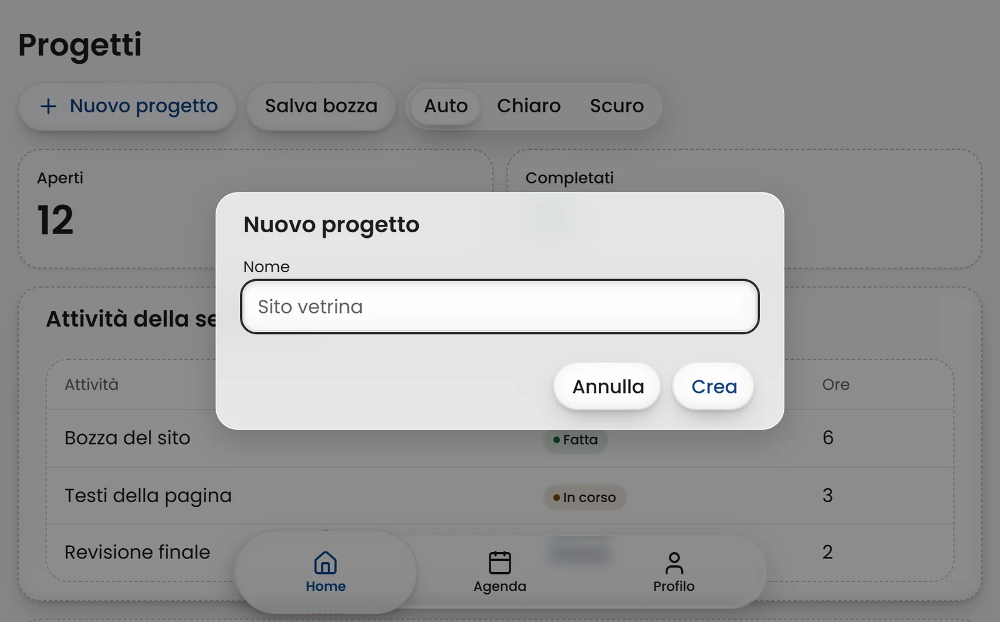 | 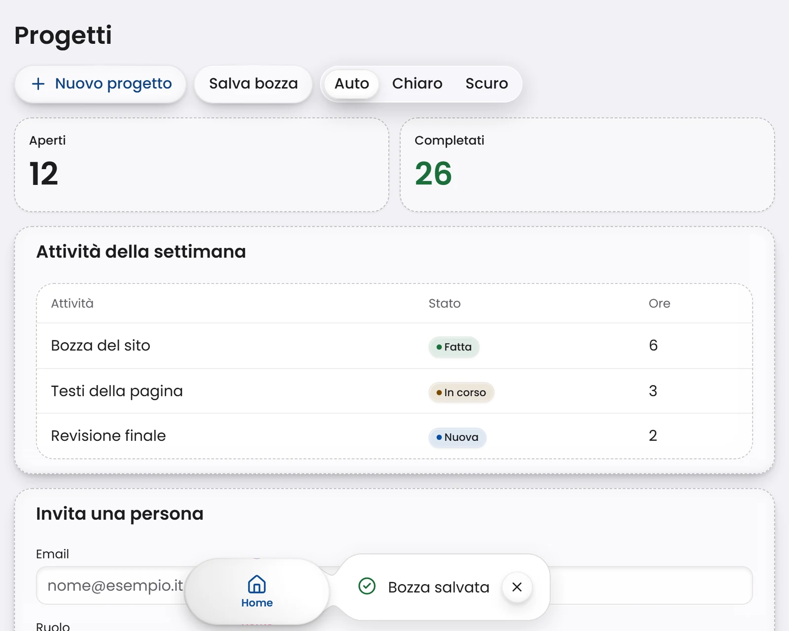 |

I frammenti seguenti vanno dentro il `<main>` della pagina qui sopra.

### Pulsanti

```html
<div class="dpi-cluster">
  <button class="dpi-btn" type="button">Secondario</button>
  <button class="dpi-btn dpi-btn--primary" type="button">Primario</button>
  <button class="dpi-btn dpi-btn--danger" type="button">Elimina</button>
  <button class="dpi-btn dpi-btn--icon-only" type="button" title="Cerca">
    <span data-dpi-icon="search"></span><span class="dpi-visually-hidden">Cerca</span>
  </button>
</div>
```

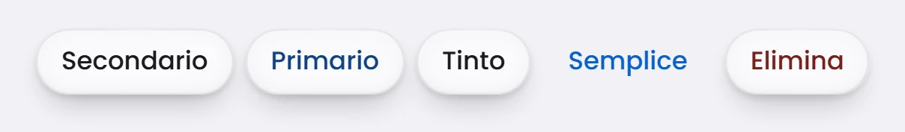

### Card

```html
<section class="dpi-card" aria-labelledby="scheda-title">
  <div class="dpi-card__body dpi-stack">
    <h3 class="dpi-card__title" id="scheda-title">Titolo della scheda</h3>
    <p class="dpi-text">Contenuto della scheda.</p>
    <div class="dpi-cluster dpi-cluster--end">
      <button class="dpi-btn" type="button">Annulla</button>
      <button class="dpi-btn dpi-btn--primary" type="button">Conferma</button>
    </div>
  </div>
</section>
```

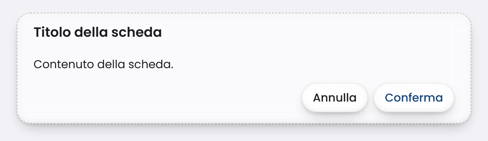

### Dialog, senza scrivere JavaScript

```html
<button class="dpi-btn" type="button" data-dpi-dialog-open="info">Apri il dialog</button>

<dialog class="dpi-dialog dpi-glass dpi-glass--strong" id="info" aria-labelledby="info-title" data-dpi-dismissible>
  <form class="dpi-dialog__form" method="dialog">
    <div class="dpi-dialog__header"><h2 class="dpi-dialog__title" id="info-title">Conferma</h2></div>
    <div class="dpi-dialog__body dpi-stack"><p class="dpi-text">Si chiude con Escape, dal fondale o con i pulsanti.</p></div>
    <div class="dpi-dialog__footer">
      <div class="dpi-cluster dpi-cluster--end">
        <button class="dpi-btn" type="button" data-dpi-dialog-close="">Annulla</button>
        <button class="dpi-btn dpi-btn--primary" type="button" data-dpi-dialog-close="ok" value="ok">Conferma</button>
      </div>
    </div>
  </form>
</dialog>
```

### Notifiche e conferme

```html
<div class="dpi-cluster">
  <button class="dpi-btn" type="button" data-dpi-toast="Bozza salvata" data-dpi-tone="success">Salva</button>
  <button class="dpi-btn dpi-btn--danger" type="button"
          data-dpi-action="elimina" data-dpi-confirm=""
          data-dpi-confirm-title="Eliminare questo elemento?"
          data-dpi-confirm-label="Elimina" data-dpi-confirm-tone="danger">Elimina</button>
</div>
```

L'azione `elimina` (evento `dpi:action`) parte solo dopo la conferma:

```js
document.addEventListener('dpi:action', (e) => {
  if (e.detail.name === 'elimina') DPI.toast.show({ message: 'Elemento eliminato', tone: 'success' });
});
```

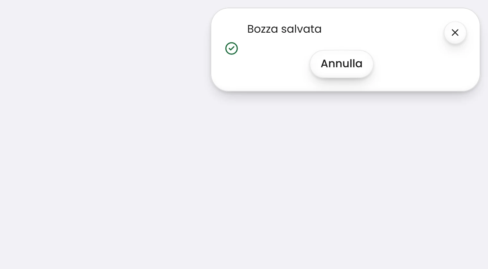

### Form

```html
<form class="dpi-stack">
  <div class="dpi-field">
    <label class="dpi-label" for="email">Email</label>
    <input class="dpi-input" id="email" name="email" type="email" required>
  </div>
  <div class="dpi-field">
    <label class="dpi-label" for="stato">Stato</label>
    <select class="dpi-select" id="stato" name="stato" data-dpi-select>
      <option value="attivo">Attivo</option>
      <option value="sospeso">Sospeso</option>
    </select>
  </div>
  <div class="dpi-field">
    <label class="dpi-label" for="note">Note</label>
    <textarea class="dpi-textarea" id="note" name="note"></textarea>
  </div>
  <div class="dpi-cluster">
    <button class="dpi-btn dpi-btn--primary" type="submit">Invia</button>
    <button class="dpi-btn" type="reset">Azzera</button>
  </div>
</form>
```

Per data, ora, colore, file e testo ricco vedi i [componenti dei moduli](docs/README.md#moduli-form).

### Bottom bar

Va fuori dal `<main>`, alla fine del `<body>`:

```html
<nav class="dpi-bottombar dpi-glass" aria-label="Sezioni" data-dpi-bottombar data-dpi-count="3" data-dpi-index="0" data-dpi-glass="bar">
  <ul class="dpi-bottombar__list">
    <li><a class="dpi-bottombar__item" href="#home" draggable="false" aria-current="page"><span class="dpi-bottombar__icon"><span data-dpi-icon="house" data-dpi-icon-size="lg"></span></span><span class="dpi-bottombar__label">Home</span></a></li>
    <li><a class="dpi-bottombar__item" href="#agenda" draggable="false"><span class="dpi-bottombar__icon"><span data-dpi-icon="calendar" data-dpi-icon-size="lg"></span></span><span class="dpi-bottombar__label">Agenda</span></a></li>
    <li><a class="dpi-bottombar__item" href="#profilo" draggable="false"><span class="dpi-bottombar__icon"><span data-dpi-icon="user" data-dpi-icon-size="lg"></span></span><span class="dpi-bottombar__label">Profilo</span></a></li>
  </ul>
</nav>
```

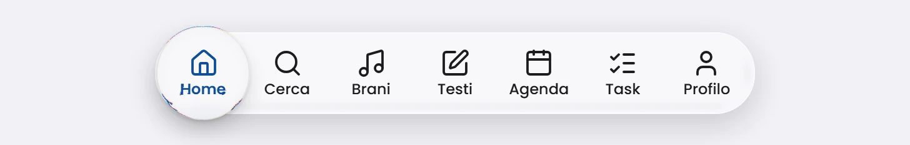

## Tema chiaro e scuro

Senza impostazioni DPI segue il tema del sistema. Per imporlo:

```html
<html lang="it" data-dpi-theme="dark">
```

Per lasciar scegliere l'utente, senza codice:

```html
<fieldset class="dpi-segmented dpi-glass dpi-glass--pill" data-dpi-glass="button">
  <legend class="dpi-visually-hidden">Aspetto</legend>
  <label class="dpi-segmented__item"><input class="dpi-segmented__input" type="radio" name="aspetto" value="auto" data-dpi-theme-pref checked><span class="dpi-segmented__label">Auto</span></label>
  <label class="dpi-segmented__item"><input class="dpi-segmented__input" type="radio" name="aspetto" value="light" data-dpi-theme-pref><span class="dpi-segmented__label">Chiaro</span></label>
  <label class="dpi-segmented__item"><input class="dpi-segmented__input" type="radio" name="aspetto" value="dark" data-dpi-theme-pref><span class="dpi-segmented__label">Scuro</span></label>
</fieldset>
```

La scelta è salvata in `localStorage` (chiave `dpi-theme`).

## API JavaScript

Tutto è esposto su `window.DPI`, disponibile dopo l'esecuzione di `dpi.js` (con `defer`: da `DOMContentLoaded` in poi).

| Chiamata | Cosa fa |
| --- | --- |
| `DPI.init(elemento)` | Inizializza il markup inserito dopo il caricamento, senza duplicare. |
| `DPI.theme.apply('auto' \| 'light' \| 'dark')` | Imposta e salva la preferenza. |
| `DPI.theme.preference()` / `DPI.theme.effective()` | Preferenza / tema effettivo. |
| `DPI.toast.show({ message, tone, duration, action })` | Notifica breve. |
| `DPI.alert(opzioni)` / `DPI.popup(opzioni)` | Avviso o popup; restituiscono una Promise. |
| `DPI.confirm(opzioni)` | Conferma; Promise `true` solo con l'azione esplicita. |
| `DPI.icon('plus')` | Restituisce l'elemento SVG di un'icona. |
| `DPI.chatbot.mount(el, opzioni)` | Monta un pannello conversazionale. |
| `DPI.loading.configure(opzioni)` / `DPI.loading.fragment(el, promessa)` | Skeleton di caricamento. |

Contenuto aggiunto da codice (in un file `.js` incluso con `defer` dopo `dpi.js`):

```js
const box = document.createElement('div');
box.innerHTML = '<button class="dpi-btn" type="button"><span data-dpi-icon="plus"></span>Aggiunto da codice</button>';
document.querySelector('main').append(box);
DPI.init(box);
```

Gli eventi (`dpi:action`, `dpi:open`, `dpi:close`, …) si ascoltano su `document`. Dettagli nella [guida](docs/guida.md#javascript-ed-eventi) e nelle pagine dei componenti.

## Personalizzazione

Si ridefiniscono le variabili, non si sovrascrivono le classi:

```css
:root {
  --dpi-accent: light-dark(#7a2bd1, #c59bff);
  --dpi-radius-md: 0.5rem;
  --dpi-container-max: 72rem;
}
```

La stessa cosa si può limitare a una parte della pagina usando un selettore proprio. Sono pronte due palette: `data-dpi-skin="violet"` e `data-dpi-skin="forest"`. Altri token nella [guida](docs/guida.md#personalizzazione).

## Requisiti e compatibilità

- Un server HTTP qualsiasi, anche statico. Nessun requisito lato server.
- Un browser recente con `light-dark()`, `color-mix()`, `:has()`, `@property` e Popover API. Le versioni minime non sono state verificate.

| Motore | Stato |
| --- | --- |
| Chromium (Chrome, Edge) | Browser di sviluppo. **Unico con la rifrazione reale del vetro.** |
| Firefox | Resa alternativa (sfocatura, velo, riflesso) senza deformazione dello sfondo. Provato con la build di Playwright. |
| WebKit | Come Firefox. Provato con la build di Playwright su Windows. |
| Safari su macOS e iOS reali | **Non verificato.** |

Non sono stati fatti test con screen reader o su dispositivi touch reali. La versione del pacchetto è `0.1.0` (`DPI.VERSION`): l'interfaccia pubblica può ancora cambiare. I limiti dei singoli componenti sono indicati nelle rispettive pagine.

## Struttura del repository

```
dpi/              la libreria da distribuire
  dpi.css         punto d'ingresso CSS (importa i fogli in css/)
  css/reset.css   base tipografica facoltativa (.dpi-root)
  dpi.js          bundle JavaScript classico
  theme-init.js   ripristino del tema prima del primo disegno
  fonts/ icons/ vendor/ img/
  LEGGIMI.txt, MANIFEST.json, THIRD-PARTY-LICENSES.txt
site/             documentazione interattiva (HTML), pubblicata con GitHub Pages
docs/             documentazione leggibile su GitHub: guida, componenti, immagini, esempi
esempio/          pagina minima funzionante
```

## Componenti

| Categoria | Pagine |
| --- | --- |
| Layout e struttura | [Pagina e contenitori](docs/componenti/pagina-e-contenitori.md) · [Disposizione](docs/componenti/disposizione.md) · [Vista a due colonne](docs/componenti/split-view.md) · [Scena](docs/componenti/scena.md) |
| Contenuti e dati | [Card e pannelli](docs/componenti/card-e-pannelli.md) · [Tipografia](docs/componenti/tipografia.md) · [Immagini e avatar](docs/componenti/immagini-e-avatar.md) · [Carosello](docs/componenti/carosello.md) · [Accordion](docs/componenti/accordion.md) · [Tabelle](docs/componenti/tabelle-e-paginazione.md) · [Elenchi](docs/componenti/elenchi.md) · [Badge, stati, avvisi](docs/componenti/badge-stati-avvisi.md) · [Metriche](docs/componenti/metriche.md) · [Audio](docs/componenti/audio.md) · [Diff](docs/componenti/diff.md) · [Barra di controlli](docs/componenti/barra-controlli.md) |
| Moduli | [Form](docs/componenti/form.md) · [Campi di testo](docs/componenti/campi-di-testo.md) · [Caselle e interruttori](docs/componenti/scelte.md) · [Segmented](docs/componenti/segmented.md) · [Select](docs/componenti/select.md) · [Combobox](docs/componenti/combobox.md) · [Chip](docs/componenti/chip.md) · [Cursore](docs/componenti/range.md) · [OTP](docs/componenti/codice-otp.md) · [File](docs/componenti/scelta-file.md) · [Ricerca](docs/componenti/ricerca.md) · [Editor di testo](docs/componenti/editor-di-testo.md) · [Data e ora](docs/componenti/data-e-ora.md) · [Colore](docs/componenti/colore.md) |
| Azioni | [Pulsanti](docs/componenti/pulsanti.md) · [Azioni espandibili](docs/componenti/azioni-espandibili.md) · [Menu](docs/componenti/menu.md) |
| Navigazione | [Bottom bar](docs/componenti/bottom-bar.md) · [Barra superiore](docs/componenti/navbar.md) · [Nav e «Altro»](docs/componenti/nav.md) · [Linguette](docs/componenti/tabs.md) · [Breadcrumb](docs/componenti/breadcrumb.md) · [Passi](docs/componenti/stepper.md) |
| Sovrapposizioni e messaggi | [Dialog](docs/componenti/dialog.md) · [Drawer e sheet](docs/componenti/drawer-e-sheet.md) · [Popover e tooltip](docs/componenti/popover-e-tooltip.md) · [Notifiche](docs/componenti/notifiche.md) · [Chatbot](docs/componenti/chatbot.md) |
| Attesa e avanzamento | [Avanzamento e spinner](docs/componenti/avanzamento.md) · [Skeleton](docs/componenti/skeleton.md) |
| Calendario e mappe | [Calendario](docs/componenti/calendario.md) · [Mappa](docs/componenti/mappa.md) |

## Licenze

**Per il progetto non è stata ancora scelta una licenza** e nel repository non c'è un file `LICENSE`. La sola pubblicazione del codice non concede il diritto di riusarlo o redistribuirlo: per questo rivolgersi al proprietario del repository.

Il pacchetto include componenti di terze parti; i testi completi sono in [`dpi/THIRD-PARTY-LICENSES.txt`](dpi/THIRD-PARTY-LICENSES.txt).

| Componente | Uso | Licenza |
| --- | --- | --- |
| [Poppins](https://github.com/itfoundry/Poppins) | font | SIL Open Font License 1.1 |
| [Lucide](https://github.com/lucide-icons/lucide) | icone | ISC (MIT per le icone derivate da Feather) |
| [LiquidGlass](https://github.com/gentpan/liquidglass) | motore di rifrazione | MIT |
