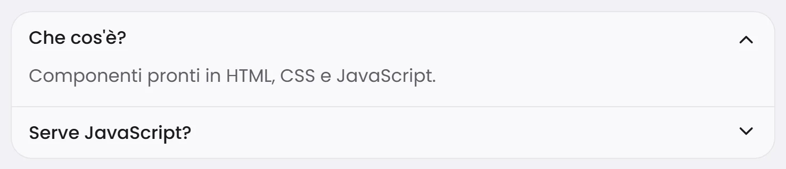
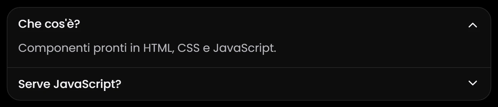

# Accordion e sezioni comprimibili

[Indice dei componenti](../README.md) · [Guida](../guida.md) · [README](../../README.md)

Sezioni da aprire a richiesta, costruite su `<details>/<summary>` nativi: funzionano anche senza JavaScript. `accordion_item` è la singola voce di un `accordion`; `disclosure` è un blocco singolo.

**Pagina interattiva:** [accordion](https://davideprioreschi.github.io/dpi-framework/site/components/accordion.html) · [accordion_item](https://davideprioreschi.github.io/dpi-framework/site/components/accordion_item.html) · [disclosure](https://davideprioreschi.github.io/dpi-framework/site/components/disclosure.html)

## Aspetto

**Accordion**



### Tema scuro



## Esempi

Il markup va in una pagina che include gli asset DPI (vedi [Installazione](../guida.md#installazione)).

### Voci a scomparsa (una alla volta)

```html
<div class="dpi-accordion">
  <details class="dpi-accordion__item" name="dpi-1-grp" open>
    <summary class="dpi-accordion__summary">
      <span>Che cos&apos;è?</span><span class="dpi-accordion__chevron" aria-hidden="true"><span data-dpi-icon="chevron-down"></span></span>
    </summary>
    <div class="dpi-accordion__body">
      <p class="dpi-text">
        Componenti pronti in HTML, CSS e JavaScript.
      </p>
    </div>
  </details>
  <details class="dpi-accordion__item" name="dpi-1-grp">
    <summary class="dpi-accordion__summary">
      <span>Serve JavaScript?</span><span class="dpi-accordion__chevron" aria-hidden="true"><span data-dpi-icon="chevron-down"></span></span>
    </summary>
    <div class="dpi-accordion__body">
      <p class="dpi-text">
        No: l&apos;accordion usa details/summary nativi.
      </p>
    </div>
  </details>
</div>
```

### Dettagli a scomparsa

```html
<details class="dpi-disclosure">
  <summary>
    Mostra i dettagli
  </summary>
  <div class="dpi-disclosure__body dpi-stack">
    <p class="dpi-text">
      Il contenuto compare e scompare (details/summary nativi).
    </p>
  </div>
</details>
```

## Classi, attributi ed eventi

Invio/Spazio sul titolo; evento nativo `toggle`.

<details>
<summary>Tutte le classi e gli attributi usati negli esempi del sito</summary>

**Classi:** `dpi-accordion`, `dpi-accordion__body`, `dpi-accordion__chevron`, `dpi-accordion__item`, `dpi-accordion__summary`, `dpi-disclosure`, `dpi-disclosure__body`, `dpi-stack`, `dpi-text`

**Attributi:** `data-dpi-icon`

</details>

## Limiti

- Nessuna animazione dell'altezza.
