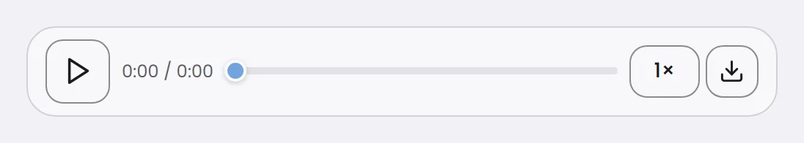
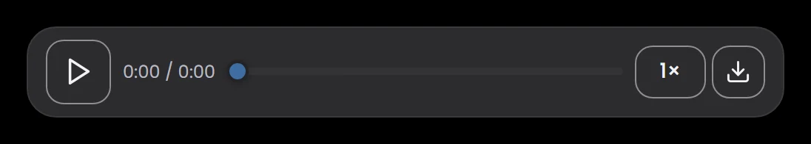

# Lettore audio

[Indice dei componenti](../README.md) · [Guida](../guida.md) · [README](../../README.md)

Comandi coerenti con il tema (play/pausa, posizione, tempo, velocità, scarica) al posto di quelli nativi; l'elemento `<audio>` resta sotto per decodifica e rete.

**Pagina interattiva:** [audio](https://davideprioreschi.github.io/dpi-framework/site/components/audio.html)

## Aspetto

**Lettore (senza file caricato)**



### Tema scuro



## Esempi

Il markup va in una pagina che include gli asset DPI (vedi [Installazione](../guida.md#installazione)).

### Lettore con scarica

```html
<div class="dpi-audio" data-dpi-audio data-dpi-audio-label="Registrazione della riunione"
     data-dpi-audio-download="/percorso/audio.mp3">
  <audio preload="none" src="/percorso/audio.mp3"></audio>   <!-- senza «controls» -->
</div>
```

### File non riavvolgibile, senza velocità

```html
<!-- file senza supporto all'intervallo di byte: la posizione è disabilitata, l'ascolto procede dall'inizio -->
<div class="dpi-audio" data-dpi-audio data-dpi-audio-noseek data-dpi-audio-rate="off">
  <audio preload="none" src="/percorso/audio.mp3"></audio>
</div>
```

## Classi, attributi ed eventi

`data-dpi-audio`, `data-dpi-audio-label`, `data-dpi-audio-download`, `data-dpi-audio-noseek`, `data-dpi-audio-rate="off"`. Avviare un audio mette in pausa gli altri.

## Limiti

- Solo audio. Negli esempi il percorso del file è un segnaposto: sostituiscilo con il tuo.
