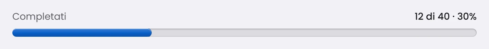
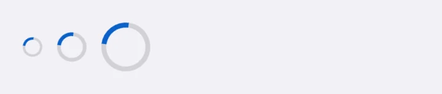

# Barra di avanzamento e spinner

[Indice dei componenti](../README.md) · [Guida](../guida.md) · [README](../../README.md)

`progress` mostra l'avanzamento di un'operazione o di una quantità (nativo, determinato o indeterminato); `spinner` segnala un'attesa di durata sconosciuta.

**Pagina interattiva:** [progress](https://davideprioreschi.github.io/dpi-framework/site/components/progress.html) · [spinner](https://davideprioreschi.github.io/dpi-framework/site/components/spinner.html)

## Aspetto

**Barra di avanzamento**



**Spinner**



## Esempi

Il markup va in una pagina che include gli asset DPI (vedi [Installazione](../guida.md#installazione)).

### Determinata e indeterminata

```html
<div class="dpi-stack dpi-stack--sm">
  <progress class="dpi-progress dpi-progress--accent" value="60" max="100" aria-label="Caricamento">
    60%
  </progress>
  <progress class="dpi-progress dpi-progress--success" value="90" max="100" aria-label="Quasi fatto">
    90%
  </progress>
  <progress class="dpi-progress dpi-progress--accent" max="100" aria-label="In attesa">
  </progress>
</div>
```

### Dimensioni dello spinner

```html
<div class="dpi-cluster dpi-cluster--md">
  <span class="dpi-spinner dpi-spinner--sm" role="status"><span class="dpi-spinner__ring" aria-hidden="true"></span><span class="dpi-visually-hidden">Attendi</span></span><span class="dpi-spinner dpi-spinner--md" role="status"><span class="dpi-spinner__ring" aria-hidden="true"></span><span class="dpi-visually-hidden">Attendi</span></span><span class="dpi-spinner dpi-spinner--lg" role="status"><span class="dpi-spinner__ring" aria-hidden="true"></span><span class="dpi-visually-hidden">Attendi</span></span>
</div>
```

## Classi, attributi ed eventi

`dpi-progress--success|warning|danger|sm`, `dpi-progressbar` (etichetta e valore in testo), `--dpi-progress-color`, `--dpi-progress-track`. Con `prefers-reduced-motion` le animazioni si attenuano.

<details>
<summary>Tutte le classi e gli attributi usati negli esempi del sito</summary>

**Classi:** `dpi-cluster`, `dpi-cluster--md`, `dpi-progress`, `dpi-progress--accent`, `dpi-progress--success`, `dpi-spinner`, `dpi-spinner--lg`, `dpi-spinner--md`, `dpi-spinner--sm`, `dpi-spinner__ring`, `dpi-stack`, `dpi-stack--sm`, `dpi-visually-hidden`

</details>

## Limiti

- Nessuna barra multipla.
