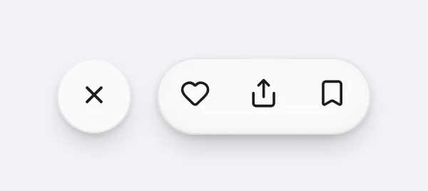
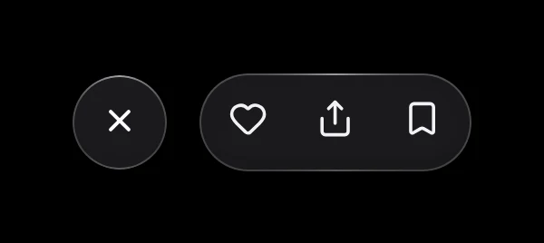

# Azioni espandibili

[Indice dei componenti](../README.md) · [Guida](../guida.md) · [README](../../README.md)

Un pulsante «+» che si allunga, forma un collo e si separa in un gruppo di azioni (da 1 a 5). Senza JavaScript il gruppo è sempre visibile. `expand_item` è la singola azione.

**Pagina interattiva:** [expand_actions](https://davideprioreschi.github.io/dpi-framework/site/components/expand_actions.html) · [expand_item](https://davideprioreschi.github.io/dpi-framework/site/components/expand_item.html)

## Aspetto

**Gruppo aperto**



### Tema scuro



## Esempi

Il markup va in una pagina che include gli asset DPI (vedi [Installazione](../guida.md#installazione)).

### Azioni espandibili

```html
<div class="dpi-expand" data-dpi-expand>
  <button class="dpi-btn dpi-btn--icon-only dpi-expand__trigger dpi-glass dpi-glass--pill" type="button" title="Azioni rapide" aria-expanded="false" aria-controls="dpi-1-panel" data-dpi-expand-trigger data-dpi-elastic data-dpi-glass="drop" data-dpi-drop="button">
    <span class="dpi-btn__content"><span data-dpi-icon="plus"></span><span class="dpi-visually-hidden">Azioni rapide</span></span>
  </button>
  <div class="dpi-expand__panel dpi-glass dpi-glass--pill" id="dpi-1-panel" role="group" aria-label="Azioni rapide" data-dpi-expand-panel data-dpi-glass="drop" data-dpi-drop="capsule">
    <span class="dpi-expand__items">
    <button class="dpi-expand__item" title="Mi piace" type="button">
      <span data-dpi-icon="heart"></span><span class="dpi-visually-hidden">Mi piace</span>
    </button>
    <button class="dpi-expand__item" title="Condividi" type="button">
      <span data-dpi-icon="share"></span><span class="dpi-visually-hidden">Condividi</span>
    </button>
    <button class="dpi-expand__item" title="Salva" type="button">
      <span data-dpi-icon="bookmark"></span><span class="dpi-visually-hidden">Salva</span>
    </button>
    </span>
  </div>
</div>
```

## Classi, attributi ed eventi

Invio/Spazio apre, Escape o clic fuori chiude. Eventi `dpi:open`, `dpi:close`, `dpi:action`. Chiuso, occupa solo lo spazio del pulsante.

<details>
<summary>Tutte le classi e gli attributi usati negli esempi del sito</summary>

**Classi:** `dpi-btn`, `dpi-btn--icon-only`, `dpi-btn__content`, `dpi-expand`, `dpi-expand__item`, `dpi-expand__items`, `dpi-expand__panel`, `dpi-expand__trigger`, `dpi-glass`, `dpi-glass--pill`, `dpi-visually-hidden`

**Attributi:** `data-dpi-drop`, `data-dpi-elastic`, `data-dpi-expand`, `data-dpi-expand-panel`, `data-dpi-expand-trigger`, `data-dpi-glass`, `data-dpi-icon`

</details>

## Limiti

- Massimo 5 azioni. Il collo è materiale SVG, non rifrazione.
