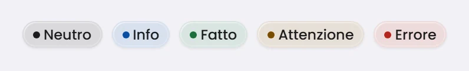
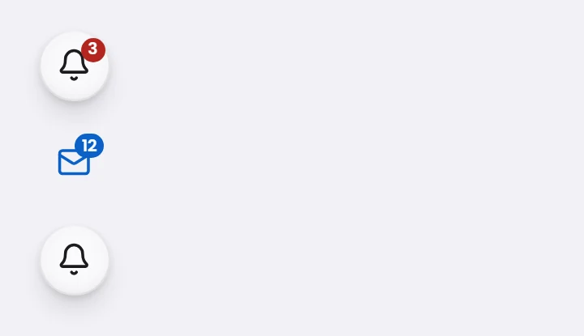
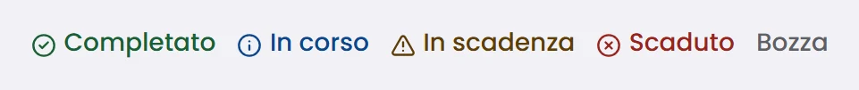
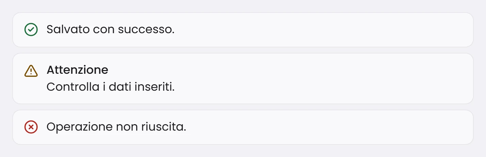
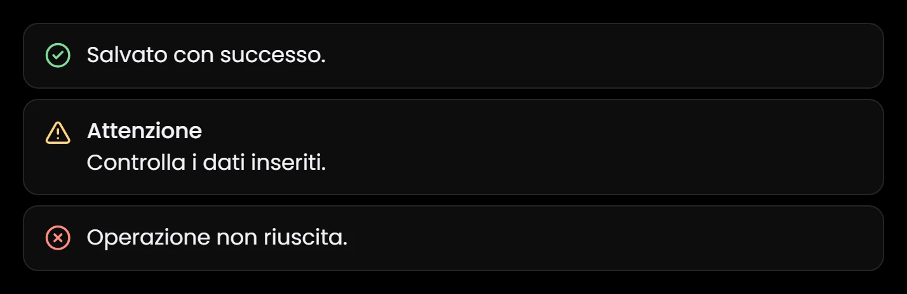

# Badge, stati e avvisi

[Indice dei componenti](../README.md) · [Guida](../guida.md) · [README](../../README.md)

Tre modi di comunicare uno stato: etichetta compatta (`badge`), testo breve con icona senza capsula (`status`) e messaggio che resta nella pagina (`alert`).

**Pagina interattiva:** [badge](https://davideprioreschi.github.io/dpi-framework/site/components/badge.html) · [status](https://davideprioreschi.github.io/dpi-framework/site/components/status.html) · [alert](https://davideprioreschi.github.io/dpi-framework/site/components/alert.html)

## Aspetto

**Badge**



**Contatori sui pulsanti**



**Stato come testo**



**Avvisi**



### Tema scuro



## Esempi

Il markup va in una pagina che include gli asset DPI (vedi [Installazione](../guida.md#installazione)).

### Toni dei badge

```html
<div class="dpi-cluster">
  <span class="dpi-badge">Neutro</span><span class="dpi-badge dpi-badge--info">Info</span><span class="dpi-badge dpi-badge--success">Fatto</span><span class="dpi-badge dpi-badge--warning">Attenzione</span><span class="dpi-badge dpi-badge--danger">Errore</span>
</div>
```

### Senza pallino

```html
<span class="dpi-badge dpi-badge--plain">Bozza</span>
<span class="dpi-badge dpi-badge--plain dpi-badge--success">Pagata</span>
<span class="dpi-badge dpi-badge--plain dpi-badge--info">Nuova</span>
<span class="dpi-badge dpi-badge--plain dpi-badge--warning">In scadenza</span>
<span class="dpi-badge dpi-badge--plain dpi-badge--danger">Scaduta</span>
```

### Contatore su un pulsante a sola icona

```html
<button class="dpi-btn dpi-btn--icon-only" type="button" aria-label="Notifiche, 3 nuove"><span data-dpi-icon="bell"></span><span class="dpi-badge dpi-badge--count dpi-badge--danger" aria-hidden="true">3</span></button>
<button class="dpi-btn dpi-btn--plain dpi-btn--icon-only" type="button" aria-label="Messaggi, 12"><span data-dpi-icon="mail"></span><span class="dpi-badge dpi-badge--count">12</span></button>
<button class="dpi-btn dpi-btn--icon-only" type="button" aria-label="Notifiche"><span data-dpi-icon="bell"></span><span class="dpi-badge dpi-badge--count" hidden>0</span></button>
```

### Stato come testo

```html
<span class="dpi-status dpi-status--success"><span data-dpi-icon="circle-check" data-dpi-icon-size="sm"></span><span>Completato</span></span>
<span class="dpi-status dpi-status--warning"><span data-dpi-icon="triangle-alert" data-dpi-icon-size="sm"></span><span>In scadenza</span></span>
<span class="dpi-status"><span>Bozza</span></span>   <!-- neutro: solo testo attenuato -->
```

### Avvisi: toni e titolo

```html
<div class="dpi-stack dpi-stack--sm">
  <div class="dpi-alert dpi-alert--success" role="status">
    <span class="dpi-alert__icon"><span data-dpi-icon="circle-check"></span></span>
    <div class="dpi-alert__body">
      Salvato con successo.
    </div>
  </div>
  <div class="dpi-alert dpi-alert--warning" role="status">
    <span class="dpi-alert__icon"><span data-dpi-icon="triangle-exclamation-point"></span></span>
    <div class="dpi-alert__body">
      <p class="dpi-alert__title">
        Attenzione
      </p>
      Controlla i dati inseriti.
    </div>
  </div>
  <div class="dpi-alert dpi-alert--danger" role="alert">
    <span class="dpi-alert__icon"><span data-dpi-icon="circle-x"></span></span>
    <div class="dpi-alert__body">
      Operazione non riuscita.
    </div>
  </div>
</div>
```

## Classi, attributi ed eventi

- Toni: `--success`, `--info`, `--warning`, `--danger`.
- `dpi-badge--plain`, `dpi-badge--count` (si posiziona da solo in un `dpi-btn--icon-only`), `dpi-badge--project` (colore `--dpi-badge-color`).
- Il numero del contatore è decorativo: il nome accessibile va sul pulsante (`aria-label`).
- `alert` ha `role=status`; con tono danger `role=alert`.

<details>
<summary>Tutte le classi e gli attributi usati negli esempi del sito</summary>

**Classi:** `dpi-alert`, `dpi-alert--danger`, `dpi-alert--success`, `dpi-alert--warning`, `dpi-alert__body`, `dpi-alert__icon`, `dpi-alert__title`, `dpi-badge`, `dpi-badge--danger`, `dpi-badge--info`, `dpi-badge--success`, `dpi-badge--warning`, `dpi-cluster`, `dpi-stack`, `dpi-stack--sm`

**Attributi:** `data-dpi-icon`

</details>
