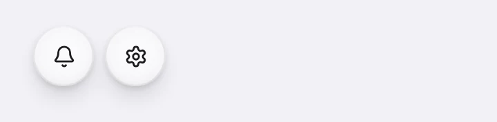

# Barra di controlli tematizzabile

[Indice dei componenti](../README.md) · [Guida](../guida.md) · [README](../../README.md)

`dpi-chrome` è una barra i cui pulsanti e campi seguono token propri, utile quando l'applicazione ha un colore di progetto.

**Pagina interattiva:** [chrome](https://davideprioreschi.github.io/dpi-framework/site/components/chrome.html)

## Aspetto

**Barra di controlli con i token predefiniti**



## Esempi

Il markup va in una pagina che include gli asset DPI (vedi [Installazione](../guida.md#installazione)).

### Barra e token

```html
<div class="dpi-chrome dpi-cluster">
  <button class="dpi-btn dpi-btn--icon-only" type="button" aria-label="Notifiche">…</button>
</div>

/* tema colorato: si ridefiniscono i token sulla barra o su un antenato */
.mia-barra { --dpi-chrome-field: color-mix(in srgb, var(--dpi-accent) 14%, var(--dpi-surface-2));
             --dpi-chrome-line:  color-mix(in srgb, var(--dpi-accent) 34%, var(--dpi-control-border)); }
```

## Classi, attributi ed eventi

Token: `--dpi-chrome-bg`, `--dpi-chrome-fg`, `--dpi-chrome-field`, `--dpi-chrome-line`, `--dpi-chrome-tint`. Valgono per `.dpi-btn`, `.dpi-input` e `.dpi-searchbar` dentro la barra.
