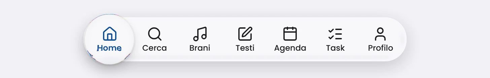
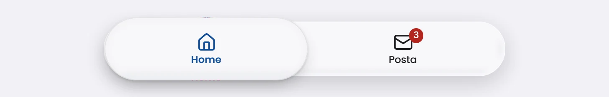
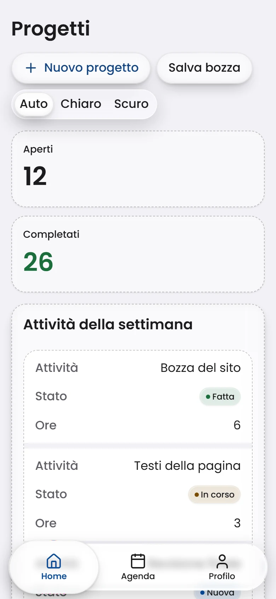
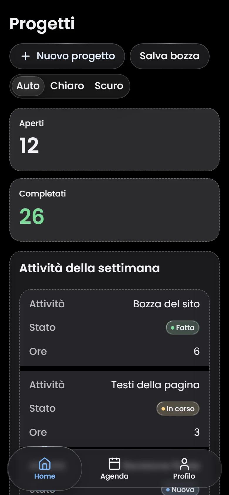

# Bottom bar

[Indice dei componenti](../README.md) · [Guida](../guida.md) · [README](../../README.md)

La navigazione principale, soprattutto su mobile: capsula in basso con icone, etichette, indicatore a lente e badge. Sono link tra pagine (`aria-current`), non linguette. Può ospitare le notifiche e la ricerca. `bar_item` è la singola voce.

**Pagina interattiva:** [bottom_bar](https://davideprioreschi.github.io/dpi-framework/site/components/bottom_bar.html) · [bar_item](https://davideprioreschi.github.io/dpi-framework/site/components/bar_item.html)

## Aspetto

**Bottom bar**



**Voce con badge**



**In una pagina su telefono**



### Tema scuro




## Esempi

Il markup va in una pagina che include gli asset DPI (vedi [Installazione](../guida.md#installazione)).

### Barra con 7 voci (anteprima nel flusso della pagina)

```html
<nav class="dpi-bottombar dpi-bottombar--inline dpi-glass" aria-label="Sezioni" data-dpi-bottombar data-dpi-inline data-dpi-count="7" data-dpi-index="0" data-dpi-glass="bar">
  <ul class="dpi-bottombar__list">
    <li>
      <a class="dpi-bottombar__item" href="#h" draggable="false" aria-current="page"><span class="dpi-bottombar__icon"><span data-dpi-icon="house" data-dpi-icon-size="lg"></span></span><span class="dpi-bottombar__label">Home</span></a>
    </li>
    <li>
      <a class="dpi-bottombar__item" href="#c" draggable="false"><span class="dpi-bottombar__icon"><span data-dpi-icon="search" data-dpi-icon-size="lg"></span></span><span class="dpi-bottombar__label">Cerca</span></a>
    </li>
    <li>
      <a class="dpi-bottombar__item" href="#b" draggable="false"><span class="dpi-bottombar__icon"><span data-dpi-icon="music" data-dpi-icon-size="lg"></span></span><span class="dpi-bottombar__label">Brani</span></a>
    </li>
    <li>
      <a class="dpi-bottombar__item" href="#t" draggable="false"><span class="dpi-bottombar__icon"><span data-dpi-icon="square-pen" data-dpi-icon-size="lg"></span></span><span class="dpi-bottombar__label">Testi</span></a>
    </li>
    <li>
      <a class="dpi-bottombar__item" href="#a" draggable="false"><span class="dpi-bottombar__icon"><span data-dpi-icon="calendar" data-dpi-icon-size="lg"></span></span><span class="dpi-bottombar__label">Agenda</span></a>
    </li>
    <li>
      <a class="dpi-bottombar__item" href="#k" draggable="false"><span class="dpi-bottombar__icon"><span data-dpi-icon="list-checks" data-dpi-icon-size="lg"></span></span><span class="dpi-bottombar__label">Task</span></a>
    </li>
    <li>
      <a class="dpi-bottombar__item" href="#p" draggable="false"><span class="dpi-bottombar__icon"><span data-dpi-icon="user" data-dpi-icon-size="lg"></span></span><span class="dpi-bottombar__label">Profilo</span></a>
    </li>
  </ul>
</nav>
```

### Voce con badge

```html
<nav class="dpi-bottombar dpi-bottombar--inline dpi-glass" aria-label="Esempio" data-dpi-bottombar data-dpi-inline data-dpi-count="2" data-dpi-index="0" data-dpi-glass="bar">
  <ul class="dpi-bottombar__list">
    <li>
      <a class="dpi-bottombar__item" href="#h" draggable="false" aria-current="page"><span class="dpi-bottombar__icon"><span data-dpi-icon="house" data-dpi-icon-size="lg"></span></span><span class="dpi-bottombar__label">Home</span></a>
    </li>
    <li>
      <a class="dpi-bottombar__item" href="#m" draggable="false"><span class="dpi-bottombar__icon"><span data-dpi-icon="mail" data-dpi-icon-size="lg"></span></span><span class="dpi-bottombar__label">Posta</span><span class="dpi-bottombar__badge" aria-hidden="true">3</span><span class="dpi-visually-hidden">, 3 nuovi</span></a>
    </li>
  </ul>
</nav>
```

## Classi, attributi ed eventi

- `data-dpi-bottombar`, `data-dpi-count`, `data-dpi-index` (voce corrente), `data-dpi-glass="bar"`.
- Per la barra fissa in basso **togli** `dpi-bottombar--inline` e `data-dpi-inline` (servono solo all'anteprima statica). La barra riserva spazio con `--dpi-bar-space`.
- `data-dpi-embedded` + `dpi-bottombar--embedded`: la stessa barra dentro un'altra barra (larghezza `--dpi-bar-embedded-max`).
- Eventi: `dpi:bar-select`, `dpi:bar-drag`.

**Ricerca nella barra** (`data-dpi-bar-search`): una lente apre un campo lungo quanto la barra; Invio è il submit nativo.

```html
<nav class="dpi-bottombar" data-dpi-bottombar data-dpi-bar-search
     data-dpi-bar-search-action="search" data-dpi-bar-search-placeholder="Cerca…">…</nav>
```

API `DPI.bar.search.open/close/toggle/query/setQuery`; eventi `dpi:bar-search-open`, `-close`, `-submit`, `-clear`.

**Notifiche dalla barra**: con una barra utilizzabile, toast, alert e conferme nascono dalla barra (comportamento sperimentale). Si disattiva con `DPI.notify.configure({ barMorph: false })` o `<html data-dpi-notify-morph="off">`.

<details>
<summary>Tutte le classi e gli attributi usati negli esempi del sito</summary>

**Classi:** `dpi-bottombar`, `dpi-bottombar--inline`, `dpi-bottombar__badge`, `dpi-bottombar__icon`, `dpi-bottombar__item`, `dpi-bottombar__label`, `dpi-bottombar__list`, `dpi-glass`, `dpi-visually-hidden`

**Attributi:** `data-dpi-bottombar`, `data-dpi-count`, `data-dpi-glass`, `data-dpi-icon`, `data-dpi-icon-size`, `data-dpi-index`, `data-dpi-inline`

</details>

## Limiti

- Rifrazione reale solo su Chromium; su Firefox e WebKit c'è un materiale sfocato. Safari reale non verificato.
