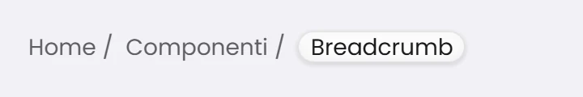

# Percorso (breadcrumb)

[Indice dei componenti](../README.md) · [Guida](../guida.md) · [README](../../README.md)

Mostra dove ci si trova in una gerarchia; l'ultimo elemento (`aria-current="page"`) è la pagina corrente. `crumb` è la singola voce.

**Pagina interattiva:** [breadcrumb](https://davideprioreschi.github.io/dpi-framework/site/components/breadcrumb.html) · [crumb](https://davideprioreschi.github.io/dpi-framework/site/components/crumb.html)

## Aspetto

**Percorso**



## Esempi

Il markup va in una pagina che include gli asset DPI (vedi [Installazione](../guida.md#installazione)).

### Percorso

```html
<nav class="dpi-breadcrumb" aria-label="Percorso">
  <ol class="dpi-breadcrumb__list">
    <li class="dpi-breadcrumb__item">
      <a class="dpi-breadcrumb__link" href="#">Home</a>
    </li>
    <li class="dpi-breadcrumb__item">
      <a class="dpi-breadcrumb__link" href="#">Componenti</a>
    </li>
    <li class="dpi-breadcrumb__item">
      <span class="dpi-breadcrumb__current" aria-current="page">Breadcrumb</span>
    </li>
  </ol>
</nav>
```

<details>
<summary>Tutte le classi e gli attributi usati negli esempi del sito</summary>

**Classi:** `dpi-breadcrumb`, `dpi-breadcrumb__current`, `dpi-breadcrumb__item`, `dpi-breadcrumb__link`, `dpi-breadcrumb__list`

</details>
