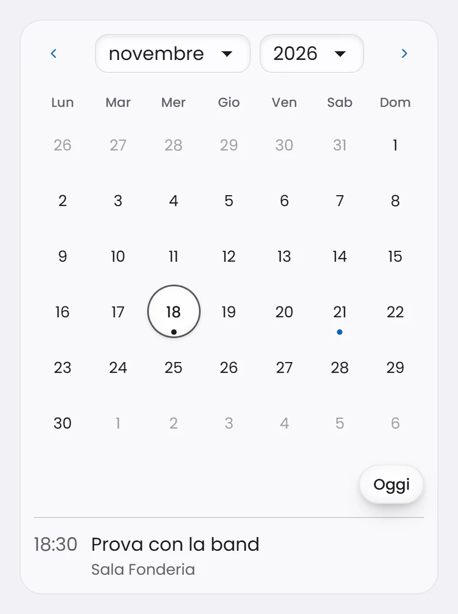
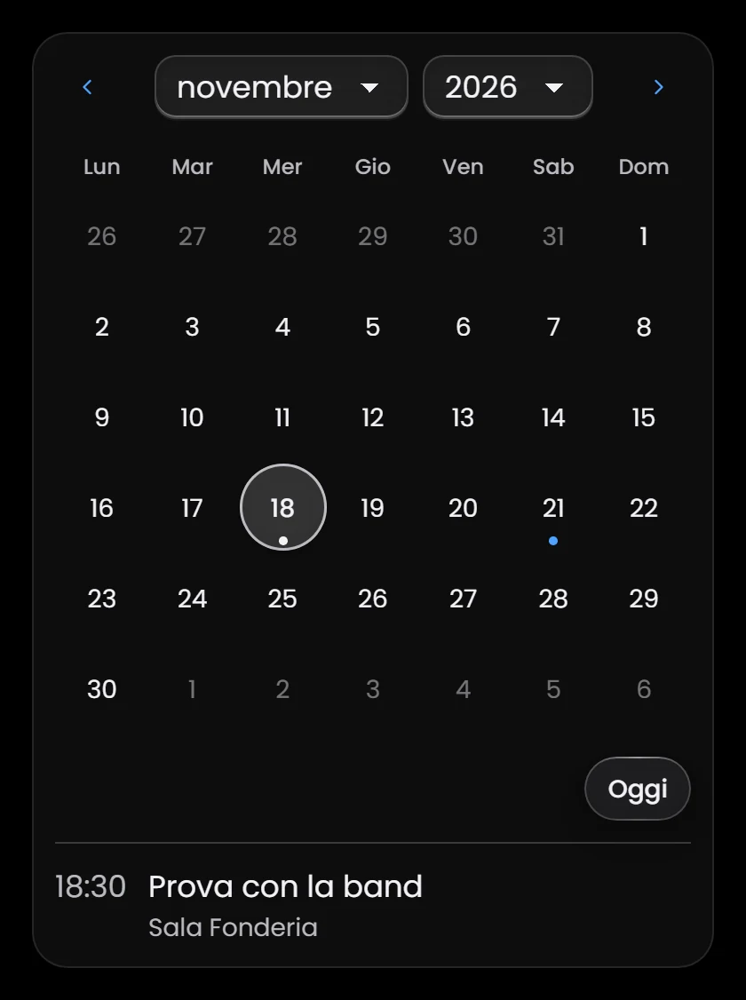

# Calendario

[Indice dei componenti](../README.md) · [Guida](../guida.md) · [README](../../README.md)

Calendario mensile con navigazione, selezione, eventi, giorni disabilitati, italiano o inglese e primo giorno configurabile. Per un campo di form usa il [selettore di data](data-e-ora.md).

**Pagina interattiva:** [calendar](https://davideprioreschi.github.io/dpi-framework/site/components/calendar.html)

## Aspetto

**Calendario con eventi**



### Tema scuro



## Esempi

Il markup va in una pagina che include gli asset DPI (vedi [Installazione](../guida.md#installazione)).

### Calendario con eventi

```html
<div class="dpi-calendar" data-dpi-calendar role="group" aria-label="Agenda" data-month="2026-11" data-value="2026-11-18" data-today="2026-11-18" data-first-day="1" data-locale="it" data-events="{&quot;2026-11-18&quot;:[{&quot;date&quot;:&quot;2026-11-18&quot;,&quot;title&quot;:&quot;Prova con la band&quot;,&quot;time&quot;:&quot;18:30&quot;,&quot;place&quot;:&quot;Sala Fonderia&quot;}],&quot;2026-11-21&quot;:[{&quot;date&quot;:&quot;2026-11-21&quot;,&quot;title&quot;:&quot;Incontro con Marta&quot;,&quot;time&quot;:&quot;16:00&quot;,&quot;place&quot;:&quot;Navigli&quot;}]}" data-details="true">
  <div class="dpi-calendar__head">
    <span data-dpi-cal="prev" class="dpi-calendar__nav">
    <button class="dpi-btn dpi-btn--plain dpi-btn--sm dpi-btn--icon-only" title="Mese precedente" type="button">
      <span class="dpi-btn__content"><span data-dpi-icon="chevron-left" data-dpi-icon-size="sm"></span><span class="dpi-visually-hidden">Mese precedente</span></span>
    </button>
    </span><span class="dpi-calendar__selects"><select class="dpi-select dpi-calendar__month" aria-label="Mese" data-dpi-cal="month"><option value="1">gennaio</option><option value="2">febbraio</option><option value="3">marzo</option><option value="4">aprile</option><option value="5">maggio</option><option value="6">giugno</option><option value="7">luglio</option><option value="8">agosto</option><option value="9">settembre</option><option value="10">ottobre</option><option value="11" selected>novembre</option><option value="12">dicembre</option></select><select class="dpi-select dpi-calendar__year" aria-label="Anno" data-dpi-cal="year"></select></span><span data-dpi-cal="next" class="dpi-calendar__nav">
    <button class="dpi-btn dpi-btn--plain dpi-btn--sm dpi-btn--icon-only" title="Mese successivo" type="button">
      <span class="dpi-btn__content"><span data-dpi-icon="chevron-right" data-dpi-icon-size="sm"></span><span class="dpi-visually-hidden">Mese successivo</span></span>
    </button>
    </span>
  </div>
  <p class="dpi-visually-hidden" aria-live="polite" data-dpi-cal-title>
    novembre 2026
  </p>
  <table class="dpi-calendar__grid" role="grid" id="dpi-1-grid" aria-label="novembre 2026">
    <thead>
      <tr>
      </tr>
    </thead>
    <tbody>
    </tbody>
  </table>
  <div class="dpi-calendar__foot">
    <span data-dpi-cal="today" class="dpi-calendar__nav">
    <button class="dpi-btn dpi-btn--tinted dpi-btn--sm" type="button">
      Oggi
    </button>
    </span>
  </div>
  <div class="dpi-calendar__details" aria-live="polite" data-dpi-cal-details>
    <ul class="dpi-calendar__events">
      <li class="dpi-calendar__event">
        <span class="dpi-calendar__event-time">18:30</span><span class="dpi-calendar__event-title">Prova con la band</span><span class="dpi-calendar__event-place">Sala Fonderia</span>
      </li>
    </ul>
  </div>
</div>
```

### Giorni disabilitati, primo giorno e lingua

```html
<div class="dpi-calendar" data-dpi-calendar role="group" aria-label="Prenotazioni" data-month="2026-12" data-today="2026-12-01" data-first-day="0" data-locale="en" data-min="2026-12-03" data-disabled-weekdays="[0,6]" data-details="true">
  <div class="dpi-calendar__head">
    <span data-dpi-cal="prev" class="dpi-calendar__nav">
    <button class="dpi-btn dpi-btn--plain dpi-btn--sm dpi-btn--icon-only" title="Previous month" type="button">
      <span class="dpi-btn__content"><span data-dpi-icon="chevron-left" data-dpi-icon-size="sm"></span><span class="dpi-visually-hidden">Previous month</span></span>
    </button>
    </span><span class="dpi-calendar__selects"><select class="dpi-select dpi-calendar__month" aria-label="Month" data-dpi-cal="month"><option value="1">January</option><option value="2">February</option><option value="3">March</option><option value="4">April</option><option value="5">May</option><option value="6">June</option><option value="7">July</option><option value="8">August</option><option value="9">September</option><option value="10">October</option><option value="11">November</option><option value="12" selected>December</option></select><select class="dpi-select dpi-calendar__year" aria-label="Year" data-dpi-cal="year"></select></span><span data-dpi-cal="next" class="dpi-calendar__nav">
    <button class="dpi-btn dpi-btn--plain dpi-btn--sm dpi-btn--icon-only" title="Next month" type="button">
      <span class="dpi-btn__content"><span data-dpi-icon="chevron-right" data-dpi-icon-size="sm"></span><span class="dpi-visually-hidden">Next month</span></span>
    </button>
    </span>
  </div>
  <p class="dpi-visually-hidden" aria-live="polite" data-dpi-cal-title>
    December 2026
  </p>
  <table class="dpi-calendar__grid" role="grid" id="dpi-1-grid" aria-label="December 2026">
    <thead>
      <tr>
      </tr>
    </thead>
    <tbody>
    </tbody>
  </table>
  <div class="dpi-calendar__foot">
    <span data-dpi-cal="today" class="dpi-calendar__nav">
    <button class="dpi-btn dpi-btn--tinted dpi-btn--sm" type="button">
      Today
    </button>
    </span>
  </div>
  <div class="dpi-calendar__details" aria-live="polite" data-dpi-cal-details>
    <p class="dpi-hint">
      Select a day to see its events.
    </p>
  </div>
</div>
```

## Classi, attributi ed eventi

Eventi `dpi:calendar-select`, `dpi:calendar-navigate`. Frecce, Home/Fine, PagSu/PagGiù (mese), con Maiusc l'anno.

<details>
<summary>Tutte le classi e gli attributi usati negli esempi del sito</summary>

**Classi:** `dpi-btn`, `dpi-btn--icon-only`, `dpi-btn--plain`, `dpi-btn--sm`, `dpi-btn--tinted`, `dpi-btn__content`, `dpi-calendar`, `dpi-calendar__details`, `dpi-calendar__event`, `dpi-calendar__event-place`, `dpi-calendar__event-time`, `dpi-calendar__event-title`, `dpi-calendar__events`, `dpi-calendar__foot`, `dpi-calendar__grid`, `dpi-calendar__head`, `dpi-calendar__month`, `dpi-calendar__nav`, `dpi-calendar__selects`, `dpi-calendar__year`, `dpi-hint`, `dpi-select`, `dpi-visually-hidden`

**Attributi:** `data-dpi-cal`, `data-dpi-cal-details`, `data-dpi-cal-title`, `data-dpi-calendar`, `data-dpi-icon`, `data-dpi-icon-size`

</details>

## Limiti

- Un mese alla volta; nessuna ricorrenza né fuso orario.
