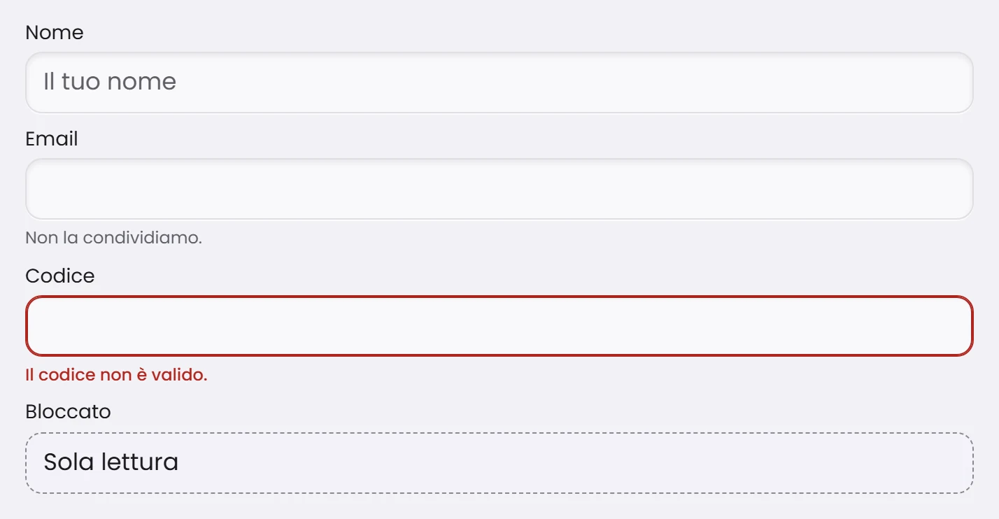
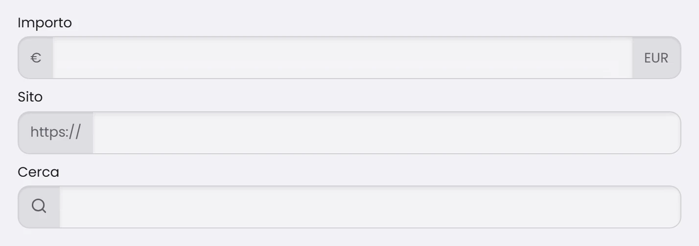
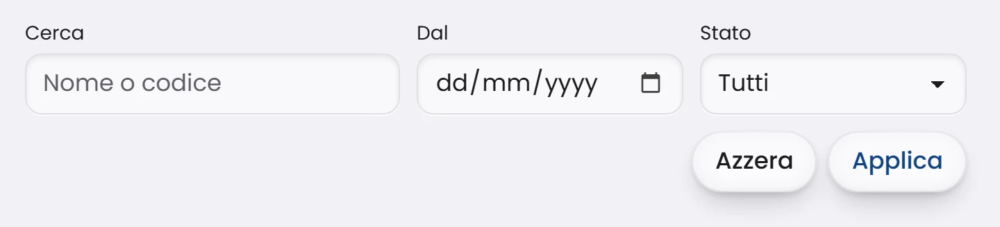
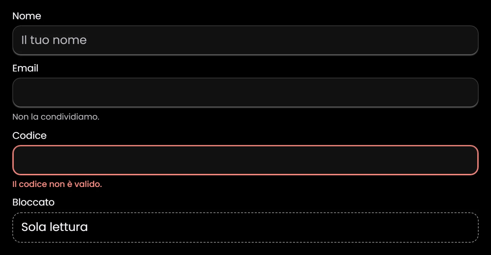

# Campi di testo

[Indice dei componenti](../README.md) · [Guida](../guida.md) · [README](../../README.md)

Campi di testo, email, password, ricerca e area di testo, con adornamenti, etichetta flottante, stati di errore e barra di filtri.

**Pagina interattiva:** [input](https://davideprioreschi.github.io/dpi-framework/site/components/input.html) · [textarea](https://davideprioreschi.github.io/dpi-framework/site/components/textarea.html)

## Aspetto

**Tipi e stati**



**Adornamenti**



**Barra di filtri**



### Tema scuro



## Esempi

Il markup va in una pagina che include gli asset DPI (vedi [Installazione](../guida.md#installazione)).

### Tipi e stati

```html
<div class="dpi-stack dpi-stack--sm">
  <div class="dpi-field">
    <label class="dpi-label" for="dpi-1">Nome</label>
    <input class="dpi-input" id="dpi-1" name="n1" type="text" placeholder="Il tuo nome">
  </div>
  <div class="dpi-field">
    <label class="dpi-label" for="dpi-2">Email</label>
    <input class="dpi-input" id="dpi-2" name="n2" type="email" aria-describedby="dpi-2-hint">
    <p class="dpi-hint" id="dpi-2-hint">
      Non la condividiamo.
    </p>
  </div>
  <div class="dpi-field">
    <label class="dpi-label" for="dpi-3">Codice</label>
    <input class="dpi-input" id="dpi-3" name="n3" type="text" aria-describedby="dpi-3-err" aria-invalid="true">
    <p class="dpi-error" id="dpi-3-err">
      Il codice non è valido.
    </p>
  </div>
  <div class="dpi-field">
    <label class="dpi-label" for="dpi-4">Bloccato</label>
    <input class="dpi-input" id="dpi-4" name="n4" type="text" value="Sola lettura" readonly>
  </div>
</div>
```

### Adornamenti (input group)

```html
<div class="dpi-stack dpi-stack--sm">
  <div class="dpi-field">
    <label class="dpi-label" for="dpi-1">Importo</label><span class="dpi-input-wrap"><span class="dpi-input-group"><span class="dpi-input-group__addon"><span>€</span></span>
    <input class="dpi-input" id="dpi-1" name="imp" type="number">
    <span class="dpi-input-group__addon"><span>EUR</span></span></span></span>
  </div>
  <div class="dpi-field">
    <label class="dpi-label" for="dpi-2">Sito</label><span class="dpi-input-wrap"><span class="dpi-input-group"><span class="dpi-input-group__addon"><span>https://</span></span>
    <input class="dpi-input" id="dpi-2" name="sito" type="text">
    </span></span>
  </div>
  <div class="dpi-field">
    <label class="dpi-label" for="dpi-3">Cerca</label><span class="dpi-input-wrap"><span class="dpi-input-group"><span class="dpi-input-group__addon"><span data-dpi-icon="search"></span></span>
    <input class="dpi-input" id="dpi-3" name="q" type="search">
    </span></span>
  </div>
</div>
```

### Etichetta flottante

```html
<div class="dpi-stack dpi-stack--sm">
  <div class="dpi-field dpi-field--floating">
    <label class="dpi-label" for="dpi-1">Email</label>
    <input class="dpi-input" id="dpi-1" name="fe" type="email" placeholder=" ">
  </div>
  <div class="dpi-field dpi-field--floating">
    <label class="dpi-label" for="dpi-2">Cognome</label>
    <input class="dpi-input" id="dpi-2" name="fc" type="text" placeholder=" ">
  </div>
</div>
```

### Password: robustezza e mostra/nascondi

```html
<div class="dpi-field">
  <label class="dpi-label" for="dpi-1">Password</label><span class="dpi-input-wrap" data-dpi-password data-dpi-strength="dpi-1-meter"><span class="dpi-input-group">
  <input class="dpi-input" id="dpi-1" name="pw" type="password" aria-describedby="dpi-1-hint">
  <span class="dpi-input-group__addon">
  <button class="dpi-btn dpi-btn--plain dpi-btn--sm dpi-btn--icon-only" title="Mostra o nascondi la password" type="button">
    <span class="dpi-btn__content"><span data-dpi-icon="eye" data-dpi-icon-size="sm"></span><span class="dpi-visually-hidden">Mostra o nascondi la password</span></span>
  </button>
  </span></span><span class="dpi-strength" id="dpi-1-meter" role="status" aria-live="polite"><span class="dpi-strength__bar" aria-hidden="true"><span></span><span></span><span></span><span></span></span><span class="dpi-strength__label" data-dpi-strength-label>Robustezza: —</span></span></span>
  <p class="dpi-hint" id="dpi-1-hint">
    La robustezza è calcolata nel browser.
  </p>
</div>
```

### Area di testo

```html
<div class="dpi-field"><label class="dpi-label" for="ta-1">Note</label><textarea class="dpi-textarea" id="ta-1" name="note" placeholder="Scrivi qui"></textarea></div>
<div class="dpi-field"><label class="dpi-label" for="ta-2">Non modificabile</label><textarea class="dpi-textarea dpi-textarea--sm" id="ta-2" readonly>Solo lettura</textarea></div>
<div class="dpi-field"><label class="dpi-label" for="ta-3">Cresce col testo</label><textarea class="dpi-textarea dpi-textarea--auto" id="ta-3" rows="2"></textarea></div>
```

## Classi, attributi ed eventi

- `dpi-field`, `dpi-label`, `dpi-input`, `dpi-textarea`, `dpi-hint`, `dpi-error`; errore con `aria-invalid="true"`.
- `dpi-textarea--sm`, `--lg`, `--fixed`, `--auto` (cresce con il testo dove il browser supporta `field-sizing`).
- Barra di filtri: `dpi-toolbar`, `dpi-field--grow`, `dpi-field--narrow`, `dpi-toolbar__actions`, `dpi-toolbar__end`.

<details>
<summary>Tutte le classi e gli attributi usati negli esempi del sito</summary>

**Classi:** `dpi-btn`, `dpi-btn--icon-only`, `dpi-btn--plain`, `dpi-btn--sm`, `dpi-btn__content`, `dpi-error`, `dpi-field`, `dpi-field--floating`, `dpi-hint`, `dpi-input`, `dpi-input-group`, `dpi-input-group__addon`, `dpi-input-wrap`, `dpi-label`, `dpi-stack`, `dpi-stack--sm`, `dpi-strength`, `dpi-strength__bar`, `dpi-strength__label`, `dpi-textarea`, `dpi-visually-hidden`

**Attributi:** `data-dpi-icon`, `data-dpi-icon-size`, `data-dpi-password`, `data-dpi-strength`, `data-dpi-strength-label`

</details>

## Limiti

- La robustezza della password è un'euristica semplice (lunghezza e varietà), non un controllo contro password note.
