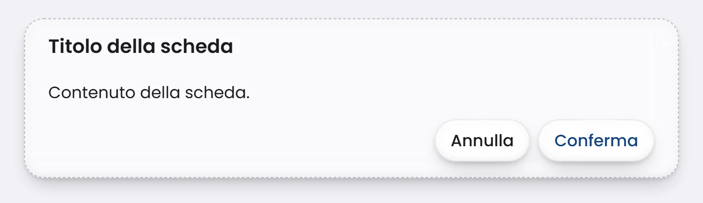
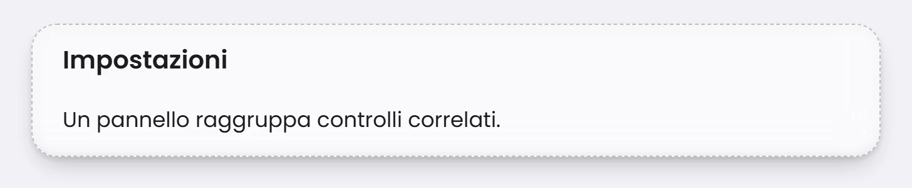
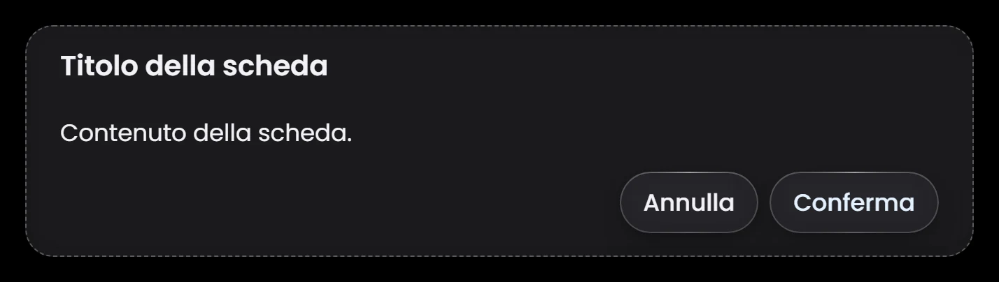

# Card e pannelli

[Indice dei componenti](../README.md) · [Guida](../guida.md) · [README](../../README.md)

Superfici per raggruppare contenuti correlati. La `card` è solida per impostazione predefinita (leggibilità dei dati), con bordo tratteggiato sottile; il `panel` è un raggruppamento in vetro.

**Pagina interattiva:** [card](https://davideprioreschi.github.io/dpi-framework/site/components/card.html) · [panel](https://davideprioreschi.github.io/dpi-framework/site/components/panel.html)

## Aspetto

**Card con azioni**



**Pannello**



### Tema scuro



## Esempi

Il markup va in una pagina che include gli asset DPI (vedi [Installazione](../guida.md#installazione)).

### Scheda con azioni

```html
<section class="dpi-card" aria-labelledby="dpi-1-title">
  <div class="dpi-card__body dpi-stack">
    <h3 class="dpi-card__title" id="dpi-1-title">
      Titolo della scheda
    </h3>
    <p class="dpi-text">
      Contenuto della scheda.
    </p>
    <div class="dpi-cluster dpi-cluster--end">
      <button class="dpi-btn" type="button">
        Annulla
      </button>
      <button class="dpi-btn dpi-btn--primary" type="button">
        Conferma
      </button>
    </div>
  </div>
</section>
```

### Pannello

```html
<section class="dpi-card" aria-labelledby="dpi-1-title">
  <div class="dpi-card__body dpi-stack">
    <h3 class="dpi-card__title" id="dpi-1-title">
      Impostazioni
    </h3>
    <p class="dpi-text">
      Un pannello raggruppa controlli correlati.
    </p>
  </div>
</section>
```

## Classi, attributi ed eventi

- `dpi-card`, `dpi-card__header`, `dpi-card__body`, `dpi-card__title`, `dpi-card__footer`.
- `dpi-card--line`: bordo pieno al posto del tratteggio (`--dpi-dash-color` ne cambia il colore).
- Le `dpi-card` ricevono materiale e animazioni da DPI: non si scrivono strati ottici.

<details>
<summary>Tutte le classi e gli attributi usati negli esempi del sito</summary>

**Classi:** `dpi-btn`, `dpi-btn--primary`, `dpi-card`, `dpi-card__body`, `dpi-card__title`, `dpi-cluster`, `dpi-cluster--end`, `dpi-stack`, `dpi-text`

</details>

## Limiti

- Nessuna variante con immagine in testa: si compone `image` + `card`.
