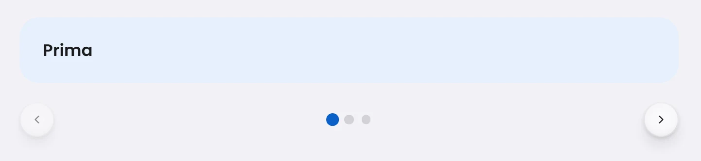

# Carosello

[Indice dei componenti](../README.md) · [Guida](../guida.md) · [README](../../README.md)

Sequenza di contenuti da scorrere in orizzontale (scroll-snap) con frecce, indicatori e tastiera. Non c'è riproduzione automatica, per scelta di accessibilità. `slide` si usa solo dentro `carousel`.

**Pagina interattiva:** [carousel](https://davideprioreschi.github.io/dpi-framework/site/components/carousel.html) · [slide](https://davideprioreschi.github.io/dpi-framework/site/components/slide.html)

## Aspetto

**Carosello**



## Esempi

Il markup va in una pagina che include gli asset DPI (vedi [Installazione](../guida.md#installazione)).

### Carosello

```html
<section class="dpi-carousel" aria-roledescription="carosello" aria-label="Immagini in evidenza" data-dpi-carousel>
  <div class="dpi-carousel__track" tabindex="0" data-dpi-carousel-track>
    <div class="dpi-carousel__slide" role="group" aria-roledescription="diapositiva" aria-label="Diapositiva 1 di 3">
      <div class="dpi-u-p-lg dpi-u-bg-accent dpi-u-r-lg">
        <h3 class="dpi-heading dpi-heading--3">
          Prima
        </h3>
      </div>
    </div>
    <div class="dpi-carousel__slide" role="group" aria-roledescription="diapositiva" aria-label="Diapositiva 2 di 3">
      <div class="dpi-u-p-lg dpi-u-bg-success dpi-u-r-lg">
        <h3 class="dpi-heading dpi-heading--3">
          Seconda
        </h3>
      </div>
    </div>
    <div class="dpi-carousel__slide" role="group" aria-roledescription="diapositiva" aria-label="Diapositiva 3 di 3">
      <div class="dpi-u-p-lg dpi-u-bg-warning dpi-u-r-lg">
        <h3 class="dpi-heading dpi-heading--3">
          Terza
        </h3>
      </div>
    </div>
  </div>
  <div class="dpi-carousel__controls">
    <button class="dpi-btn dpi-btn--sm dpi-btn--icon-only" title="Diapositiva precedente" type="button">
      <span data-dpi-icon="chevron-left" data-dpi-icon-size="sm"></span><span class="dpi-visually-hidden">Diapositiva precedente</span>
    </button>
    <div class="dpi-carousel__dots">
      <button class="dpi-carousel__dot" type="button" aria-label="Vai alla diapositiva 1" aria-current="true" data-index="0">
      </button>
      <button class="dpi-carousel__dot" type="button" aria-label="Vai alla diapositiva 2" data-index="1">
      </button>
      <button class="dpi-carousel__dot" type="button" aria-label="Vai alla diapositiva 3" data-index="2">
      </button>
    </div>
    <button class="dpi-btn dpi-btn--sm dpi-btn--icon-only" title="Diapositiva successiva" type="button">
      <span data-dpi-icon="chevron-right" data-dpi-icon-size="sm"></span><span class="dpi-visually-hidden">Diapositiva successiva</span>
    </button>
  </div>
</section>
```

## Classi, attributi ed eventi

Tastiera: frecce, Home/End. Evento: `dpi:slide` (`index`).

<details>
<summary>Tutte le classi e gli attributi usati negli esempi del sito</summary>

**Classi:** `dpi-btn`, `dpi-btn--icon-only`, `dpi-btn--sm`, `dpi-carousel`, `dpi-carousel__controls`, `dpi-carousel__dot`, `dpi-carousel__dots`, `dpi-carousel__slide`, `dpi-carousel__track`, `dpi-heading`, `dpi-heading--3`, `dpi-text`, `dpi-u-bg-accent`, `dpi-u-bg-success`, `dpi-u-bg-warning`, `dpi-u-p-lg`, `dpi-u-r-lg`, `dpi-visually-hidden`

**Attributi:** `data-dpi-carousel`, `data-dpi-carousel-track`, `data-dpi-icon`, `data-dpi-icon-size`

</details>

## Limiti

- Nessuna riproduzione automatica né dissolvenza.
