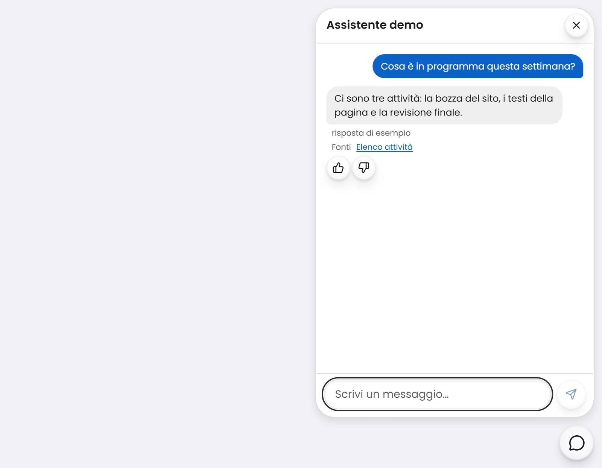
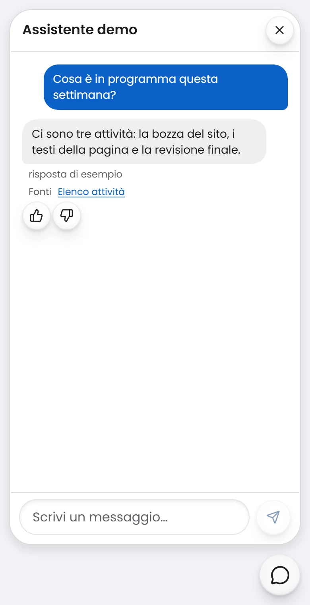
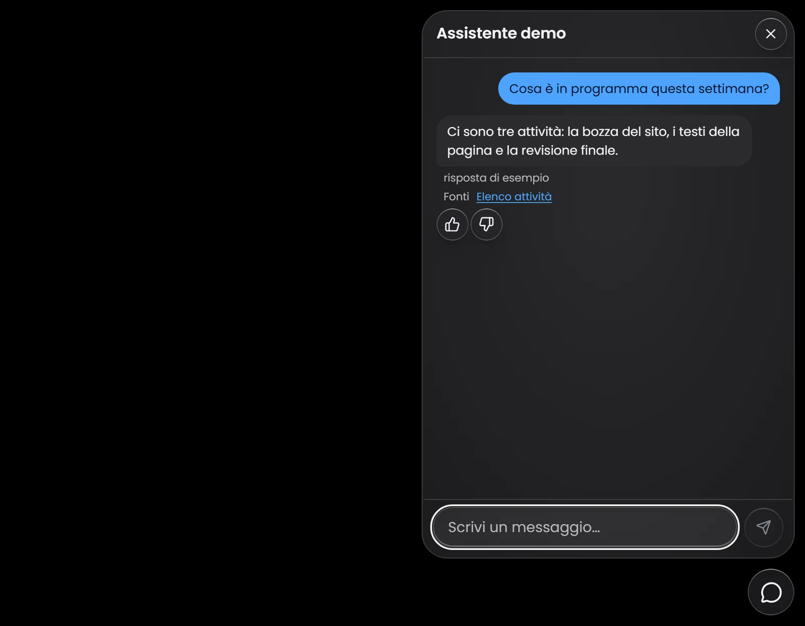

# Chatbot

[Indice dei componenti](../README.md) · [Guida](../guida.md) · [README](../../README.md)

Pannello conversazionale non modale. È solo interfaccia: non chiama alcun servizio. L'applicazione passa i messaggi e ascolta gli eventi.

**Pagina interattiva:** [chatbot](https://davideprioreschi.github.io/dpi-framework/site/components/chatbot.html)

## Aspetto

**Pannello aperto (messaggi di esempio)**



**Su telefono**



### Tema scuro



## Esempi

Il markup va in una pagina che include gli asset DPI (vedi [Installazione](../guida.md#installazione)).

### Markup dichiarativo

```html
<div data-dpi-chatbot
     data-dpi-title="Assistente"
     data-dpi-placeholder="Scrivi un messaggio…"
     data-dpi-empty="Come posso aiutarti?"
     data-dpi-trigger-label="Apri l’assistente"></div>

<!-- slot facoltativi: figli diretti con data-dpi-chatbot-slot, adottati dal componente -->
<div data-dpi-chatbot>
  <div data-dpi-chatbot-slot="above">Contesto di pagina…</div>
</div>
```

### API JavaScript

```js
const bot = DPI.chatbot.mount(el, {
  title: 'Assistente', subtitle: 'Risponde solo con i tuoi dati', placeholder: 'Chiedi qualcosa…', emptyText: 'Come posso aiutarti?',
  suggestions: ['Riassumi l’ultima riunione', 'Quali task sono in ritardo?'],
  headerActions: [{ id: 'new', label: 'Nuova conversazione', icon: 'plus' }],   // pulsanti dell’intestazione
  tools: [{ id: 'mic', label: 'Detta con la voce', icon: 'mic' }],               // pulsanti del compositore (es. microfono)
  attach: false /* o { accept: 'image/*', multiple: true } */, maxLength: 1500, echo: true, enterToSend: true, persistSuggestions: false,
  icon: 'message-circle', triggerLabel: 'Apri l’assistente', maxHeight: '48rem', width: '26rem', labels: { you: 'Tu', assistant: 'Assistente' },
});
const same = DPI.chatbot.get(el);            // istanza esistente (o null)

bot.addMessage({ id: 'a1', role: 'assistant', text: 'Ciao!', meta: 'adesso',
  sources: [{ title: 'Task #12', href: '#/task/12' }], actions: [{ id: 'open', label: 'Apri', icon: 'external-link' }], feedback: true });
bot.updateMessage('a1', { text: 'Testo aggiornato', status: 'done', feedbackValue: 1 });
bot.removeMessage('a1');  bot.clear();
bot.setLoading(true);  bot.setLoading({ label: 'Cerco…' });  bot.setLoading(false);
bot.setError('Servizio non raggiungibile');  bot.setError(null);
bot.setDisabled(true);  bot.setSuggestions([...]);  bot.setHeader({ title, subtitle });  bot.setHeaderActions([...]);  bot.setTools([...]);
bot.slot('above' | 'aside' | 'header-actions' | 'empty');   // elemento in cui inserire nodi dell’app
bot.showAside(true);  bot.toggleAside();   // pannello secondario (es. elenco conversazioni)
bot.getValue();  bot.setValue('testo');  bot.focus();  bot.scrollToEnd();  bot.send('testo');
bot.open();  bot.close();  bot.toggle();  bot.isOpen();  bot.destroy();
```

## Classi, attributi ed eventi

- Eventi: `dpi:chatbot-send` (`{ text, files, source, messageId }`, annullabile), `dpi:chatbot-action`, `dpi:chatbot-feedback`, `dpi:chatbot-open`, `dpi:chatbot-close`, `dpi:chatbot-aside`.
- Il testo dell'applicazione entra con `textContent`; il campo `html` di un messaggio va usato solo con contenuto già sanificato dall'applicazione.
- Pulsante esterno: `data-dpi-chatbot-trigger-for="id"`.
- Dimensioni: `--dpi-chatbot-w`, `--dpi-chatbot-max-height`, `--dpi-chatbot-top`, `--dpi-chatbot-gap`.
- `role="dialog"` non modale, cronologia `role="log"`; Invio invia, Maiusc+Invio va a capo, Escape chiude.

## Limiti

- Senza JavaScript il componente non compare.
