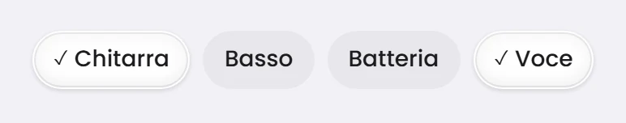
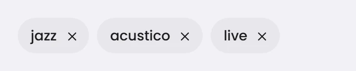

# Chip

[Indice dei componenti](../README.md) · [Guida](../guida.md) · [README](../../README.md)

Filtri a selezione multipla, scelta singola o etichette rimovibili. `chip` è il singolo elemento del gruppo.

**Pagina interattiva:** [chip_group](https://davideprioreschi.github.io/dpi-framework/site/components/chip_group.html) · [chip](https://davideprioreschi.github.io/dpi-framework/site/components/chip.html)

## Aspetto

**Filtri**



**Etichette rimovibili**



## Esempi

Il markup va in una pagina che include gli asset DPI (vedi [Installazione](../guida.md#installazione)).

### Filtri (selezione multipla)

```html
<fieldset class="dpi-chips" data-dpi-chips="multiple">
  <legend class="dpi-visually-hidden">
    Strumenti
  </legend>
  <label class="dpi-chip">
  <input class="dpi-chip__input" type="checkbox" name="strumenti" value="chitarra" checked>
  <span class="dpi-chip__body"><span>Chitarra</span></span></label><label class="dpi-chip">
  <input class="dpi-chip__input" type="checkbox" name="strumenti" value="basso">
  <span class="dpi-chip__body"><span>Basso</span></span></label><label class="dpi-chip">
  <input class="dpi-chip__input" type="checkbox" name="strumenti" value="batteria">
  <span class="dpi-chip__body"><span>Batteria</span></span></label><label class="dpi-chip">
  <input class="dpi-chip__input" type="checkbox" name="strumenti" value="voce" checked>
  <span class="dpi-chip__body"><span>Voce</span></span></label>
</fieldset>
```

### Scelta singola

```html
<fieldset class="dpi-chips" data-dpi-chips="single">
  <legend class="dpi-visually-hidden">
    Formato
  </legend>
  <label class="dpi-chip">
  <input class="dpi-chip__input" type="radio" name="formato" value="s" checked>
  <span class="dpi-chip__body"><span>Singolo</span></span></label><label class="dpi-chip">
  <input class="dpi-chip__input" type="radio" name="formato" value="ep">
  <span class="dpi-chip__body"><span>EP</span></span></label><label class="dpi-chip">
  <input class="dpi-chip__input" type="radio" name="formato" value="lp">
  <span class="dpi-chip__body"><span>Album</span></span></label>
</fieldset>
```

### Etichette rimovibili

```html
<fieldset class="dpi-chips" data-dpi-chips="input">
  <legend class="dpi-visually-hidden">
    Tag
  </legend>
  <span class="dpi-chip dpi-chip--input" data-dpi-chip><span>jazz</span>
  <button class="dpi-chip__remove" type="button" aria-label="Rimuovi jazz">
    <span data-dpi-icon="x" data-dpi-icon-size="sm"></span>
  </button>
  </span><span class="dpi-chip dpi-chip--input" data-dpi-chip><span>acustico</span>
  <button class="dpi-chip__remove" type="button" aria-label="Rimuovi acustico">
    <span data-dpi-icon="x" data-dpi-icon-size="sm"></span>
  </button>
  </span><span class="dpi-chip dpi-chip--input" data-dpi-chip><span>live</span>
  <button class="dpi-chip__remove" type="button" aria-label="Rimuovi live">
    <span data-dpi-icon="x" data-dpi-icon-size="sm"></span>
  </button>
  </span>
</fieldset>
```

## Classi, attributi ed eventi

Evento `dpi:chip-remove` (`label`) per le etichette rimovibili.

<details>
<summary>Tutte le classi e gli attributi usati negli esempi del sito</summary>

**Classi:** `dpi-chip`, `dpi-chip--input`, `dpi-chip__body`, `dpi-chip__input`, `dpi-chip__remove`, `dpi-chips`, `dpi-visually-hidden`

**Attributi:** `data-dpi-chip`, `data-dpi-chips`, `data-dpi-icon`, `data-dpi-icon-size`

</details>

## Limiti

- Le etichette rimovibili non vengono inviate con il form: la lista è gestita dall'applicazione.
