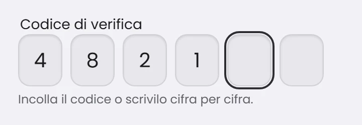

# Codice monouso (OTP)

[Indice dei componenti](../README.md) · [Guida](../guida.md) · [README](../../README.md)

Codice a più caselle con avanzamento automatico, Backspace all'indietro e incolla distribuito; il form riceve un unico valore.

**Pagina interattiva:** [otp](https://davideprioreschi.github.io/dpi-framework/site/components/otp.html)

## Aspetto

**Codice in compilazione**



## Esempi

Il markup va in una pagina che include gli asset DPI (vedi [Installazione](../guida.md#installazione)).

### Codice monouso

```html
<fieldset class="dpi-field dpi-otp" data-dpi-otp aria-describedby="dpi-1-hint">
  <legend class="dpi-label">
    Codice di verifica
  </legend>
  <div class="dpi-otp__cells">
    <input class="dpi-otp__cell" type="text" inputmode="numeric" maxlength="1" autocomplete="one-time-code" aria-label="Cifra 1 di 6" pattern="[0-9]" id="dpi-1">
    <input class="dpi-otp__cell" type="text" inputmode="numeric" maxlength="1" autocomplete="off" aria-label="Cifra 2 di 6" pattern="[0-9]">
    <input class="dpi-otp__cell" type="text" inputmode="numeric" maxlength="1" autocomplete="off" aria-label="Cifra 3 di 6" pattern="[0-9]">
    <input class="dpi-otp__cell" type="text" inputmode="numeric" maxlength="1" autocomplete="off" aria-label="Cifra 4 di 6" pattern="[0-9]">
    <input class="dpi-otp__cell" type="text" inputmode="numeric" maxlength="1" autocomplete="off" aria-label="Cifra 5 di 6" pattern="[0-9]">
    <input class="dpi-otp__cell" type="text" inputmode="numeric" maxlength="1" autocomplete="off" aria-label="Cifra 6 di 6" pattern="[0-9]">
  </div>
  <input type="hidden" name="otp" value="" data-dpi-otp-value>
  <p class="dpi-hint" id="dpi-1-hint">
    Incolla il codice o scrivilo cifra per cifra.
  </p>
</fieldset>
```

## Classi, attributi ed eventi

Eventi: `dpi:otp-complete` (`value`), `change`.

<details>
<summary>Tutte le classi e gli attributi usati negli esempi del sito</summary>

**Classi:** `dpi-field`, `dpi-hint`, `dpi-label`, `dpi-otp`, `dpi-otp__cell`, `dpi-otp__cells`

**Attributi:** `data-dpi-otp`, `data-dpi-otp-value`

</details>

## Limiti

- La proposta del codice ricevuto per SMS dipende dal supporto del browser (`autocomplete=one-time-code`).
