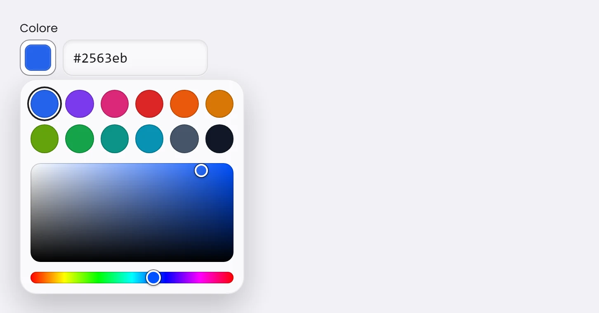
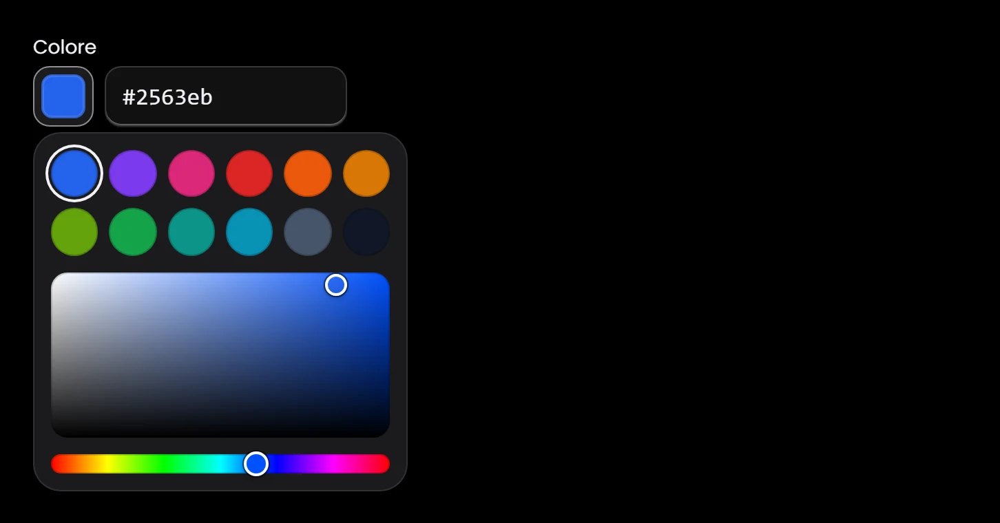

# Scelta del colore

[Indice dei componenti](../README.md) · [Guida](../guida.md) · [README](../../README.md)

Anteprima, tavolozza, selezione personalizzata e valore esadecimale modificabile. Il campo con `name` è un normale input `#rrggbb`.

**Pagina interattiva:** [colorpicker](https://davideprioreschi.github.io/dpi-framework/site/components/colorpicker.html)

## Aspetto

**Pannello del colore aperto**



### Tema scuro



## Esempi

Il markup va in una pagina che include gli asset DPI (vedi [Installazione](../guida.md#installazione)).

### Tavolozza predefinita

```html
<div class="dpi-field">
  <label class="dpi-label" for="colore">Colore</label>
  <div class="dpi-colorpicker" data-dpi-colorpicker>
    <input class="dpi-input dpi-colorpicker__hex" id="colore" type="text" name="colore" value="#2563eb"
           placeholder="#rrggbb" maxlength="7" autocomplete="off" spellcheck="false" pattern="#[0-9a-fA-F]{6}">
  </div>
</div>
```

### Facoltativo, con tavolozza dell'applicazione

```html
<div class="dpi-colorpicker" data-dpi-colorpicker data-dpi-colorpicker-clearable
     data-dpi-colors="#0f766e,#b45309,#be123c,#4338ca,#15803d,#475569">
  <input class="dpi-input dpi-colorpicker__hex" type="text" name="colore" value="" placeholder="#rrggbb"
         maxlength="7" pattern="#[0-9a-fA-F]{6}">
</div>
```

## Classi, attributi ed eventi

`data-dpi-colorpicker`, `data-dpi-colorpicker-clearable`, `data-dpi-colors="#…,#…"`. Invio, Spazio o Alt+Freccia giù aprono; frecce nella tavolozza; Escape chiude.

## Limiti

- Solo colori pieni (nessuna opacità).
