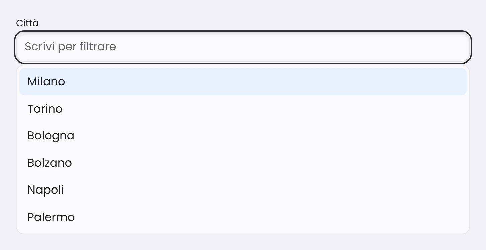

# Combobox (campo con suggerimenti)

[Indice dei componenti](../README.md) · [Guida](../guida.md) · [README](../../README.md)

Per scegliere da un elenco lungo filtrandolo mentre si scrive. Il valore inviato è quello dell'opzione scelta.

**Pagina interattiva:** [combobox](https://davideprioreschi.github.io/dpi-framework/site/components/combobox.html)

## Aspetto

**Suggerimenti aperti**



## Esempi

Il markup va in una pagina che include gli asset DPI (vedi [Installazione](../guida.md#installazione)).

### Campo con suggerimenti

```html
<div class="dpi-field">
  <label class="dpi-label" for="dpi-1">Città</label>
  <div class="dpi-combobox" data-dpi-combobox>
    <input class="dpi-input dpi-combobox__input" type="text" id="dpi-1" role="combobox" aria-autocomplete="list" aria-expanded="false" aria-controls="dpi-1-list" autocomplete="off" placeholder="Scrivi per filtrare" value="">
    <input type="hidden" name="citta" value="" data-dpi-combobox-value>
    <ul class="dpi-combobox__list" role="listbox" id="dpi-1-list" hidden>
      <li class="dpi-combobox__option" role="option" id="dpi-1-o0" data-value="mi" aria-selected="false">
        Milano
      </li>
      <li class="dpi-combobox__option" role="option" id="dpi-1-o1" data-value="to" aria-selected="false">
        Torino
      </li>
      <li class="dpi-combobox__option" role="option" id="dpi-1-o2" data-value="bo" aria-selected="false">
        Bologna
      </li>
      <li class="dpi-combobox__option" role="option" id="dpi-1-o3" data-value="bz" aria-selected="false">
        Bolzano
      </li>
      <li class="dpi-combobox__option" role="option" id="dpi-1-o4" data-value="na" aria-selected="false">
        Napoli
      </li>
      <li class="dpi-combobox__option" role="option" id="dpi-1-o5" data-value="pa" aria-selected="false">
        Palermo
      </li>
      <li class="dpi-combobox__empty" role="presentation" hidden>
        Nessun risultato
      </li>
    </ul>
  </div>
</div>
```

## Classi, attributi ed eventi

Eventi: `dpi:combobox-select` (`value`, `label`), `change`. Frecce, Home/End, Invio sceglie, Escape chiude e ripristina.

<details>
<summary>Tutte le classi e gli attributi usati negli esempi del sito</summary>

**Classi:** `dpi-combobox`, `dpi-combobox__empty`, `dpi-combobox__input`, `dpi-combobox__list`, `dpi-combobox__option`, `dpi-field`, `dpi-input`, `dpi-label`

**Attributi:** `data-dpi-combobox`, `data-dpi-combobox-value`

</details>

## Limiti

- Selezione singola su elenco statico: niente ricerca asincrona né raggruppamenti.
