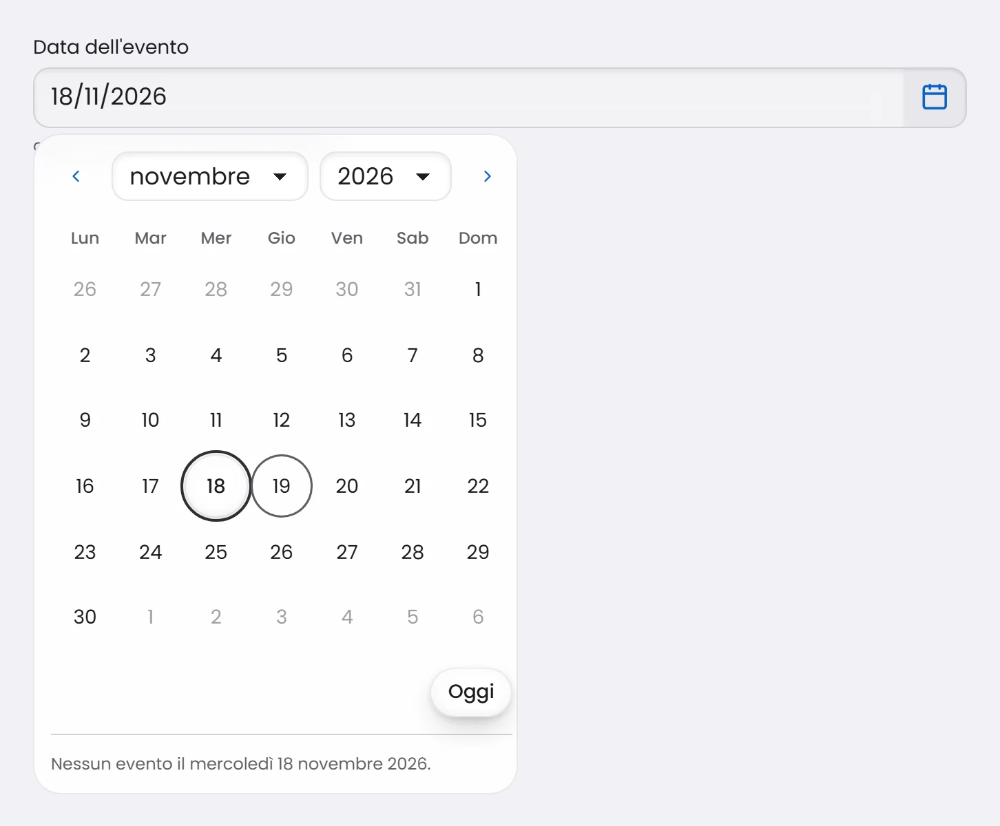
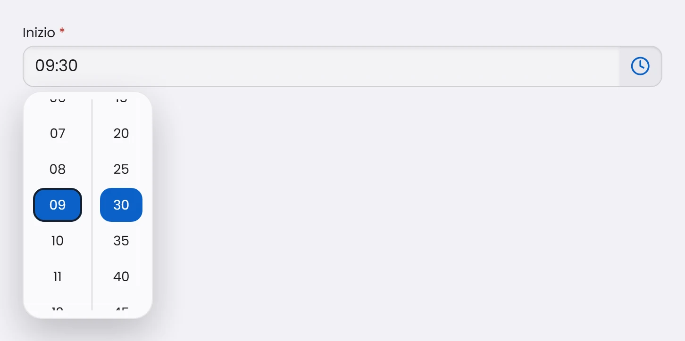
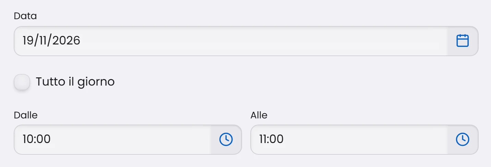
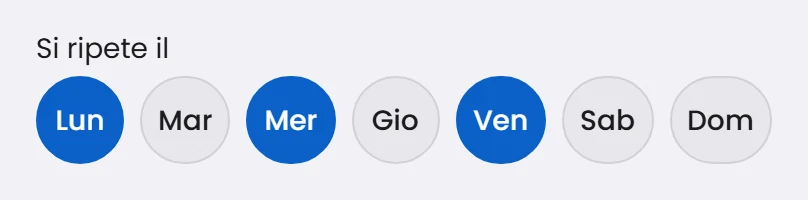
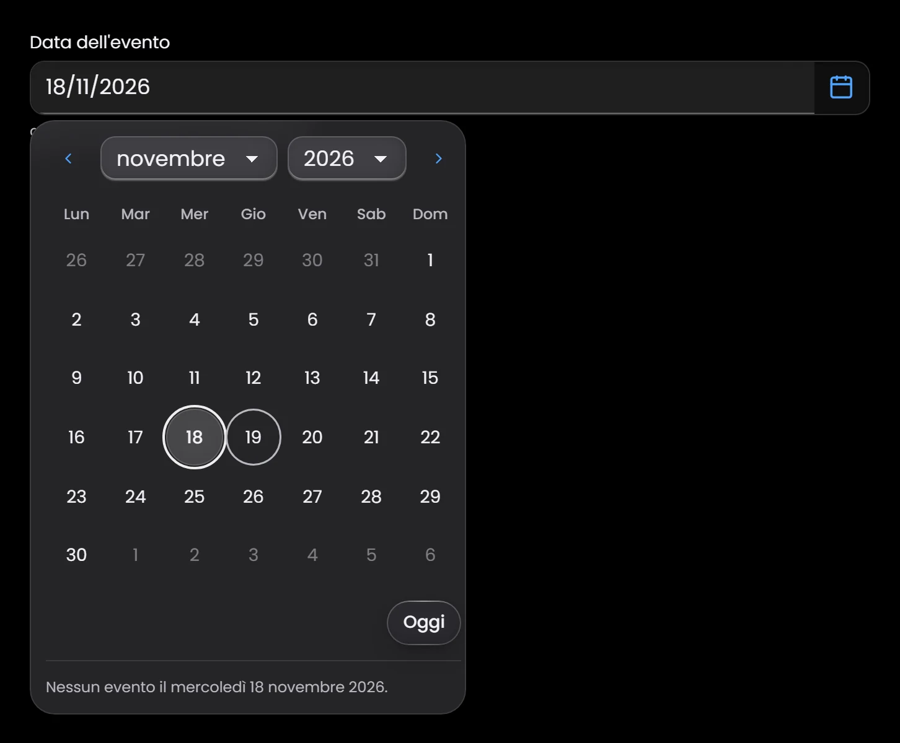

# Data, ora e giorni

[Indice dei componenti](../README.md) · [Guida](../guida.md) · [README](../../README.md)

Selettori di data (`gg/mm/aaaa`), ora a 24 ore, data e ora insieme (anche intervalli) e giorni della settimana. Il form riceve valori prevedibili (`AAAA-MM-GG`, `HH:MM`) in campi con il `name` indicato.

**Pagina interattiva:** [datepicker](https://davideprioreschi.github.io/dpi-framework/site/components/datepicker.html) · [timepicker](https://davideprioreschi.github.io/dpi-framework/site/components/timepicker.html) · [datetime](https://davideprioreschi.github.io/dpi-framework/site/components/datetime.html) · [weekdays](https://davideprioreschi.github.io/dpi-framework/site/components/weekdays.html)

## Aspetto

**Calendario aperto**



**Selettore dell'ora aperto**



**Intervallo**



**Giorni della settimana**



### Tema scuro



## Esempi

Il markup va in una pagina che include gli asset DPI (vedi [Installazione](../guida.md#installazione)).

### Selettore di data

<details>
<summary>Mostra il codice</summary>

```html
<div class="dpi-field">
  <label class="dpi-label" for="dpi-1">Data dell&apos;evento</label>
  <div class="dpi-datepicker" data-dpi-datepicker data-locale="it">
    <div class="dpi-input-group">
      <input class="dpi-input" type="text" id="dpi-1" inputmode="numeric" autocomplete="off" placeholder="gg/mm/aaaa" value="18/11/2026" data-dpi-date-text aria-describedby="dpi-1-hint">
      <button class="dpi-btn dpi-btn--plain dpi-btn--icon-only" popovertarget="dpi-1-pop" aria-haspopup="dialog" title="Apri il calendario" type="button">
        <span class="dpi-btn__content"><span data-dpi-icon="calendar"></span><span class="dpi-visually-hidden">Apri il calendario</span></span>
      </button>
    </div>
    <input type="hidden" name="data" value="2026-11-18" data-dpi-date-value>
    <div class="dpi-datepicker__panel dpi-popover__panel" id="dpi-1-pop" popover="auto" role="dialog" aria-label="Calendario">
      <div class="dpi-calendar" data-dpi-calendar role="group" aria-label="Calendario: Data dell&apos;evento" data-month="2026-11" data-value="2026-11-18" data-today="2026-11-19" data-first-day="1" data-locale="it" data-details="true">
        <div class="dpi-calendar__head">
          <span data-dpi-cal="prev" class="dpi-calendar__nav">
          <button class="dpi-btn dpi-btn--plain dpi-btn--sm dpi-btn--icon-only" title="Mese precedente" type="button">
            <span class="dpi-btn__content"><span data-dpi-icon="chevron-left" data-dpi-icon-size="sm"></span><span class="dpi-visually-hidden">Mese precedente</span></span>
          </button>
          </span><span class="dpi-calendar__selects"><select class="dpi-select dpi-calendar__month" aria-label="Mese" data-dpi-cal="month"><option value="1">gennaio</option><option value="2">febbraio</option><option value="3">marzo</option><option value="4">aprile</option><option value="5">maggio</option><option value="6">giugno</option><option value="7">luglio</option><option value="8">agosto</option><option value="9">settembre</option><option value="10">ottobre</option><option value="11" selected>novembre</option><option value="12">dicembre</option></select><select class="dpi-select dpi-calendar__year" aria-label="Anno" data-dpi-cal="year"></select></span><span data-dpi-cal="next" class="dpi-calendar__nav">
          <button class="dpi-btn dpi-btn--plain dpi-btn--sm dpi-btn--icon-only" title="Mese successivo" type="button">
            <span class="dpi-btn__content"><span data-dpi-icon="chevron-right" data-dpi-icon-size="sm"></span><span class="dpi-visually-hidden">Mese successivo</span></span>
          </button>
          </span>
        </div>
        <p class="dpi-visually-hidden" aria-live="polite" data-dpi-cal-title>
          novembre 2026
        </p>
        <table class="dpi-calendar__grid" role="grid" id="dpi-2-grid" aria-label="novembre 2026">
          <thead>
            <tr>
            </tr>
          </thead>
          <tbody>
          </tbody>
        </table>
        <div class="dpi-calendar__foot">
          <span data-dpi-cal="today" class="dpi-calendar__nav">
          <button class="dpi-btn dpi-btn--tinted dpi-btn--sm" type="button">
            Oggi
          </button>
          </span>
        </div>
        <div class="dpi-calendar__details" aria-live="polite" data-dpi-cal-details>
          <p class="dpi-hint">
            Nessun evento il mercoledì 18 novembre 2026.
          </p>
        </div>
      </div>
    </div>
  </div>
  <p class="dpi-hint" id="dpi-1-hint">
    gg/mm/aaaa oppure dal calendario
  </p>
</div>
```

</details>

### Con limiti min/max

<details>
<summary>Mostra il codice</summary>

```html
<div class="dpi-field">
  <label class="dpi-label" for="dpi-1">Data dell&apos;evento</label>
  <div class="dpi-datepicker" data-dpi-datepicker data-locale="it">
    <div class="dpi-input-group">
      <input class="dpi-input" type="text" id="dpi-1" inputmode="numeric" autocomplete="off" placeholder="gg/mm/aaaa" value="18/11/2026" data-dpi-date-text aria-describedby="dpi-1-hint">
      <button class="dpi-btn dpi-btn--plain dpi-btn--icon-only" popovertarget="dpi-1-pop" aria-haspopup="dialog" title="Apri il calendario" type="button">
        <span class="dpi-btn__content"><span data-dpi-icon="calendar"></span><span class="dpi-visually-hidden">Apri il calendario</span></span>
      </button>
    </div>
    <input type="hidden" name="data" value="2026-11-18" data-dpi-date-value>
    <div class="dpi-datepicker__panel dpi-popover__panel" id="dpi-1-pop" popover="auto" role="dialog" aria-label="Calendario">
      <div class="dpi-calendar" data-dpi-calendar role="group" aria-label="Calendario: Data dell&apos;evento" data-month="2026-11" data-value="2026-11-18" data-today="2026-11-19" data-first-day="1" data-locale="it" data-details="true">
        <div class="dpi-calendar__head">
          <span data-dpi-cal="prev" class="dpi-calendar__nav">
          <button class="dpi-btn dpi-btn--plain dpi-btn--sm dpi-btn--icon-only" title="Mese precedente" type="button">
            <span class="dpi-btn__content"><span data-dpi-icon="chevron-left" data-dpi-icon-size="sm"></span><span class="dpi-visually-hidden">Mese precedente</span></span>
          </button>
          </span><span class="dpi-calendar__selects"><select class="dpi-select dpi-calendar__month" aria-label="Mese" data-dpi-cal="month"><option value="1">gennaio</option><option value="2">febbraio</option><option value="3">marzo</option><option value="4">aprile</option><option value="5">maggio</option><option value="6">giugno</option><option value="7">luglio</option><option value="8">agosto</option><option value="9">settembre</option><option value="10">ottobre</option><option value="11" selected>novembre</option><option value="12">dicembre</option></select><select class="dpi-select dpi-calendar__year" aria-label="Anno" data-dpi-cal="year"></select></span><span data-dpi-cal="next" class="dpi-calendar__nav">
          <button class="dpi-btn dpi-btn--plain dpi-btn--sm dpi-btn--icon-only" title="Mese successivo" type="button">
            <span class="dpi-btn__content"><span data-dpi-icon="chevron-right" data-dpi-icon-size="sm"></span><span class="dpi-visually-hidden">Mese successivo</span></span>
          </button>
          </span>
        </div>
        <p class="dpi-visually-hidden" aria-live="polite" data-dpi-cal-title>
          novembre 2026
        </p>
        <table class="dpi-calendar__grid" role="grid" id="dpi-2-grid" aria-label="novembre 2026">
          <thead>
            <tr>
            </tr>
          </thead>
          <tbody>
          </tbody>
        </table>
        <div class="dpi-calendar__foot">
          <span data-dpi-cal="today" class="dpi-calendar__nav">
          <button class="dpi-btn dpi-btn--tinted dpi-btn--sm" type="button">
            Oggi
          </button>
          </span>
        </div>
        <div class="dpi-calendar__details" aria-live="polite" data-dpi-cal-details>
          <p class="dpi-hint">
            Nessun evento il mercoledì 18 novembre 2026.
          </p>
        </div>
      </div>
    </div>
  </div>
  <p class="dpi-hint" id="dpi-1-hint">
    gg/mm/aaaa oppure dal calendario
  </p>
</div>
```

</details>

### Selettore di ora

```html
<form class="dpi-stack" method="get" aria-label="Esempio" data-dpi-action-prevent>
<div class="dpi-field">
<label class="dpi-label" for="f-inizio">Inizio <span class="dpi-required" aria-hidden="true">*</span>
</label>
<div class="dpi-timepicker" data-dpi-timepicker data-locale="it" data-step="5">
<div class="dpi-input-group">
<input class="dpi-input" type="text" id="f-inizio" inputmode="numeric" autocomplete="off" maxlength="5" placeholder="HH:MM" value="09:30" data-dpi-time-text required>
<button class="dpi-btn dpi-btn--plain dpi-btn--icon-only" popovertarget="tpp-1" aria-haspopup="dialog" title="Scegli l'ora" type="button">
<span data-dpi-icon="clock">
</span>
<span class="dpi-visually-hidden">Scegli l'ora: Inizio</span>
</button>
</div>
<input type="hidden" name="inizio" value="09:30" data-dpi-time-value>
<div class="dpi-timepicker__panel dpi-popover__panel" id="tpp-1" popover="auto" role="dialog" aria-label="Scegli l'ora: Inizio">
</div>
</div>
</div>
</form>
```

### Data e ora

<details>
<summary>Mostra il codice</summary>

```html
<form class="dpi-stack" method="get" aria-label="Esempio" data-dpi-action-prevent>
<div class="dpi-datetime" data-dpi-datetime>
<div class="dpi-field">
<label class="dpi-label" for="f-data">Data <span class="dpi-required" aria-hidden="true">*</span>
</label>
<div class="dpi-datepicker" data-dpi-datepicker data-locale="it">
<div class="dpi-input-group">
<input class="dpi-input" type="text" id="f-data" inputmode="numeric" autocomplete="off" maxlength="10" placeholder="gg/mm/aaaa" value="19/11/2026" data-dpi-date-text required>
<button class="dpi-btn dpi-btn--plain dpi-btn--icon-only" popovertarget="dpp-5" aria-haspopup="dialog" title="Apri il calendario" type="button">
<span data-dpi-icon="calendar">
</span>
<span class="dpi-visually-hidden">Apri il calendario: Data</span>
</button>
</div>
<input type="hidden" name="data" value="2026-11-19" data-dpi-date-value>
<div class="dpi-datepicker__panel dpi-popover__panel" id="dpp-5" popover="auto" role="dialog" aria-label="Calendario: Data">
<div class="dpi-calendar" data-dpi-calendar role="group" aria-label="Calendario: Data" data-month="2026-11" data-value="2026-11-19" data-today="2026-11-19" data-first-day="1" data-locale="it" data-details="false">
<div class="dpi-calendar__head">
<span data-dpi-cal="prev" class="dpi-calendar__nav">
<button class="dpi-btn dpi-btn--plain dpi-btn--sm dpi-btn--icon-only" title="Mese precedente" type="button">
<span data-dpi-icon="chevron-left" data-dpi-icon-size="sm">
</span>
<span class="dpi-visually-hidden">Mese precedente</span>
</button>
</span>
<span class="dpi-calendar__selects">
<select class="dpi-select dpi-calendar__month" aria-label="Mese" data-dpi-cal="month">
<option value="1">gennaio</option>
<option value="2">febbraio</option>
<option value="3">marzo</option>
<option value="4">aprile</option>
<option value="5">maggio</option>
<option value="6">giugno</option>
<option value="7">luglio</option>
<option value="8">agosto</option>
<option value="9">settembre</option>
<option value="10">ottobre</option>
<option value="11" selected>novembre</option>
<option value="12">dicembre</option>
</select>
<select class="dpi-select dpi-calendar__year" aria-label="Anno" data-dpi-cal="year">
</select>
</span>
<span data-dpi-cal="next" class="dpi-calendar__nav">
<button class="dpi-btn dpi-btn--plain dpi-btn--sm dpi-btn--icon-only" title="Mese successivo" type="button">
<span data-dpi-icon="chevron-right" data-dpi-icon-size="sm">
</span>
<span class="dpi-visually-hidden">Mese successivo</span>
</button>
</span>
</div>
<p class="dpi-visually-hidden" aria-live="polite" data-dpi-cal-title>
</p>
<table class="dpi-calendar__grid" role="grid" id="dpp-5-cal-grid" aria-label="">
<thead>
<tr>
</tr>
</thead>
<tbody>
</tbody>
</table>
<div class="dpi-calendar__foot">
<span data-dpi-cal="today" class="dpi-calendar__nav">
<button class="dpi-btn dpi-btn--tinted dpi-btn--sm" type="button">Oggi</button>
</span>
</div>
</div>
</div>
</div>
</div>
<div class="dpi-field">
<label class="dpi-label" for="f-ora">Ora <span class="dpi-required" aria-hidden="true">*</span>
</label>
<div class="dpi-timepicker" data-dpi-timepicker data-locale="it" data-step="5">
<div class="dpi-input-group">
<input class="dpi-input" type="text" id="f-ora" inputmode="numeric" autocomplete="off" maxlength="5" placeholder="HH:MM" value="10:00" data-dpi-time-text required>
<button class="dpi-btn dpi-btn--plain dpi-btn--icon-only" popovertarget="tpp-6" aria-haspopup="dialog" title="Scegli l'ora" type="button">
<span data-dpi-icon="clock">
</span>
<span class="dpi-visually-hidden">Scegli l'ora: Ora</span>
</button>
</div>
<input type="hidden" name="ora" value="10:00" data-dpi-time-value>
<div class="dpi-timepicker__panel dpi-popover__panel" id="tpp-6" popover="auto" role="dialog" aria-label="Scegli l'ora: Ora">
</div>
</div>
</div>
</div>
</form>
```

</details>

### Intervallo con «tutto il giorno»

<details>
<summary>Mostra il codice</summary>

```html
<form class="dpi-stack" method="get" aria-label="Esempio" data-dpi-action-prevent>
<div class="dpi-datetime" data-dpi-datetime>
<div class="dpi-field">
<label class="dpi-label" for="f-data">Data <span class="dpi-required" aria-hidden="true">*</span>
</label>
<div class="dpi-datepicker" data-dpi-datepicker data-locale="it">
<div class="dpi-input-group">
<input class="dpi-input" type="text" id="f-data" inputmode="numeric" autocomplete="off" maxlength="10" placeholder="gg/mm/aaaa" value="19/11/2026" data-dpi-date-text required>
<button class="dpi-btn dpi-btn--plain dpi-btn--icon-only" popovertarget="dpp-5" aria-haspopup="dialog" title="Apri il calendario" type="button">
<span data-dpi-icon="calendar">
</span>
<span class="dpi-visually-hidden">Apri il calendario: Data</span>
</button>
</div>
<input type="hidden" name="data" value="2026-11-19" data-dpi-date-value>
<div class="dpi-datepicker__panel dpi-popover__panel" id="dpp-5" popover="auto" role="dialog" aria-label="Calendario: Data">
<div class="dpi-calendar" data-dpi-calendar role="group" aria-label="Calendario: Data" data-month="2026-11" data-value="2026-11-19" data-today="2026-11-19" data-first-day="1" data-locale="it" data-details="false">
<div class="dpi-calendar__head">
<span data-dpi-cal="prev" class="dpi-calendar__nav">
<button class="dpi-btn dpi-btn--plain dpi-btn--sm dpi-btn--icon-only" title="Mese precedente" type="button">
<span data-dpi-icon="chevron-left" data-dpi-icon-size="sm">
</span>
<span class="dpi-visually-hidden">Mese precedente</span>
</button>
</span>
<span class="dpi-calendar__selects">
<select class="dpi-select dpi-calendar__month" aria-label="Mese" data-dpi-cal="month">
<option value="1">gennaio</option>
<option value="2">febbraio</option>
<option value="3">marzo</option>
<option value="4">aprile</option>
<option value="5">maggio</option>
<option value="6">giugno</option>
<option value="7">luglio</option>
<option value="8">agosto</option>
<option value="9">settembre</option>
<option value="10">ottobre</option>
<option value="11" selected>novembre</option>
<option value="12">dicembre</option>
</select>
<select class="dpi-select dpi-calendar__year" aria-label="Anno" data-dpi-cal="year">
</select>
</span>
<span data-dpi-cal="next" class="dpi-calendar__nav">
<button class="dpi-btn dpi-btn--plain dpi-btn--sm dpi-btn--icon-only" title="Mese successivo" type="button">
<span data-dpi-icon="chevron-right" data-dpi-icon-size="sm">
</span>
<span class="dpi-visually-hidden">Mese successivo</span>
</button>
</span>
</div>
<p class="dpi-visually-hidden" aria-live="polite" data-dpi-cal-title>
</p>
<table class="dpi-calendar__grid" role="grid" id="dpp-5-cal-grid" aria-label="">
<thead>
<tr>
</tr>
</thead>
<tbody>
</tbody>
</table>
<div class="dpi-calendar__foot">
<span data-dpi-cal="today" class="dpi-calendar__nav">
<button class="dpi-btn dpi-btn--tinted dpi-btn--sm" type="button">Oggi</button>
</span>
</div>
</div>
</div>
</div>
</div>
<div class="dpi-field">
<label class="dpi-label" for="f-ora">Ora <span class="dpi-required" aria-hidden="true">*</span>
</label>
<div class="dpi-timepicker" data-dpi-timepicker data-locale="it" data-step="5">
<div class="dpi-input-group">
<input class="dpi-input" type="text" id="f-ora" inputmode="numeric" autocomplete="off" maxlength="5" placeholder="HH:MM" value="10:00" data-dpi-time-text required>
<button class="dpi-btn dpi-btn--plain dpi-btn--icon-only" popovertarget="tpp-6" aria-haspopup="dialog" title="Scegli l'ora" type="button">
<span data-dpi-icon="clock">
</span>
<span class="dpi-visually-hidden">Scegli l'ora: Ora</span>
</button>
</div>
<input type="hidden" name="ora" value="10:00" data-dpi-time-value>
<div class="dpi-timepicker__panel dpi-popover__panel" id="tpp-6" popover="auto" role="dialog" aria-label="Scegli l'ora: Ora">
</div>
</div>
</div>
</div>
</form>
```

</details>

### Giorni della settimana

<details>
<summary>Mostra il codice</summary>

```html
<form class="dpi-stack" method="get" aria-label="Esempio" data-dpi-action-prevent>
<div class="dpi-field">
<span class="dpi-label" id="wdl-3">Si ripete il</span>
<div class="dpi-weekdays" role="group" aria-labelledby="wdl-3" data-dpi-weekdays data-first-day="1">
<label class="dpi-weekdays__item" data-dow="1">
<input class="dpi-weekdays__input" type="checkbox" name="giorni" value="1" checked>
<span class="dpi-weekdays__body">
<span aria-hidden="true">Lun</span>
<span class="dpi-visually-hidden">lunedì</span>
</span>
</label>
<label class="dpi-weekdays__item" data-dow="2">
<input class="dpi-weekdays__input" type="checkbox" name="giorni" value="2">
<span class="dpi-weekdays__body">
<span aria-hidden="true">Mar</span>
<span class="dpi-visually-hidden">martedì</span>
</span>
</label>
<label class="dpi-weekdays__item" data-dow="3">
<input class="dpi-weekdays__input" type="checkbox" name="giorni" value="3" checked>
<span class="dpi-weekdays__body">
<span aria-hidden="true">Mer</span>
<span class="dpi-visually-hidden">mercoledì</span>
</span>
</label>
<label class="dpi-weekdays__item" data-dow="4">
<input class="dpi-weekdays__input" type="checkbox" name="giorni" value="4">
<span class="dpi-weekdays__body">
<span aria-hidden="true">Gio</span>
<span class="dpi-visually-hidden">giovedì</span>
</span>
</label>
<label class="dpi-weekdays__item" data-dow="5">
<input class="dpi-weekdays__input" type="checkbox" name="giorni" value="5" checked>
<span class="dpi-weekdays__body">
<span aria-hidden="true">Ven</span>
<span class="dpi-visually-hidden">venerdì</span>
</span>
</label>
<label class="dpi-weekdays__item" data-dow="6">
<input class="dpi-weekdays__input" type="checkbox" name="giorni" value="6">
<span class="dpi-weekdays__body">
<span aria-hidden="true">Sab</span>
<span class="dpi-visually-hidden">sabato</span>
</span>
</label>
<label class="dpi-weekdays__item" data-dow="0">
<input class="dpi-weekdays__input" type="checkbox" name="giorni" value="7">
<span class="dpi-weekdays__body">
<span aria-hidden="true">Dom</span>
<span class="dpi-visually-hidden">domenica</span>
</span>
</label>
</div>
</div>
</form>
```

</details>

### Selezione singola

<details>
<summary>Mostra il codice</summary>

```html
<form class="dpi-stack" method="get" aria-label="Esempio" data-dpi-action-prevent>
<div class="dpi-field">
<span class="dpi-label" id="wdl-3">Si ripete il</span>
<div class="dpi-weekdays" role="group" aria-labelledby="wdl-3" data-dpi-weekdays data-first-day="1">
<label class="dpi-weekdays__item" data-dow="1">
<input class="dpi-weekdays__input" type="checkbox" name="giorni" value="1" checked>
<span class="dpi-weekdays__body">
<span aria-hidden="true">Lun</span>
<span class="dpi-visually-hidden">lunedì</span>
</span>
</label>
<label class="dpi-weekdays__item" data-dow="2">
<input class="dpi-weekdays__input" type="checkbox" name="giorni" value="2">
<span class="dpi-weekdays__body">
<span aria-hidden="true">Mar</span>
<span class="dpi-visually-hidden">martedì</span>
</span>
</label>
<label class="dpi-weekdays__item" data-dow="3">
<input class="dpi-weekdays__input" type="checkbox" name="giorni" value="3" checked>
<span class="dpi-weekdays__body">
<span aria-hidden="true">Mer</span>
<span class="dpi-visually-hidden">mercoledì</span>
</span>
</label>
<label class="dpi-weekdays__item" data-dow="4">
<input class="dpi-weekdays__input" type="checkbox" name="giorni" value="4">
<span class="dpi-weekdays__body">
<span aria-hidden="true">Gio</span>
<span class="dpi-visually-hidden">giovedì</span>
</span>
</label>
<label class="dpi-weekdays__item" data-dow="5">
<input class="dpi-weekdays__input" type="checkbox" name="giorni" value="5" checked>
<span class="dpi-weekdays__body">
<span aria-hidden="true">Ven</span>
<span class="dpi-visually-hidden">venerdì</span>
</span>
</label>
<label class="dpi-weekdays__item" data-dow="6">
<input class="dpi-weekdays__input" type="checkbox" name="giorni" value="6">
<span class="dpi-weekdays__body">
<span aria-hidden="true">Sab</span>
<span class="dpi-visually-hidden">sabato</span>
</span>
</label>
<label class="dpi-weekdays__item" data-dow="0">
<input class="dpi-weekdays__input" type="checkbox" name="giorni" value="7">
<span class="dpi-weekdays__body">
<span aria-hidden="true">Dom</span>
<span class="dpi-visually-hidden">domenica</span>
</span>
</label>
</div>
</div>
</form>
```

</details>

## Classi, attributi ed eventi

- Data: `data-dpi-datepicker`, `data-min` / `data-max`; evento `dpi:datepicker-change`; `DPI.datepicker.sync(el, valore)`.
- Ora: `data-dpi-timepicker`, `data-step` / `data-min` / `data-max`; evento `dpi:timepicker-change`; `DPI.timepicker.sync`, `setDisabled`.
- Data e ora: `data-dpi-datetime`, `data-dpi-allday`; con due date la fine non precede l'inizio.
- Giorni: `data-dpi-weekdays`, `data-first-day`; evento `dpi:weekdays-change`; `DPI.weekdays.get(el)` / `set(el, valori)`.

<details>
<summary>Tutte le classi e gli attributi usati negli esempi del sito</summary>

**Classi:** `dpi-btn`, `dpi-btn--icon-only`, `dpi-btn--plain`, `dpi-btn--sm`, `dpi-btn--tinted`, `dpi-btn__content`, `dpi-calendar`, `dpi-calendar__details`, `dpi-calendar__foot`, `dpi-calendar__grid`, `dpi-calendar__head`, `dpi-calendar__month`, `dpi-calendar__nav`, `dpi-calendar__selects`, `dpi-calendar__year`, `dpi-datepicker`, `dpi-datepicker__panel`, `dpi-field`, `dpi-hint`, `dpi-input`, `dpi-input-group`, `dpi-label`, `dpi-popover__panel`, `dpi-select`, `dpi-visually-hidden`

**Attributi:** `data-dpi-cal`, `data-dpi-cal-details`, `data-dpi-cal-title`, `data-dpi-calendar`, `data-dpi-date-text`, `data-dpi-date-value`, `data-dpi-datepicker`, `data-dpi-icon`, `data-dpi-icon-size`

</details>

## Limiti

- Nessuna conversione di fuso orario.
- I menu di mese e anno del calendario sono `select`: l'elenco aperto può avere la resa del sistema.
- Etichette dei giorni in italiano nel markup.
