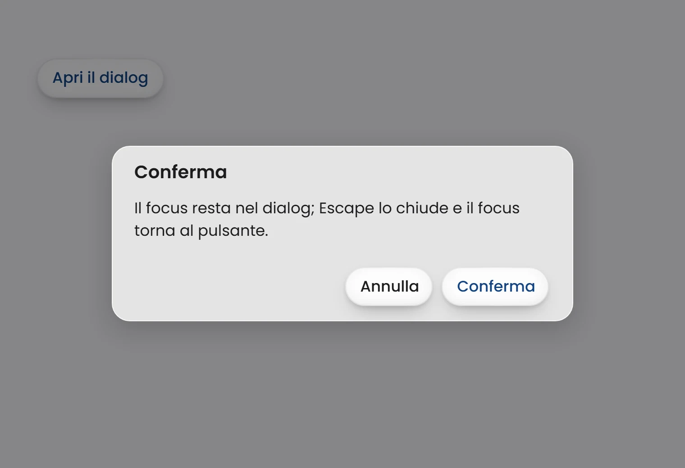
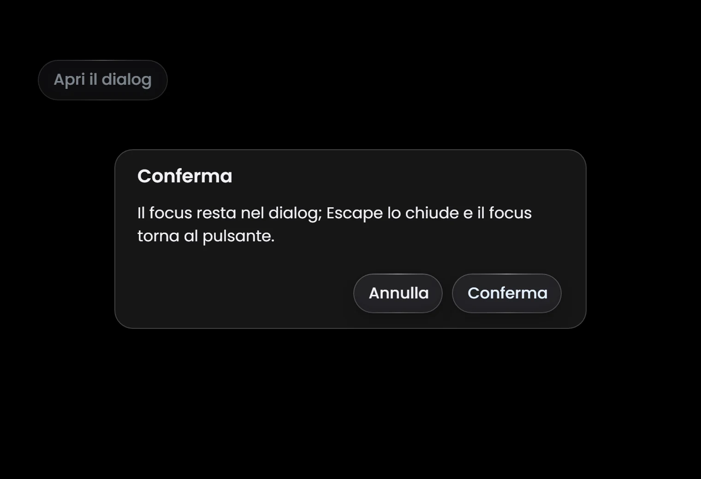

# Dialog

[Indice dei componenti](../README.md) · [Guida](../guida.md) · [README](../../README.md)

Finestra modale sul `<dialog>` nativo: focus intrappolato, Escape, focus restituito al pulsante. Si apre senza scrivere JavaScript.

**Pagina interattiva:** [dialog](https://davideprioreschi.github.io/dpi-framework/site/components/dialog.html)

## Aspetto

**Dialog aperto**



### Tema scuro



## Esempi

Il markup va in una pagina che include gli asset DPI (vedi [Installazione](../guida.md#installazione)).

### Dialog modale

```html
<div class="dpi-stack">
  <button class="dpi-btn dpi-btn--primary" data-dpi-dialog-open="dlg-esempio" type="button">
    Apri il dialog
  </button>
  <dialog class="dpi-dialog dpi-glass dpi-glass--strong" id="dlg-esempio" aria-labelledby="dlg-esempio-title" data-dpi-dismissible>
    <form class="dpi-dialog__form" method="dialog">
      <div class="dpi-dialog__header">
        <h2 class="dpi-dialog__title" id="dlg-esempio-title">
          Conferma
        </h2>
      </div>
      <div class="dpi-dialog__body dpi-stack">
        <p class="dpi-text">
          Il focus resta nel dialog; Escape lo chiude e il focus torna al pulsante.
        </p>
      </div>
      <div class="dpi-dialog__footer">
        <div class="dpi-cluster dpi-cluster--end">
          <button class="dpi-btn" data-dpi-dialog-close="" type="button">
            Annulla
          </button>
          <button class="dpi-btn dpi-btn--primary" data-dpi-dialog-close="ok" type="button" value="ok">
            Conferma
          </button>
        </div>
      </div>
    </form>
  </dialog>
</div>
```

## Classi, attributi ed eventi

`data-dpi-dialog-open="id"`, `data-dpi-dialog-close`, `data-dpi-dismissible` (chiusura dal fondale). Eventi `dpi:open`, `dpi:close`.

<details>
<summary>Tutte le classi e gli attributi usati negli esempi del sito</summary>

**Classi:** `dpi-btn`, `dpi-btn--primary`, `dpi-cluster`, `dpi-cluster--end`, `dpi-dialog`, `dpi-dialog__body`, `dpi-dialog__footer`, `dpi-dialog__form`, `dpi-dialog__header`, `dpi-dialog__title`, `dpi-glass`, `dpi-glass--strong`, `dpi-stack`, `dpi-text`

**Attributi:** `data-dpi-dialog-close`, `data-dpi-dialog-open`, `data-dpi-dismissible`

</details>

## Limiti

- Richiede JavaScript per aprirsi.
