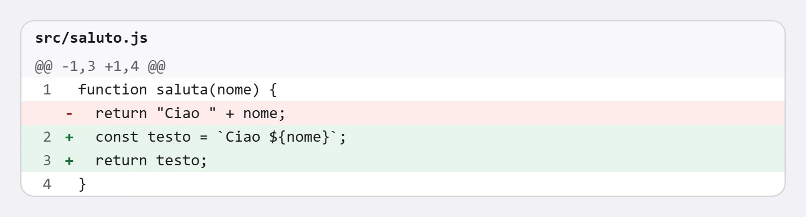
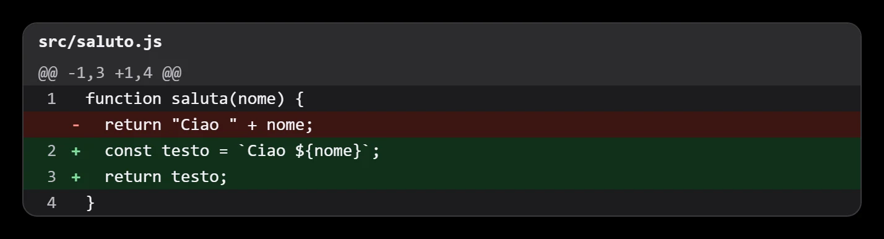

# Differenze di codice

[Indice dei componenti](../README.md) · [Guida](../guida.md) · [README](../../README.md)

Righe di codice con numeri, aggiunte e rimozioni distinguibili e selezione di righe dal numero (per esempio per commentarle).

**Pagina interattiva:** [diff](https://davideprioreschi.github.io/dpi-framework/site/components/diff.html)

## Aspetto

**Diff**



### Tema scuro



## Esempi

Il markup va in una pagina che include gli asset DPI (vedi [Installazione](../guida.md#installazione)).

### Diff con selezione di righe

```html
<div class="dpi-diff" data-dpi-diff role="group" aria-label="...">
  <div class="dpi-diff__row dpi-diff__row--file"><code class="dpi-diff__text">src/saluto.js</code></div>
  <div class="dpi-diff__row dpi-diff__row--hunk"><code class="dpi-diff__text">@@ -1,3 +1,4 @@</code></div>
  <div class="dpi-diff__row dpi-diff__row--add" data-dpi-diff-line="2" data-dpi-diff-path="src/saluto.js">
    <button class="dpi-diff__num" type="button" data-dpi-diff-pick aria-pressed="false" aria-label="Riga 2">2</button>
    <span class="dpi-diff__sign"><span class="dpi-visually-hidden">Aggiunta </span><span aria-hidden="true">+</span></span>
    <code class="dpi-diff__text">  const testo = ...;</code>
  </div>
  <div class="dpi-diff__row dpi-diff__row--del"> ... </div>   <!-- riga rimossa: numero non selezionabile -->
  <div class="dpi-diff__panel" data-dpi-diff-panel hidden> ... </div>
</div>
```

## Classi, attributi ed eventi

Clic sul numero per selezionare, Maiusc+clic per un intervallo, Esc per deselezionare. Evento `dpi:diff-select` (`{ diff, path, from, to, panel }`). API: `DPI.diff.select`, `DPI.diff.clear`, `DPI.diff.selection`.

## Limiti

- Il framework non legge patch né evidenzia la sintassi: il markup delle righe lo costruisce l'applicazione (con escape del testo).
