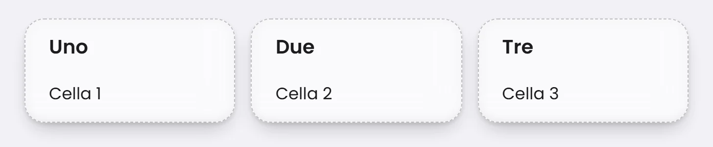
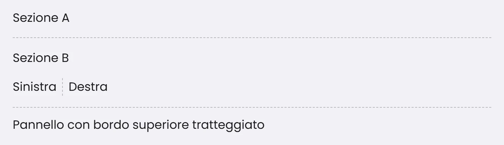

# Disposizione: stack, cluster, griglia, divisori

[Indice dei componenti](../README.md) · [Guida](../guida.md) · [README](../../README.md)

Quattro primitive per disporre gli elementi: colonna con spaziatura regolare (`stack`), riga che va a capo (`cluster`), griglia a colonne auto-adattive o fisse (`grid`) e linee di separazione (`divider`).

**Pagina interattiva:** [stack](https://davideprioreschi.github.io/dpi-framework/site/components/stack.html) · [cluster](https://davideprioreschi.github.io/dpi-framework/site/components/cluster.html) · [grid](https://davideprioreschi.github.io/dpi-framework/site/components/grid.html) · [divider](https://davideprioreschi.github.io/dpi-framework/site/components/divider.html)

## Aspetto

**Griglia auto-adattiva**



**Divisori**



### Tema scuro


## Esempi

Il markup va in una pagina che include gli asset DPI (vedi [Installazione](../guida.md#installazione)).

### Elementi in colonna

```html
<div class="dpi-stack">
  <p class="dpi-text">
    Primo
  </p>
  <p class="dpi-text">
    Secondo
  </p>
  <p class="dpi-text">
    Terzo
  </p>
</div>
```

### Elementi affiancati

```html
<div class="dpi-cluster dpi-cluster--between">
  <button class="dpi-btn" type="button">
    Annulla
  </button>
  <button class="dpi-btn dpi-btn--primary" type="button">
    Salva
  </button>
</div>
```

### Colonne che si adattano

```html
<div class="dpi-auto-grid dpi-auto-grid--sm">
  <section class="dpi-card" aria-labelledby="dpi-1-title">
    <div class="dpi-card__body dpi-stack">
      <h3 class="dpi-card__title" id="dpi-1-title">
        Uno
      </h3>
      <p class="dpi-text">
        Cella 1
      </p>
    </div>
  </section>
  <section class="dpi-card" aria-labelledby="dpi-2-title">
    <div class="dpi-card__body dpi-stack">
      <h3 class="dpi-card__title" id="dpi-2-title">
        Due
      </h3>
      <p class="dpi-text">
        Cella 2
      </p>
    </div>
  </section>
  <section class="dpi-card" aria-labelledby="dpi-3-title">
    <div class="dpi-card__body dpi-stack">
      <h3 class="dpi-card__title" id="dpi-3-title">
        Tre
      </h3>
      <p class="dpi-text">
        Cella 3
      </p>
    </div>
  </section>
</div>
```

### Colonne fisse e gutter

```html
<div class="dpi-cols dpi-cols--3 dpi-gap--lg">
  <div class="dpi-u-p-md dpi-u-bg-accent dpi-u-r-md">
    <p class="dpi-text">
      1
    </p>
  </div>
  <div class="dpi-u-p-md dpi-u-bg-accent dpi-u-r-md">
    <p class="dpi-text">
      2
    </p>
  </div>
  <div class="dpi-u-p-md dpi-u-bg-accent dpi-u-r-md">
    <p class="dpi-text">
      3
    </p>
  </div>
</div>
```

### Divisori orizzontali e verticali

```html
<div class="dpi-stack">
  <p class="dpi-text">
    Sopra
  </p>
  <hr class="dpi-divider">
  <div class="dpi-cluster">
    <p class="dpi-text">
      A
    </p>
    <span class="dpi-vr" role="separator" aria-orientation="vertical"></span>
    <p class="dpi-text">
      B
    </p>
  </div>
</div>
```

### Separatori strutturali tratteggiati

```html
<div class="dpi-stack">
  <p class="dpi-text">Sezione A</p>
  <hr class="dpi-divider dpi-divider--dashed">
  <p class="dpi-text">Sezione B</p>
  <div class="dpi-cluster">
    <span>Sinistra</span>
    <span class="dpi-divider dpi-divider--vertical dpi-divider--dashed" role="separator" aria-orientation="vertical"></span>
    <span>Destra</span>
  </div>
  <div class="dpi-dash-top">Contenuto con bordo superiore tratteggiato</div>
</div>
```

## Classi, attributi ed eventi

- `dpi-stack`, `dpi-cluster` (`dpi-cluster--end` allinea a destra).
- `dpi-auto-grid` (con `dpi-auto-grid--2` al massimo due colonne, soglia `--dpi-auto-min`).
- `dpi-cols` e `dpi-cols--N`: colonne fisse da 40rem in su, una sola colonna sotto.
- `dpi-divider`, `dpi-divider--dashed`, `dpi-divider--vertical`; utilità `dpi-dash-top/bottom/start/end`.

<details>
<summary>Tutte le classi e gli attributi usati negli esempi del sito</summary>

**Classi:** `dpi-auto-grid`, `dpi-auto-grid--sm`, `dpi-btn`, `dpi-btn--primary`, `dpi-card`, `dpi-card__body`, `dpi-card__title`, `dpi-cluster`, `dpi-cluster--between`, `dpi-cols`, `dpi-cols--3`, `dpi-divider`, `dpi-gap--lg`, `dpi-stack`, `dpi-text`, `dpi-u-bg-accent`, `dpi-u-p-md`, `dpi-u-r-md`, `dpi-vr`

</details>
