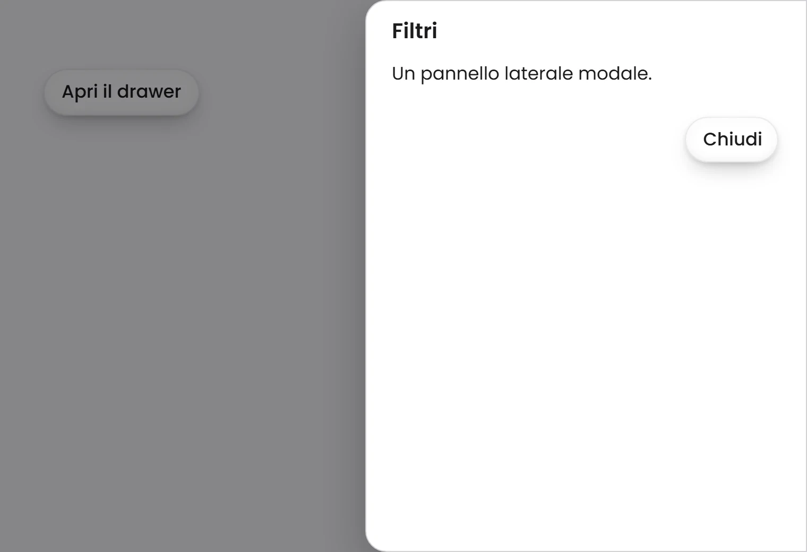
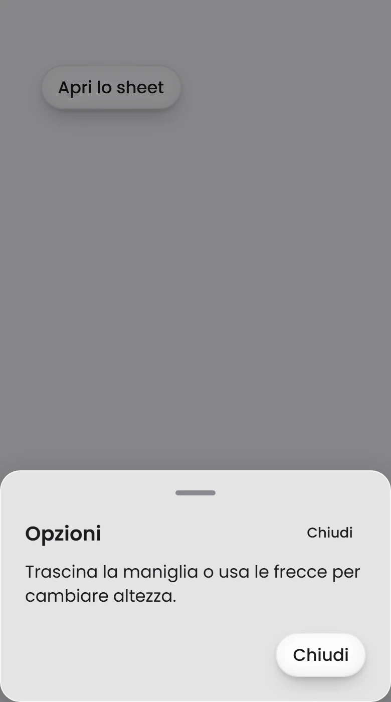

# Drawer e bottom sheet

[Indice dei componenti](../README.md) · [Guida](../guida.md) · [README](../../README.md)

Pannello laterale per contenuti più lunghi (`drawer`) e pannello che sale dal basso con maniglia trascinabile (`sheet`), entrambi modali.

**Pagina interattiva:** [drawer](https://davideprioreschi.github.io/dpi-framework/site/components/drawer.html) · [sheet](https://davideprioreschi.github.io/dpi-framework/site/components/sheet.html)

## Aspetto

**Drawer aperto**



**Bottom sheet aperto su telefono**



## Esempi

Il markup va in una pagina che include gli asset DPI (vedi [Installazione](../guida.md#installazione)).

### Drawer laterale

```html
<button class="dpi-btn" type="button" data-dpi-dialog-open="filtri">Apri il drawer</button>

<dialog class="dpi-dialog dpi-dialog--drawer dpi-dialog--end" id="filtri" aria-labelledby="filtri-title" data-dpi-dismissible>
  <form class="dpi-dialog__form" method="dialog">
    <div class="dpi-dialog__header"><h2 class="dpi-dialog__title" id="filtri-title">Filtri</h2></div>
    <div class="dpi-dialog__body dpi-stack"><p class="dpi-text">Un pannello laterale modale.</p></div>
    <div class="dpi-dialog__footer">
      <div class="dpi-cluster dpi-cluster--end">
        <button class="dpi-btn" type="button" data-dpi-dialog-close="">Chiudi</button>
      </div>
    </div>
  </form>
</dialog>
```

### Bottom sheet

```html
<div class="dpi-stack">
  <button class="dpi-btn" data-dpi-dialog-open="sht-esempio" type="button">
    Apri lo sheet
  </button>
  <dialog class="dpi-sheet" id="sht-esempio" aria-labelledby="sht-esempio-title" data-dpi-sheet="medium" data-dpi-dismissible>
    <div class="dpi-sheet__panel dpi-glass dpi-glass--strong">
      <button class="dpi-sheet__handle" type="button" data-dpi-sheet-handle aria-expanded="false" aria-label="Espandi o riduci il pannello">
        <span class="dpi-sheet__grip" aria-hidden="true"></span>
      </button>
      <div class="dpi-sheet__header">
        <h2 class="dpi-sheet__title" id="sht-esempio-title">
          Opzioni
        </h2>
        <button class="dpi-btn dpi-btn--plain dpi-btn--sm" type="button" data-dpi-dialog-close="" autofocus>
          Chiudi
        </button>
      </div>
      <div class="dpi-sheet__body dpi-stack">
        <p class="dpi-text">
          Trascina la maniglia o usa le frecce per cambiare altezza.
        </p>
      </div>
      <div class="dpi-sheet__footer">
        <div class="dpi-cluster dpi-cluster--end">
          <button class="dpi-btn" data-dpi-dialog-close="" type="button">
            Chiudi
          </button>
        </div>
      </div>
    </div>
  </dialog>
</div>
```

## Classi, attributi ed eventi

- Stesso aprire/chiudere del dialog.
- Sheet: `data-dpi-sheet="medium|large"`, `data-dpi-sheet-handle`; frecce sulla maniglia per cambiare altezza.

<details>
<summary>Tutte le classi e gli attributi usati negli esempi del sito</summary>

**Classi:** `dpi-btn`, `dpi-btn--plain`, `dpi-btn--sm`, `dpi-cluster`, `dpi-cluster--end`, `dpi-dialog`, `dpi-dialog__body`, `dpi-dialog__footer`, `dpi-dialog__form`, `dpi-dialog__header`, `dpi-dialog__title`, `dpi-glass`, `dpi-glass--strong`, `dpi-sheet`, `dpi-sheet__body`, `dpi-sheet__footer`, `dpi-sheet__grip`, `dpi-sheet__handle`, `dpi-sheet__header`, `dpi-sheet__panel`, `dpi-sheet__title`, `dpi-stack`, `dpi-text`

**Attributi:** `data-dpi-dialog-close`, `data-dpi-dialog-open`, `data-dpi-dismissible`, `data-dpi-sheet`, `data-dpi-sheet-handle`

</details>

## Limiti

- La chiusura dello sheet con Escape non è animata.
