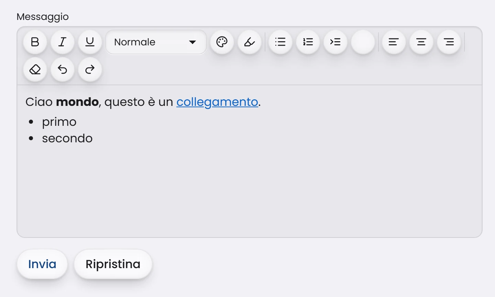
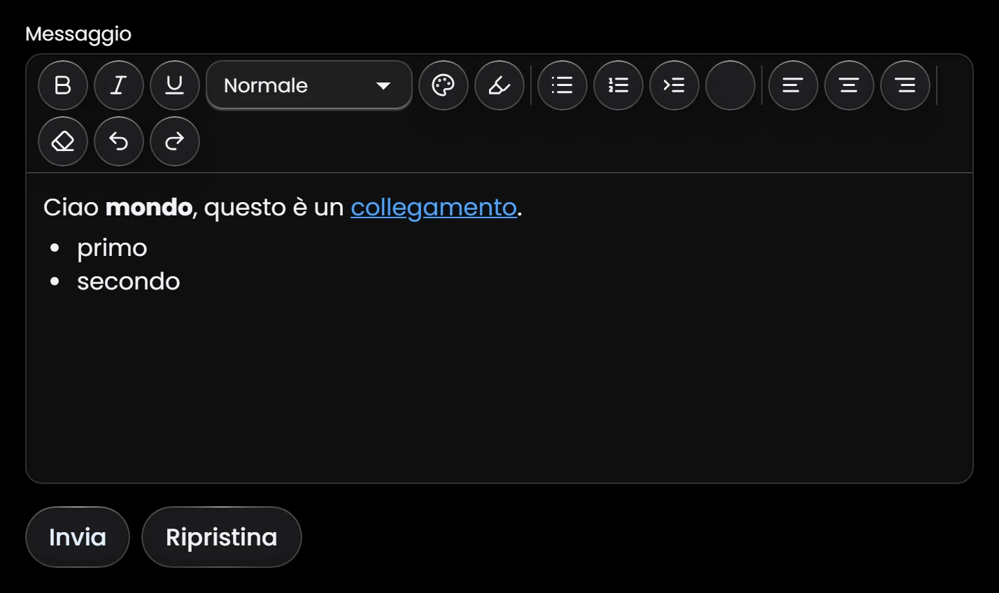

# Editor di testo ricco

[Indice dei componenti](../README.md) · [Guida](../guida.md) · [README](../../README.md)

Barra con grassetto, corsivo, sottolineato, dimensione, colore del testo, evidenziazione, elenchi, citazione, collegamento, allineamento, pulizia, annulla e ripeti; l'HTML sanificato viaggia in un campo nascosto con lo stesso `name`.

**Pagina interattiva:** [richtext](https://davideprioreschi.github.io/dpi-framework/site/components/richtext.html)

## Aspetto

**Editor**



### Tema scuro



## Esempi

Il markup va in una pagina che include gli asset DPI (vedi [Installazione](../guida.md#installazione)).

### Editor con valore iniziale

```html
<form class="dpi-stack" method="get" aria-label="Esempio di editor ricco">
  <div class="dpi-field">
    <label class="dpi-label" id="rt-1-label" for="rt-1">Messaggio</label>
    <div class="dpi-richtext" data-dpi-richtext data-dpi-rows="8" data-dpi-richtext-text="testo">
      <div class="dpi-richtext__area" id="rt-1" aria-labelledby="rt-1-label" data-placeholder="Scrivi il messaggio…"></div>
      <textarea class="dpi-richtext__value" name="html" hidden>&lt;p&gt;Ciao &lt;b&gt;mondo&lt;/b&gt;, questo è un &lt;a href=&quot;https://example.org&quot;&gt;collegamento&lt;/a&gt;.&lt;/p&gt;&lt;ul&gt;&lt;li&gt;primo&lt;/li&gt;&lt;li&gt;secondo&lt;/li&gt;&lt;/ul&gt;</textarea>
    </div>
  </div>
  <div class="dpi-cluster"><button class="dpi-btn dpi-btn--primary" type="submit">Invia</button><button class="dpi-btn" type="reset">Ripristina</button></div>
</form>
```

### A tutta altezza e obbligatorio

```html
<form class="dpi-stack" method="get" aria-label="Esempio di editor ricco">
  <div class="dpi-field">
    <label class="dpi-label" id="rt-1-label" for="rt-1">Messaggio</label>
    <div class="dpi-richtext" data-dpi-richtext data-dpi-rows="8" data-dpi-richtext-text="testo">
      <div class="dpi-richtext__area" id="rt-1" aria-labelledby="rt-1-label" data-placeholder="Scrivi il messaggio…"></div>
      <textarea class="dpi-richtext__value" name="html" hidden>&lt;p&gt;Ciao &lt;b&gt;mondo&lt;/b&gt;, questo è un &lt;a href=&quot;https://example.org&quot;&gt;collegamento&lt;/a&gt;.&lt;/p&gt;&lt;ul&gt;&lt;li&gt;primo&lt;/li&gt;&lt;li&gt;secondo&lt;/li&gt;&lt;/ul&gt;</textarea>
    </div>
  </div>
  <div class="dpi-cluster"><button class="dpi-btn dpi-btn--primary" type="submit">Invia</button><button class="dpi-btn" type="reset">Ripristina</button></div>
</form>
```

## Classi, attributi ed eventi

- Evento `dpi:richtext` dopo un comando della barra; durante la scrittura si ascolta `input`.
- API: `DPI.richtext.value(el)`, `text(el)`, `set(el, html)`, `sanitize(html)`, `toText(html)`.
- `data-dpi-richtext-required`, `data-dpi-richtext-text` (secondo campo con il testo semplice).

## Limiti

- La sanificazione nel browser non sostituisce quella lato server.
- Si basa su `document.execCommand` (obsoleto, ancora supportato dai browser). Le immagini incollate non sono supportate.
