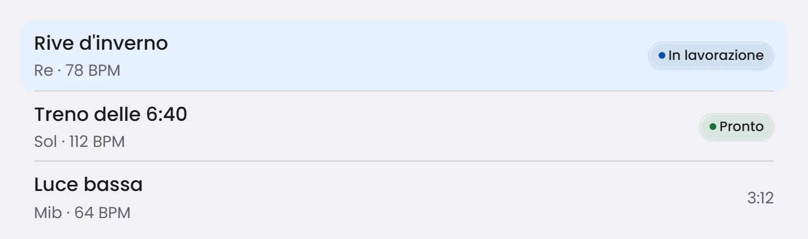
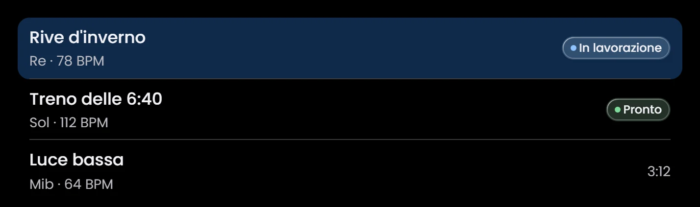

# Elenchi di righe

[Indice dei componenti](../README.md) · [Guida](../guida.md) · [README](../../README.md)

Elenco di righe con titolo, dettaglio e stato; le righe azionabili sono pulsanti o link nativi. Per più colonne si usa la tabella.

**Pagina interattiva:** [list_group](https://davideprioreschi.github.io/dpi-framework/site/components/list_group.html) · [list_item](https://davideprioreschi.github.io/dpi-framework/site/components/list_item.html)

## Aspetto

**Elenco di righe**



### Tema scuro



## Esempi

Il markup va in una pagina che include gli asset DPI (vedi [Installazione](../guida.md#installazione)).

### Elenco con righe azionabili

```html
<ul class="dpi-list" aria-label="Brani">
  <li>
    <a class="dpi-list__row dpi-list__row_link" aria-current="true" href="#a"><span class="dpi-list__text"><span class="dpi-list__label">Rive d&apos;inverno</span><span class="dpi-list__detail">Re · 78 BPM</span></span><span class="dpi-badge dpi-badge--info">In lavorazione</span></a>
  </li>
  <li>
    <a class="dpi-list__row dpi-list__row_link" href="#b"><span class="dpi-list__text"><span class="dpi-list__label">Treno delle 6:40</span><span class="dpi-list__detail">Sol · 112 BPM</span></span><span class="dpi-badge dpi-badge--success">Pronto</span></a>
  </li>
  <li class="dpi-list__row">
    <span class="dpi-list__text"><span class="dpi-list__label">Luce bassa</span><span class="dpi-list__detail">Mib · 64 BPM</span></span><span class="dpi-list__meta">3:12</span>
  </li>
</ul>
```

### Riga con icona e dettaglio

```html
<ul class="dpi-list" aria-label="Appuntamenti">
  <li class="dpi-list__row">
    <span class="dpi-list__icon"><span data-dpi-icon="clock"></span></span><span class="dpi-list__text"><span class="dpi-list__label">Prova con la band</span><span class="dpi-list__detail">Sala Fonderia</span></span><span class="dpi-list__meta">18:30</span>
  </li>
  <li class="dpi-list__row dpi-list__row--done">
    <span class="dpi-list__text"><span class="dpi-list__label">Task completato</span></span>
  </li>
</ul>
```

## Classi, attributi ed eventi

Le righe con `data-dpi-action` emettono `dpi:action`. Stati: corrente, completata, disabilitata.

<details>
<summary>Tutte le classi e gli attributi usati negli esempi del sito</summary>

**Classi:** `dpi-badge`, `dpi-badge--info`, `dpi-badge--success`, `dpi-list`, `dpi-list__detail`, `dpi-list__icon`, `dpi-list__label`, `dpi-list__meta`, `dpi-list__row`, `dpi-list__row--done`, `dpi-list__row_link`, `dpi-list__text`

**Attributi:** `data-dpi-icon`

</details>
