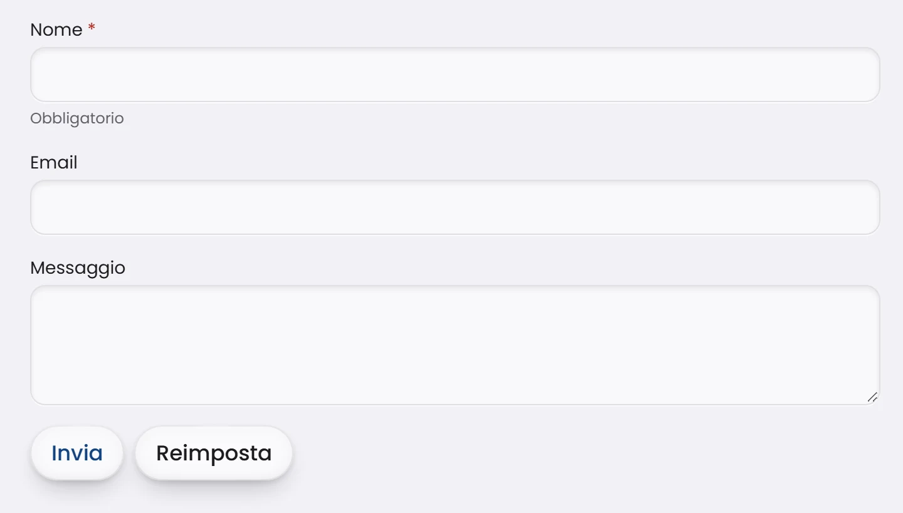
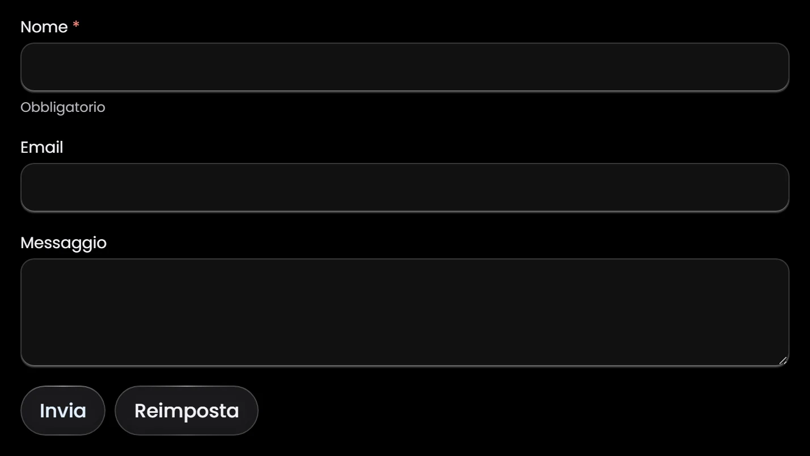

# Form

[Indice dei componenti](../README.md) · [Guida](../guida.md) · [README](../../README.md)

Il form è quello nativo: validazione del browser (`required`, `type`, `pattern`, `min`/`max`), invio e reset. Ogni campo ha etichetta, suggerimento ed errore collegati con `aria-describedby`.

**Pagina interattiva:** [form](https://davideprioreschi.github.io/dpi-framework/site/components/form.html)

## Aspetto

**Form**



### Tema scuro



## Esempi

Il markup va in una pagina che include gli asset DPI (vedi [Installazione](../guida.md#installazione)).

### Form con validazione nativa

```html
<form class="dpi-stack" method="get" aria-label="Contatto">
  <div class="dpi-field">
    <label class="dpi-label" for="dpi-1">Nome <span class="dpi-required" aria-hidden="true">*</span></label>
    <input class="dpi-input" id="dpi-1" name="nome" type="text" aria-describedby="dpi-1-hint" required>
    <p class="dpi-hint" id="dpi-1-hint">
      Obbligatorio
    </p>
  </div>
  <div class="dpi-field">
    <label class="dpi-label" for="dpi-2">Email</label>
    <input class="dpi-input" id="dpi-2" name="email" type="email">
  </div>
  <div class="dpi-field">
    <label class="dpi-label" for="dpi-3">Messaggio</label><textarea class="dpi-textarea" id="dpi-3" name="msg" rows="3"></textarea>
  </div>
  <div class="dpi-cluster">
    <button class="dpi-btn dpi-btn--primary" type="submit">
      Invia
    </button>
    <button class="dpi-btn" type="reset">
      Reimposta
    </button>
  </div>
</form>
```

## Classi, attributi ed eventi

Per le azioni in fondo al form si usa `actions` (vedi [Pulsanti](pulsanti.md)). Per le barre di filtri c'è `dpi-toolbar` (vedi [Campi di testo](campi-di-testo.md)).

<details>
<summary>Tutte le classi e gli attributi usati negli esempi del sito</summary>

**Classi:** `dpi-btn`, `dpi-btn--primary`, `dpi-cluster`, `dpi-field`, `dpi-hint`, `dpi-input`, `dpi-label`, `dpi-required`, `dpi-stack`, `dpi-textarea`

</details>
