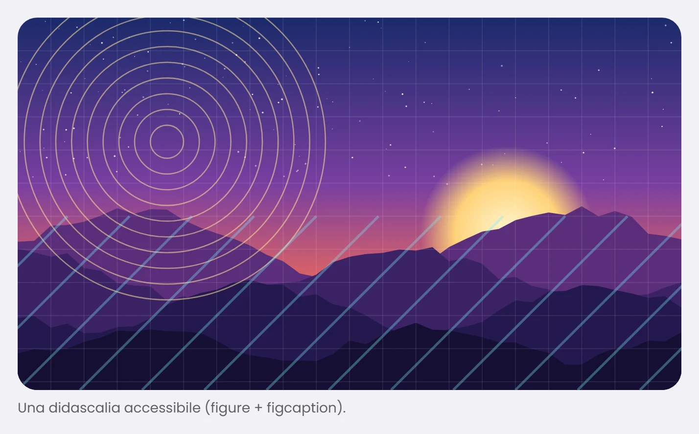
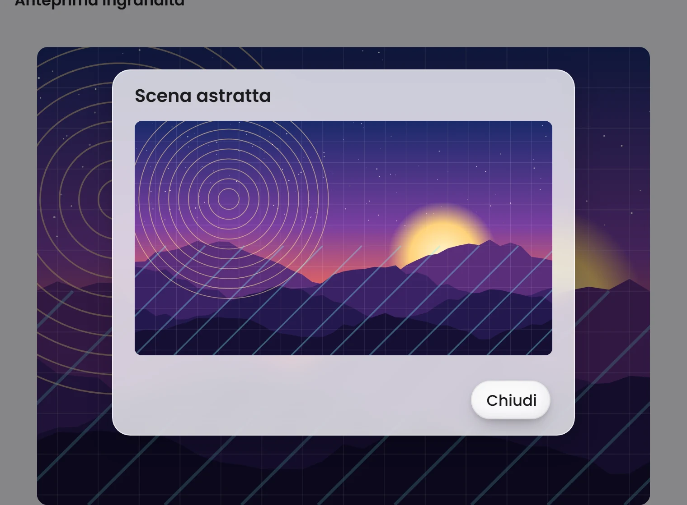
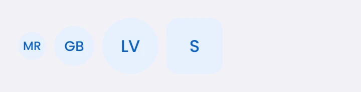
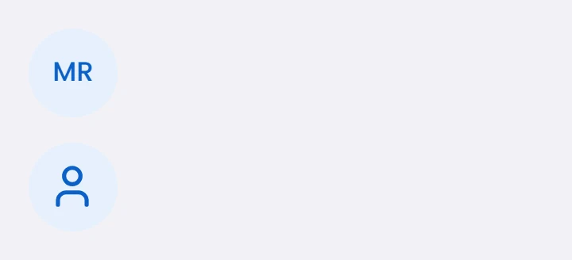

# Immagini e avatar

[Indice dei componenti](../README.md) · [Guida](../guida.md) · [README](../../README.md)

Immagini con rapporto d'aspetto, caricamento differito, didascalia, anteprima ingrandita e testo di ripiego in caso di errore; avatar con immagine e iniziali di riserva.

**Pagina interattiva:** [image](https://davideprioreschi.github.io/dpi-framework/site/components/image.html) · [avatar](https://davideprioreschi.github.io/dpi-framework/site/components/avatar.html)

## Aspetto

**Immagine con didascalia**



**Anteprima ingrandita**



**Avatar con iniziali**



**Ripiego quando l'immagine non si carica**



## Esempi

Il markup va in una pagina che include gli asset DPI (vedi [Installazione](../guida.md#installazione)).

### Rapporto d'aspetto e didascalia

```html
<figure class="dpi-figure">
  <span class="dpi-image dpi-ratio-16-9 dpi-fit-cover dpi-radius-lg">
  
  <span class="dpi-image__fallback" role="img" aria-label="Immagine non disponibile"><span data-dpi-icon="info"></span><span>Immagine non disponibile</span></span></span>
  <figcaption class="dpi-figure__caption">
    Una didascalia accessibile (figure + figcaption).
  </figcaption>
</figure>
```

### Anteprima ingrandita

```html
<span class="dpi-image-wrap">
<button class="dpi-image__zoom" type="button" data-dpi-dialog-open="dpi-1-zoom" aria-label="Ingrandisci: Scena astratta">
  <span class="dpi-image dpi-ratio-4-3 dpi-fit-cover dpi-radius-md">
  
  <span class="dpi-image__fallback" role="img" aria-label="Immagine non disponibile"><span data-dpi-icon="info"></span><span>Immagine non disponibile</span></span></span>
</button>
<dialog class="dpi-dialog dpi-glass dpi-glass--strong" id="dpi-1-zoom" aria-labelledby="dpi-1-zoom-title" data-dpi-dismissible>
  <form class="dpi-dialog__form" method="dialog">
    <div class="dpi-dialog__header">
      <h2 class="dpi-dialog__title" id="dpi-1-zoom-title">
        Scena astratta
      </h2>
    </div>
    <div class="dpi-dialog__body dpi-stack">
      <span class="dpi-image-wrap"><span class="dpi-image dpi-ratio-auto dpi-fit-contain dpi-radius-sm">
      
      <span class="dpi-image__fallback" role="img" aria-label="Immagine non disponibile"><span data-dpi-icon="info"></span><span>Immagine non disponibile</span></span></span></span>
    </div>
    <div class="dpi-dialog__footer">
      <div class="dpi-cluster dpi-cluster--end">
        <button class="dpi-btn" data-dpi-dialog-close="" type="button">
          Chiudi
        </button>
      </div>
    </div>
  </form>
</dialog>
</span>
```

### Stato di errore

```html
<span class="dpi-image-wrap"><span class="dpi-image dpi-ratio-4-3 dpi-fit-cover dpi-radius-md">

<span class="dpi-image__fallback" role="img" aria-label="Immagine non disponibile"><span data-dpi-icon="info"></span><span>Immagine non disponibile</span></span></span></span>
```

### Avatar: iniziali e dimensioni

```html
<div class="dpi-cluster">
  <span class="dpi-avatar dpi-avatar--sm" role="img" aria-label="Mario Rossi"><span class="dpi-avatar__initials" aria-hidden="true">MR</span></span><span class="dpi-avatar dpi-avatar--md" role="img" aria-label="Giulia Bianchi"><span class="dpi-avatar__initials" aria-hidden="true">GB</span></span><span class="dpi-avatar dpi-avatar--lg" role="img" aria-label="Luca Verdi"><span class="dpi-avatar__initials" aria-hidden="true">LV</span></span><span class="dpi-avatar dpi-avatar--lg dpi-avatar--square" role="img" aria-label="Studio"><span class="dpi-avatar__initials" aria-hidden="true">S</span></span>
</div>
```

### Avatar intero (contain) e ripiego

```html
<span class="dpi-avatar dpi-avatar--lg dpi-avatar--contain dpi-avatar--square" role="img" aria-label="Progetto Alfa"><span class="dpi-avatar__initials" aria-hidden="true">PA</span></span>
```

## Classi, attributi ed eventi

- `dpi-avatar--lg`, `--square`, `--contain` (immagine non ritagliata, fondo `--dpi-avatar-bg`).
- Un'immagine in errore mostra le iniziali (`dpi-avatar__initials`) o un'icona persona.
- L'anteprima ingrandita usa un `<dialog>` (Escape chiude).

<details>
<summary>Tutte le classi e gli attributi usati negli esempi del sito</summary>

**Classi:** `dpi-avatar`, `dpi-avatar--lg`, `dpi-avatar--md`, `dpi-avatar--sm`, `dpi-avatar--square`, `dpi-avatar__initials`, `dpi-btn`, `dpi-cluster`, `dpi-cluster--end`, `dpi-dialog`, `dpi-dialog__body`, `dpi-dialog__footer`, `dpi-dialog__form`, `dpi-dialog__header`, `dpi-dialog__title`, `dpi-figure`, `dpi-figure__caption`, `dpi-fit-contain`, `dpi-fit-cover`, `dpi-glass`, `dpi-glass--strong`, `dpi-image`, `dpi-image-wrap`, `dpi-image__fallback`, `dpi-image__img`, `dpi-image__zoom`, `dpi-radius-lg`, `dpi-radius-md`, `dpi-radius-sm`, `dpi-ratio-16-9`, `dpi-ratio-4-3`, `dpi-ratio-auto`, `dpi-stack`

**Attributi:** `data-dpi-dialog-close`, `data-dpi-dialog-open`, `data-dpi-dismissible`, `data-dpi-icon`, `data-dpi-image`

</details>

## Limiti

- Un solo `src` (nessun `srcset`/`picture`). Nessun gruppo di avatar né indicatore di stato.
