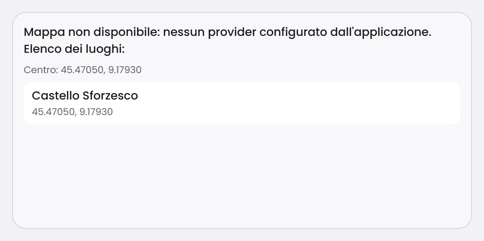

# Mappa

[Indice dei componenti](../README.md) · [Guida](../guida.md) · [README](../../README.md)

Mappa con centro, zoom, marker e popup. Il framework non include provider né chiavi: l'applicazione registra il proprio e ne rispetta le condizioni. Senza provider o senza rete mostra l'elenco dei luoghi. `map_marker` è il singolo marker.

**Pagina interattiva:** [map](https://davideprioreschi.github.io/dpi-framework/site/components/map.html) · [map_marker](https://davideprioreschi.github.io/dpi-framework/site/components/map_marker.html)

## Aspetto

**Ripiego senza provider**



## Esempi

Il markup va in una pagina che include gli asset DPI (vedi [Installazione](../guida.md#installazione)).

### Mappa con marker

```html
<div class="dpi-map dpi-map--md" data-dpi-map data-lat="45.4642" data-lng="9.1916" data-zoom="15" data-provider="osm" data-load="consent" data-markers="[{&quot;lat&quot;:45.4642,&quot;lng&quot;:9.1916,&quot;title&quot;:&quot;Duomo di Milano&quot;,&quot;description&quot;:&quot;Piazza del Duomo&quot;}]" data-label="Piazza del Duomo, Milano">
  <div class="dpi-map__fallback" data-dpi-map-fallback>
    <p class="dpi-map__status" role="status" data-dpi-map-status>
      La mappa usa un servizio esterno e non è ancora caricata.
    </p>
    <p class="dpi-map__center">
      Centro: 45.46420, 9.19160
    </p>
    <ul class="dpi-map__places" aria-label="Luoghi">
      <li class="dpi-map__place">
        <span class="dpi-map__place-title">Duomo di Milano</span><span class="dpi-map__place-desc">Piazza del Duomo</span><span class="dpi-map__place-coords">45.46420, 9.19160</span>
      </li>
    </ul>
    <div class="dpi-map__consent">
      <button class="dpi-btn dpi-btn--tinted dpi-btn--sm" type="button">
        <span data-dpi-icon="download" data-dpi-icon-size="sm"></span>Carica la mappa
      </button>
    </div>
  </div>
  <div class="dpi-map__viewport" hidden data-dpi-map-viewport tabindex="0" role="application" aria-label="Piazza del Duomo, Milano — frecce per spostare, + e − per lo zoom">
    <div class="dpi-map__controls">
      <button class="dpi-btn dpi-btn--sm dpi-btn--icon-only" title="Aumenta lo zoom" type="button">
        <span data-dpi-icon="plus" data-dpi-icon-size="sm"></span><span class="dpi-visually-hidden">Aumenta lo zoom</span>
      </button>
      <button class="dpi-btn dpi-btn--sm dpi-btn--icon-only" title="Riduci lo zoom" type="button">
        <span data-dpi-icon="minus" data-dpi-icon-size="sm"></span><span class="dpi-visually-hidden">Riduci lo zoom</span>
      </button>
    </div>
  </div>
</div>
```

### Senza provider: ripiego

```html
<div class="dpi-map dpi-map--md" data-dpi-map data-lat="45.4705" data-lng="9.1793" data-zoom="14" data-load="consent" data-markers="[{&quot;lat&quot;:45.4705,&quot;lng&quot;:9.1793,&quot;title&quot;:&quot;Castello Sforzesco&quot;,&quot;description&quot;:&quot;&quot;}]" data-label="Luogo di esempio">
  <div class="dpi-map__fallback" data-dpi-map-fallback>
    <p class="dpi-map__status" role="status" data-dpi-map-status>
      Mappa non disponibile: nessun provider configurato dall&apos;applicazione. Elenco dei luoghi:
    </p>
    <p class="dpi-map__center">
      Centro: 45.47050, 9.17930
    </p>
    <ul class="dpi-map__places" aria-label="Luoghi">
      <li class="dpi-map__place">
        <span class="dpi-map__place-title">Castello Sforzesco</span><span class="dpi-map__place-coords">45.47050, 9.17930</span>
      </li>
    </ul>
  </div>
  <div class="dpi-map__viewport" hidden data-dpi-map-viewport tabindex="0" role="application" aria-label="Luogo di esempio — frecce per spostare, + e − per lo zoom">
    <div class="dpi-map__controls">
      <button class="dpi-btn dpi-btn--sm dpi-btn--icon-only" title="Aumenta lo zoom" type="button">
        <span data-dpi-icon="plus" data-dpi-icon-size="sm"></span><span class="dpi-visually-hidden">Aumenta lo zoom</span>
      </button>
      <button class="dpi-btn dpi-btn--sm dpi-btn--icon-only" title="Riduci lo zoom" type="button">
        <span data-dpi-icon="minus" data-dpi-icon-size="sm"></span><span class="dpi-visually-hidden">Riduci lo zoom</span>
      </button>
    </div>
  </div>
</div>
```

### Nessuna risorsa esterna

```html
<div class="dpi-map dpi-map--md" data-dpi-map data-lat="45.4529" data-lng="9.1771" data-zoom="13" data-provider="osm" data-load="never" data-markers="[{&quot;lat&quot;:45.4529,&quot;lng&quot;:9.1771,&quot;title&quot;:&quot;Darsena&quot;,&quot;description&quot;:&quot;Navigli&quot;}]" data-label="Solo elenco">
  <div class="dpi-map__fallback" data-dpi-map-fallback>
    <p class="dpi-map__status" role="status" data-dpi-map-status>
      Mappa non caricata: nessuna risorsa esterna richiesta. Elenco dei luoghi:
    </p>
    <p class="dpi-map__center">
      Centro: 45.45290, 9.17710
    </p>
    <ul class="dpi-map__places" aria-label="Luoghi">
      <li class="dpi-map__place">
        <span class="dpi-map__place-title">Darsena</span><span class="dpi-map__place-desc">Navigli</span><span class="dpi-map__place-coords">45.45290, 9.17710</span>
      </li>
    </ul>
  </div>
  <div class="dpi-map__viewport" hidden data-dpi-map-viewport tabindex="0" role="application" aria-label="Solo elenco — frecce per spostare, + e − per lo zoom">
    <div class="dpi-map__controls">
      <button class="dpi-btn dpi-btn--sm dpi-btn--icon-only" title="Aumenta lo zoom" type="button">
        <span data-dpi-icon="plus" data-dpi-icon-size="sm"></span><span class="dpi-visually-hidden">Aumenta lo zoom</span>
      </button>
      <button class="dpi-btn dpi-btn--sm dpi-btn--icon-only" title="Riduci lo zoom" type="button">
        <span data-dpi-icon="minus" data-dpi-icon-size="sm"></span><span class="dpi-visually-hidden">Riduci lo zoom</span>
      </button>
    </div>
  </div>
</div>
```

## Classi, attributi ed eventi

`DPI.map.registerProvider(nome, { tiles, attribution })`; eventi `dpi:map-ready`, `dpi:map-marker`, `dpi:map-fallback`. Con una CSP il dominio delle tessere va ammesso in `img-src`.

<details>
<summary>Tutte le classi e gli attributi usati negli esempi del sito</summary>

**Classi:** `dpi-btn`, `dpi-btn--icon-only`, `dpi-btn--sm`, `dpi-btn--tinted`, `dpi-map`, `dpi-map--md`, `dpi-map__center`, `dpi-map__consent`, `dpi-map__controls`, `dpi-map__fallback`, `dpi-map__place`, `dpi-map__place-coords`, `dpi-map__place-desc`, `dpi-map__place-title`, `dpi-map__places`, `dpi-map__status`, `dpi-map__viewport`, `dpi-visually-hidden`

**Attributi:** `data-dpi-icon`, `data-dpi-icon-size`, `data-dpi-map`, `data-dpi-map-fallback`, `data-dpi-map-status`, `data-dpi-map-viewport`

</details>

## Limiti

- Solo tessere raster Web Mercator: nessuna geocodifica, percorsi o clustering.
