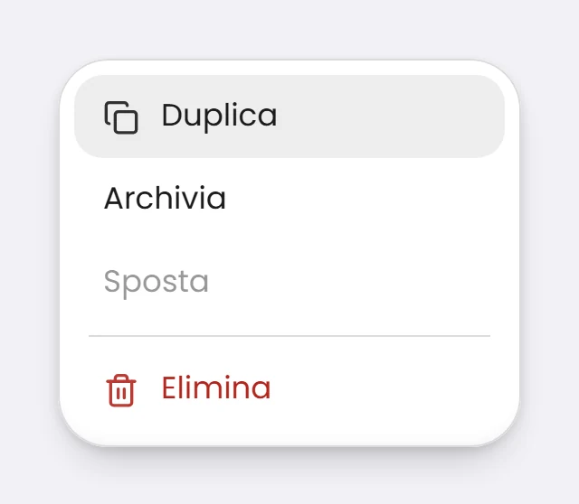
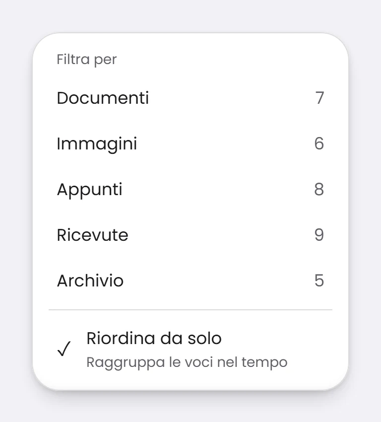
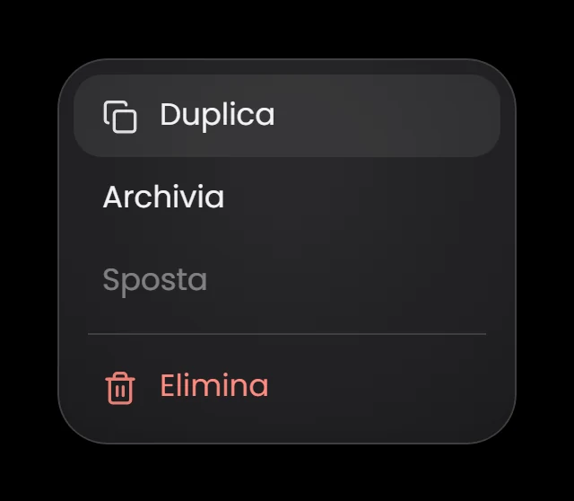

# Menu a comparsa

[Indice dei componenti](../README.md) · [Guida](../guida.md) · [README](../../README.md)

Menu che emerge dal proprio pulsante: distingue le azioni (pulsanti) dalla navigazione (link). `item` è la voce, `separator` la linea tra gruppi. La superficie del menu è opaca.

**Pagina interattiva:** [menu](https://davideprioreschi.github.io/dpi-framework/site/components/menu.html) · [item](https://davideprioreschi.github.io/dpi-framework/site/components/item.html) · [separator](https://davideprioreschi.github.io/dpi-framework/site/components/separator.html)

## Aspetto

**Menu di azioni aperto**



**Menu con valori e selezione**



### Tema scuro



## Esempi

Il markup va in una pagina che include gli asset DPI (vedi [Installazione](../guida.md#installazione)).

### Menu di azioni

```html
<div class="dpi-dropdown" data-dpi-dropdown="actions">
  <button class="dpi-btn" type="button" data-dpi-dropdown-trigger>
    Azioni
  </button>
  <div class="dpi-menu" id="dpi-1" data-dpi-dropdown-panel>
    <ul class="dpi-menu__list">
      <li>
        <button class="dpi-menu__item" type="button">
          <span data-dpi-icon="copy"></span><span class="dpi-menu__label">Duplica</span>
        </button>
      </li>
      <li>
        <button class="dpi-menu__item" type="button">
          <span class="dpi-menu__label">Archivia</span>
        </button>
      </li>
      <li>
        <button class="dpi-menu__item" type="button" disabled>
          <span class="dpi-menu__label">Sposta</span>
        </button>
      </li>
      <li>
        <hr class="dpi-menu__sep">
      </li>
      <li>
        <button class="dpi-menu__item dpi-menu__item--danger" type="button">
          <span data-dpi-icon="trash"></span><span class="dpi-menu__label">Elimina</span>
        </button>
      </li>
    </ul>
  </div>
</div>
```

### Pulsante a sola icona

```html
<div class="dpi-dropdown" data-dpi-dropdown="actions">
  <button class="dpi-btn dpi-btn--icon-only" type="button" title="Altre azioni" data-dpi-dropdown-trigger>
    <span data-dpi-icon="ellipsis"></span><span class="dpi-visually-hidden">Altre azioni</span>
  </button>
  <div class="dpi-menu" id="dpi-1" data-dpi-dropdown-panel>
    <ul class="dpi-menu__list">
      <li>
        <button class="dpi-menu__item" type="button">
          <span class="dpi-menu__label">Modifica</span>
        </button>
      </li>
      <li>
        <button class="dpi-menu__item" type="button">
          <span class="dpi-menu__label">Condividi</span>
        </button>
      </li>
    </ul>
  </div>
</div>
```

### Menu di navigazione

```html
<div class="dpi-dropdown" data-dpi-dropdown="nav">
  <button class="dpi-btn" type="button" data-dpi-dropdown-trigger>
    Sezioni
  </button>
  <div class="dpi-menu" id="dpi-1" data-dpi-dropdown-panel>
    <ul class="dpi-menu__list">
      <li>
        <a class="dpi-menu__item" href="#layout"><span class="dpi-menu__label">Layout</span></a>
      </li>
      <li>
        <a class="dpi-menu__item" href="#form"><span class="dpi-menu__label">Form</span></a>
      </li>
    </ul>
  </div>
</div>
```

### Raccolte, valori e selezione

```html
<div class="dpi-cluster dpi-cluster--end">
  <div class="dpi-dropdown dpi-dropdown--end" data-dpi-dropdown="actions">
    <button class="dpi-btn dpi-btn--icon-only" type="button" aria-label="Filtra le raccolte" data-dpi-dropdown-trigger>
      <span data-dpi-icon="ellipsis"></span>
    </button>
    <div class="dpi-menu dpi-menu--wide" data-dpi-dropdown-panel>
      <ul class="dpi-menu__list">
        <li><p class="dpi-menu__title">Filtra per</p></li>
        <li><button class="dpi-menu__item" type="button"><span class="dpi-menu__label">Documenti</span><span class="dpi-menu__value">7</span></button></li>
        <li><button class="dpi-menu__item" type="button"><span class="dpi-menu__label">Immagini</span><span class="dpi-menu__value">6</span></button></li>
        <li><hr class="dpi-menu__sep"></li>
        <li><button class="dpi-menu__item" type="button" role="menuitemcheckbox" aria-checked="true" data-dpi-keep-open>
          <span class="dpi-menu__text"><span class="dpi-menu__label">Riordina da solo</span><span class="dpi-menu__description">Raggruppa le voci nel tempo</span></span>
        </button></li>
      </ul>
    </div>
  </div>
</div>
```

## Classi, attributi ed eventi

- `data-dpi-dropdown="actions|nav"`, `data-dpi-dropdown-trigger`, `data-dpi-dropdown-panel`; `data-dpi-keep-open`.
- `dpi-menu__item--danger`, `dpi-menu--wide`, `dpi-menu__title`, `dpi-menu__value`, `dpi-menu__description`.
- Frecce, Home/End, ricerca per iniziale, Escape, Tab. Eventi `dpi:open`, `dpi:close`, `dpi:action`, `dpi:menu-change`.
- Token: `--dpi-menu-bg`, `--dpi-menu-fg`, `--dpi-menu-border`, `--dpi-menu-shadow`, `--dpi-menu-hover`.

<details>
<summary>Tutte le classi e gli attributi usati negli esempi del sito</summary>

**Classi:** `dpi-btn`, `dpi-btn--icon-only`, `dpi-dropdown`, `dpi-glass`, `dpi-menu`, `dpi-menu__item`, `dpi-menu__item--danger`, `dpi-menu__label`, `dpi-menu__list`, `dpi-menu__sep`, `dpi-visually-hidden`

**Attributi:** `data-dpi-drop`, `data-dpi-dropdown`, `data-dpi-dropdown-panel`, `data-dpi-dropdown-trigger`, `data-dpi-glass`, `data-dpi-icon`

</details>

## Limiti

- La prima apertura dopo l'avvio del browser può avere un fotogramma lungo.
