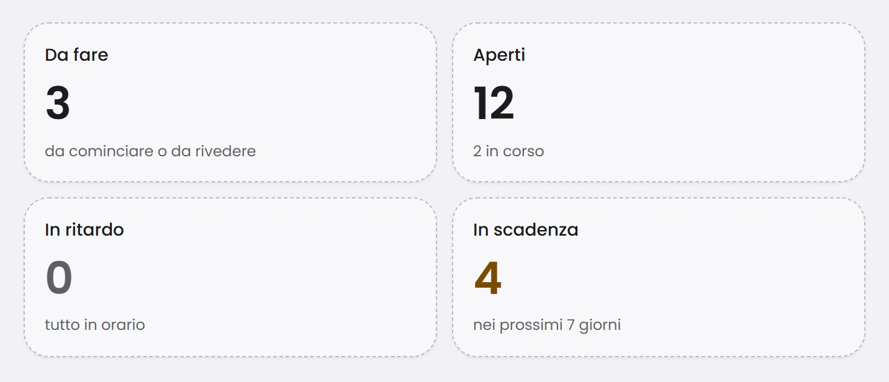
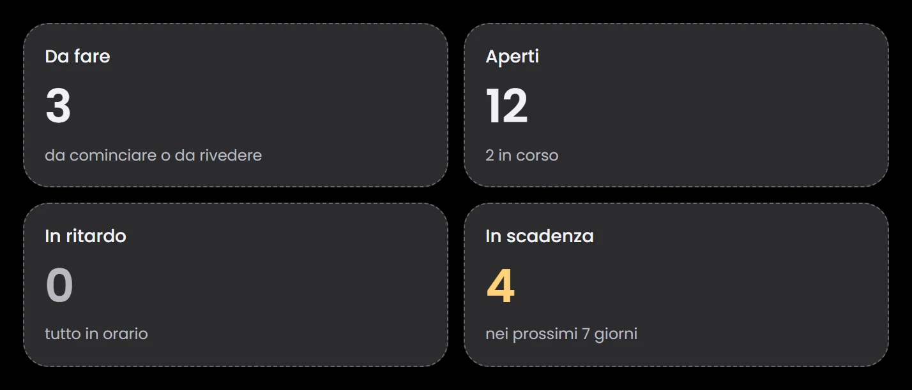

# Metriche

[Indice dei componenti](../README.md) · [Guida](../guida.md) · [README](../../README.md)

Numeri chiave in griglia adattiva: valore grande a cifre tabulari ed etichetta attenuata, su un elenco di definizioni nativo.

**Pagina interattiva:** [metric](https://davideprioreschi.github.io/dpi-framework/site/components/metric.html)

## Aspetto

**Metriche**


**Variante a riquadri**



### Tema scuro



## Esempi

Il markup va in una pagina che include gli asset DPI (vedi [Installazione](../guida.md#installazione)).

### Metriche con toni

```html
<dl class="dpi-metrics">
  <div class="dpi-metric"><dt class="dpi-metric__label">Aperti</dt><dd class="dpi-metric__value">12</dd></div>
  <div class="dpi-metric dpi-metric--success"><dt class="dpi-metric__label">Fatti</dt><dd class="dpi-metric__value">26</dd></div>
</dl>
```

## Classi, attributi ed eventi

- `dpi-metrics` (griglia), `dpi-metric`, `dpi-metric__label`, `dpi-metric__value`, `dpi-metric__note`.
- `dpi-metrics--sm`, `dpi-metrics--cards` (riquadri), `dpi-metric--link` (riquadro cliccabile), `dpi-metric--zero`.
- Larghezza minima di colonna: `--dpi-metric-min`.
