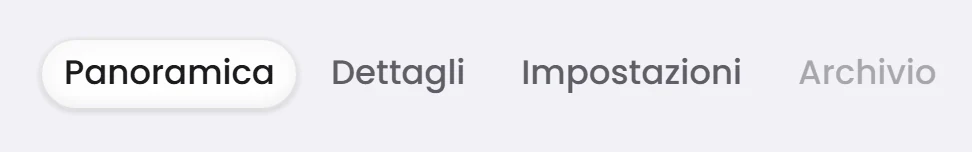
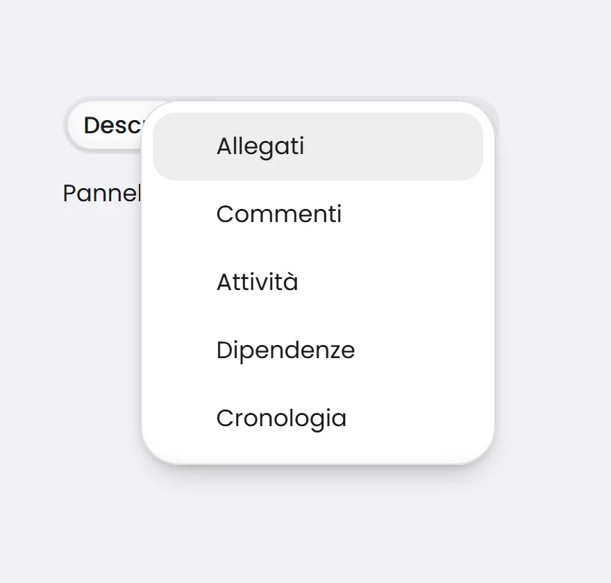

# Navigazione e voci «Altro»

[Indice dei componenti](../README.md) · [Guida](../guida.md) · [README](../../README.md)

Gruppi di link con voce corrente (sottolineati, pillole, verticali) e scrollspy facoltativo. Con `data-dpi-overflow` le voci di nav o linguette che non entrano passano in un menu «Altro». `nav_item` è la singola voce.

**Pagina interattiva:** [nav](https://davideprioreschi.github.io/dpi-framework/site/components/nav.html) · [nav_item](https://davideprioreschi.github.io/dpi-framework/site/components/nav_item.html) · [overflow](https://davideprioreschi.github.io/dpi-framework/site/components/overflow.html)

## Aspetto

**Nav sottolineato**



**Menu «Altro» aperto**



## Esempi

Il markup va in una pagina che include gli asset DPI (vedi [Installazione](../guida.md#installazione)).

### Sottolineato

```html
<nav class="dpi-nav dpi-nav--underline" aria-label="Sezioni" data-dpi-nav>
  <ul class="dpi-nav__list">
    <li class="dpi-nav__item">
      <a class="dpi-nav__link" href="#a" aria-current="page"><span>Panoramica</span></a>
    </li>
    <li class="dpi-nav__item">
      <a class="dpi-nav__link" href="#b"><span>Dettagli</span></a>
    </li>
    <li class="dpi-nav__item">
      <a class="dpi-nav__link" href="#c"><span>Impostazioni</span></a>
    </li>
    <li class="dpi-nav__item">
      <span class="dpi-nav__link" aria-disabled="true"><span>Archivio</span></span>
    </li>
  </ul>
</nav>
```

### Pillole con scorrimento

```html
<nav class="dpi-nav dpi-nav--pills dpi-nav--scroll" aria-label="Categorie" data-dpi-nav>
  <ul class="dpi-nav__list">
    <li class="dpi-nav__item">
      <a class="dpi-nav__link" href="#1" aria-current="page"><span>Tutti</span></a>
    </li>
    <li class="dpi-nav__item">
      <a class="dpi-nav__link" href="#2"><span>Chitarre</span></a>
    </li>
    <li class="dpi-nav__item">
      <a class="dpi-nav__link" href="#3"><span>Tastiere</span></a>
    </li>
    <li class="dpi-nav__item">
      <a class="dpi-nav__link" href="#4"><span>Percussioni</span></a>
    </li>
    <li class="dpi-nav__item">
      <a class="dpi-nav__link" href="#5"><span>Fiati</span></a>
    </li>
    <li class="dpi-nav__item">
      <a class="dpi-nav__link" href="#6"><span>Archi</span></a>
    </li>
    <li class="dpi-nav__item">
      <a class="dpi-nav__link" href="#7"><span>Accessori</span></a>
    </li>
    <li class="dpi-nav__item">
      <a class="dpi-nav__link" href="#8"><span>Amplificatori</span></a>
    </li>
  </ul>
</nav>
```

### Linguette con «Altro»

```html
<div class="dpi-tabs dpi-tabs--underline" data-dpi-tabs data-dpi-overflow>
  <div class="dpi-tabs__list" role="tablist" aria-label="Sezioni del task">
    <button class="dpi-tabs__tab" type="button" role="tab" id="ov-t0" aria-controls="ov-p0" aria-selected="true" tabindex="0" data-value="descrizione"><span>Descrizione</span></button>
    <button class="dpi-tabs__tab" type="button" role="tab" id="ov-t1" aria-controls="ov-p1" aria-selected="false" tabindex="-1" data-value="sotto-task"><span>Sotto-task</span></button>
    <button class="dpi-tabs__tab" type="button" role="tab" id="ov-t2" aria-controls="ov-p2" aria-selected="false" tabindex="-1" data-value="allegati"><span>Allegati</span></button>
    <button class="dpi-tabs__tab" type="button" role="tab" id="ov-t3" aria-controls="ov-p3" aria-selected="false" tabindex="-1" data-value="commenti"><span>Commenti</span></button>
    <button class="dpi-tabs__tab" type="button" role="tab" id="ov-t4" aria-controls="ov-p4" aria-selected="false" tabindex="-1" data-value="attività"><span>Attività</span></button>
    <button class="dpi-tabs__tab" type="button" role="tab" id="ov-t5" aria-controls="ov-p5" aria-selected="false" tabindex="-1" data-value="dipendenze"><span>Dipendenze</span></button>
    <button class="dpi-tabs__tab" type="button" role="tab" id="ov-t6" aria-controls="ov-p6" aria-selected="false" tabindex="-1" data-value="cronologia"><span>Cronologia</span></button>
  </div>
  <div class="dpi-tabs__panel" role="tabpanel" id="ov-p0" aria-labelledby="ov-t0" tabindex="0"><p class="dpi-text">Pannello «Descrizione».</p></div>
  <div class="dpi-tabs__panel" role="tabpanel" id="ov-p1" aria-labelledby="ov-t1" tabindex="0" data-dpi-inactive><p class="dpi-text">Pannello «Sotto-task».</p></div>
  <div class="dpi-tabs__panel" role="tabpanel" id="ov-p2" aria-labelledby="ov-t2" tabindex="0" data-dpi-inactive><p class="dpi-text">Pannello «Allegati».</p></div>
  <div class="dpi-tabs__panel" role="tabpanel" id="ov-p3" aria-labelledby="ov-t3" tabindex="0" data-dpi-inactive><p class="dpi-text">Pannello «Commenti».</p></div>
  <div class="dpi-tabs__panel" role="tabpanel" id="ov-p4" aria-labelledby="ov-t4" tabindex="0" data-dpi-inactive><p class="dpi-text">Pannello «Attività».</p></div>
  <div class="dpi-tabs__panel" role="tabpanel" id="ov-p5" aria-labelledby="ov-t5" tabindex="0" data-dpi-inactive><p class="dpi-text">Pannello «Dipendenze».</p></div>
  <div class="dpi-tabs__panel" role="tabpanel" id="ov-p6" aria-labelledby="ov-t6" tabindex="0" data-dpi-inactive><p class="dpi-text">Pannello «Cronologia».</p></div>
</div>
```

### Navigazione con «Altro»

```html
<nav class="dpi-nav dpi-nav--pills" aria-label="Sezioni" data-dpi-nav data-dpi-overflow>
  <ul class="dpi-nav__list">
    <li class="dpi-nav__item"><a class="dpi-nav__link" href="#ov-nav-0"><span>Descrizione</span></a></li>
    <li class="dpi-nav__item"><a class="dpi-nav__link" href="#ov-nav-1"><span>Sotto-task</span></a></li>
    <li class="dpi-nav__item"><a class="dpi-nav__link" href="#ov-nav-2" aria-current="page"><span>Allegati</span></a></li>
    <li class="dpi-nav__item"><a class="dpi-nav__link" href="#ov-nav-3"><span>Commenti</span></a></li>
    <li class="dpi-nav__item"><a class="dpi-nav__link" href="#ov-nav-4"><span>Attività</span></a></li>
    <li class="dpi-nav__item"><a class="dpi-nav__link" href="#ov-nav-5"><span>Dipendenze</span></a></li>
    <li class="dpi-nav__item"><a class="dpi-nav__link" href="#ov-nav-6"><span>Cronologia</span></a></li>
  </ul>
</nav>
```

## Classi, attributi ed eventi

- `data-dpi-nav`, `data-dpi-overflow`, `data-dpi-overflow-label`.
- Evento `dpi:overflow` (`{ visible, total, hidden }`).

<details>
<summary>Tutte le classi e gli attributi usati negli esempi del sito</summary>

**Classi:** `dpi-nav`, `dpi-nav--pills`, `dpi-nav--scroll`, `dpi-nav--underline`, `dpi-nav__item`, `dpi-nav__link`, `dpi-nav__list`

**Attributi:** `data-dpi-icon`, `data-dpi-nav`

</details>

## Limiti

- Lo scrollspy osserva lo scorrimento della finestra, non di contenitori interni.
- `data-dpi-overflow` è solo orizzontale e non va combinato con `dpi-nav--scroll`.
