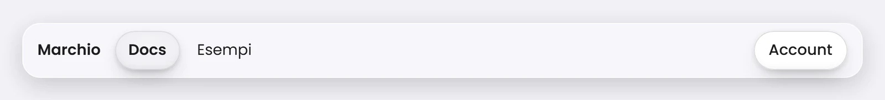
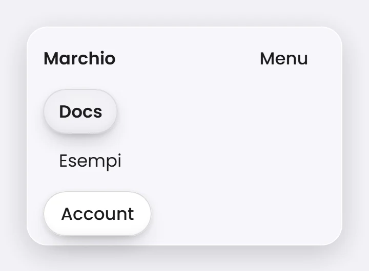

# Barra superiore

[Indice dei componenti](../README.md) · [Guida](../guida.md) · [README](../../README.md)

Barra superiore facoltativa con marchio, link e altri controlli; sotto i 768px si comprime in un menu.

**Pagina interattiva:** [navbar](https://davideprioreschi.github.io/dpi-framework/site/components/navbar.html)

## Aspetto

**Su schermo largo**



**Su telefono, menu aperto**



## Esempi

Il markup va in una pagina che include gli asset DPI (vedi [Installazione](../guida.md#installazione)).

### Barra di navigazione

```html
<header class="dpi-navbar dpi-glass" data-dpi-navbar data-dpi-glass="bar">
  <div class="dpi-navbar__inner dpi-container">
    <a class="dpi-navbar__brand" href="#">Marchio</a>
    <button class="dpi-btn dpi-btn--plain dpi-navbar__toggle" type="button" data-dpi-navbar-toggle aria-controls="dpi-1-menu" aria-expanded="false">
      <span class="dpi-btn__content">Menu</span>
    </button>
    <div class="dpi-navbar__collapse" id="dpi-1-menu" data-dpi-navbar-collapse>
      <nav aria-label="Principale">
        <ul class="dpi-navbar__list">
          <li>
            <a class="dpi-navbar__link" href="#docs" aria-current="page">Docs</a>
          </li>
          <li>
            <a class="dpi-navbar__link" href="#esempi">Esempi</a>
          </li>
        </ul>
      </nav>
      <div class="dpi-navbar__end">
        <div class="dpi-dropdown" data-dpi-dropdown="actions">
          <button class="dpi-btn" type="button" data-dpi-dropdown-trigger>
            Account
          </button>
          <div class="dpi-menu dpi-glass" id="dpi-2" data-dpi-dropdown-panel data-dpi-glass="menu" data-dpi-drop="menu">
            <ul class="dpi-menu__list">
              <li>
                <a class="dpi-menu__item" href="#profilo"><span class="dpi-menu__label">Profilo</span></a>
              </li>
              <li>
                <a class="dpi-menu__item" href="#esci"><span class="dpi-menu__label">Esci</span></a>
              </li>
            </ul>
          </div>
        </div>
      </div>
    </div>
  </div>
</header>
```

## Classi, attributi ed eventi

`data-dpi-navbar`, `data-dpi-navbar-toggle`, `data-dpi-navbar-collapse`; `dpi-navbar--sticky`. Escape chiude il menu mobile.

<details>
<summary>Tutte le classi e gli attributi usati negli esempi del sito</summary>

**Classi:** `dpi-btn`, `dpi-btn--plain`, `dpi-btn__content`, `dpi-container`, `dpi-dropdown`, `dpi-glass`, `dpi-menu`, `dpi-menu__item`, `dpi-menu__label`, `dpi-menu__list`, `dpi-navbar`, `dpi-navbar__brand`, `dpi-navbar__collapse`, `dpi-navbar__end`, `dpi-navbar__inner`, `dpi-navbar__link`, `dpi-navbar__list`, `dpi-navbar__toggle`

**Attributi:** `data-dpi-drop`, `data-dpi-dropdown`, `data-dpi-dropdown-panel`, `data-dpi-dropdown-trigger`, `data-dpi-glass`, `data-dpi-navbar`, `data-dpi-navbar-collapse`, `data-dpi-navbar-toggle`

</details>
