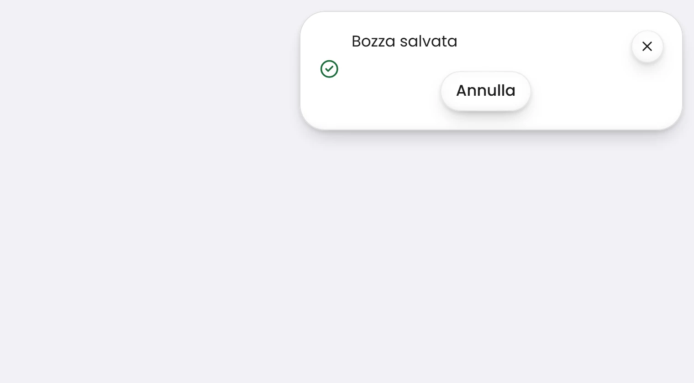
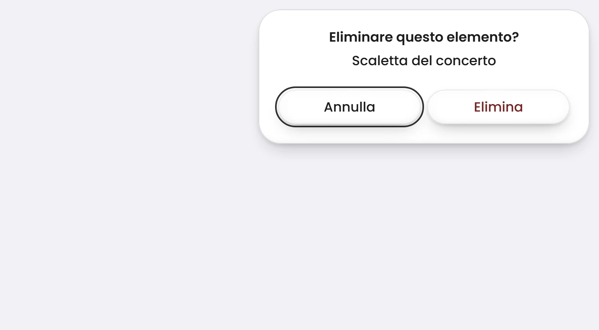
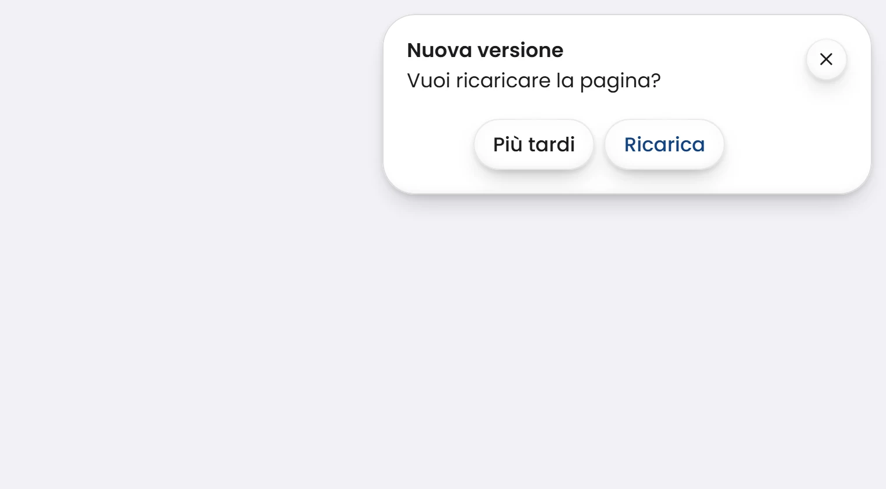
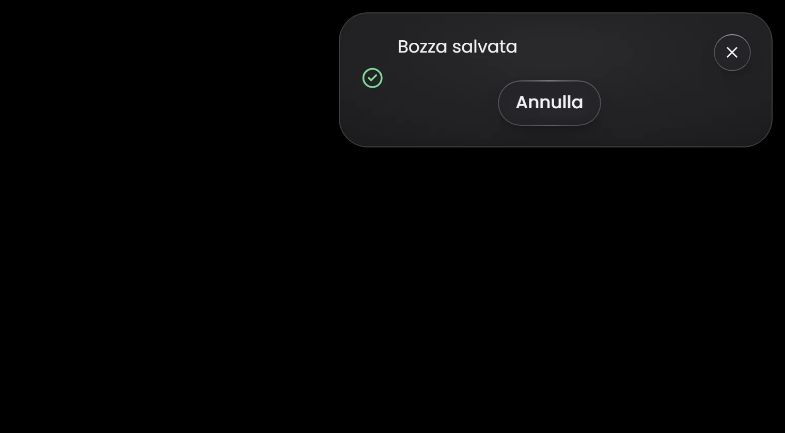
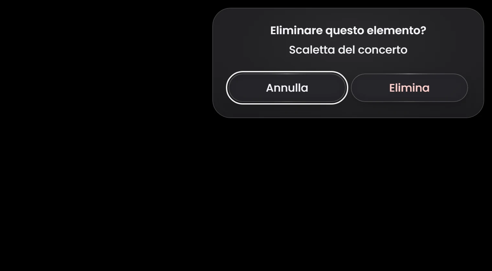

# Notifiche, conferme e toast

[Indice dei componenti](../README.md) · [Guida](../guida.md) · [README](../../README.md)

Toast, avvisi globali, popup informativi e conferme, da attributi HTML o da JavaScript. Le notifiche si accodano e compaiono una alla volta; con una bottom bar nascono dalla barra, altrimenti entrano da destra. `toast` e `toast_region` coprono anche il caso dei messaggi scritti direttamente nell'HTML.

**Pagina interattiva:** [notifiche](https://davideprioreschi.github.io/dpi-framework/site/components/notifiche.html) · [toast](https://davideprioreschi.github.io/dpi-framework/site/components/toast.html) · [toast_region](https://davideprioreschi.github.io/dpi-framework/site/components/toast_region.html)

## Aspetto

**Toast con azione**



**Conferma**



**Popup con azioni**



### Tema scuro





## Esempi

Il markup va in una pagina che include gli asset DPI (vedi [Installazione](../guida.md#installazione)).

### Attivazione da HTML

```html
<!-- toast e alert: l'attributo contiene il messaggio -->
<button class="dpi-btn" data-dpi-toast="Bozza salvata" data-dpi-tone="success">Salva</button>
<button class="dpi-btn" data-dpi-alert="Sincronizzazione sospesa" data-dpi-title="Attenzione" data-dpi-tone="warning">Avviso</button>

<!-- conferma: intercetta il clic PRIMA di dpi:action e dell'azione nativa; senza conferma l'azione non parte -->
<button class="dpi-btn dpi-btn--danger" type="button"
        data-dpi-action="task-delete" value="t1"
        data-dpi-confirm=""
        data-dpi-confirm-title="Eliminare questo task?"
        data-dpi-confirm-detail="Scrivere la scaletta"
        data-dpi-confirm-label="Elimina"
        data-dpi-confirm-tone="danger">Elimina</button>
```

### API JavaScript

```js
DPI.toast.show({ message: 'Bozza salvata', tone: 'success', duration: 5000 });   // compatibile con la vecchia firma
DPI.toast.show({ message: 'Task eliminato', action: { label: 'Annulla', onClick: () => ripristina() } });

await DPI.alert({ title: 'Attenzione', message: 'Sincronizzazione sospesa', tone: 'warning' });   // risolta alla chiusura

const scelta = await DPI.popup({
  title: 'Nuova versione', message: 'Vuoi ricaricare la pagina?',
  actions: [{ label: 'Più tardi', value: 'later' }, { label: 'Ricarica', value: 'reload', variant: 'primary' }],
});   // 'later' | 'reload' | 'dismiss'

if (await DPI.confirm({ title: 'Eliminare questo task?', detail: task.title, confirmLabel: 'Elimina', tone: 'danger' })) {
  eliminaUnaVolta(task);   // Promise<boolean>: true solo con l'azione esplicita
}

DPI.notify.configure({ origin: '#barra-principale' });   // barra di origine predefinita
```

### Area notifiche nella pagina

```html
<div class="dpi-toast-region dpi-toast-region--bottom" role="region" aria-label="Notifiche" aria-live="polite" data-dpi-toasts>
  <template data-dpi-toast-template>
    <div class="dpi-toast" role="status">
      <span class="dpi-toast__message">Messaggio</span>
      <button class="dpi-btn dpi-btn--plain dpi-btn--sm dpi-btn--icon-only" title="Chiudi notifica" type="button">
        <span class="dpi-btn__content"><span data-dpi-icon="x" data-dpi-icon-size="sm"></span><span class="dpi-visually-hidden">Chiudi notifica</span></span>
      </button>
    </div>
  </template>
  <div class="dpi-toast dpi-toast--success" role="status">
    <span class="dpi-toast__message">Preferenze salvate</span>
    <button class="dpi-btn dpi-btn--plain dpi-btn--sm dpi-btn--icon-only" title="Chiudi notifica" type="button">
      <span class="dpi-btn__content"><span data-dpi-icon="x" data-dpi-icon-size="sm"></span><span class="dpi-visually-hidden">Chiudi notifica</span></span>
    </button>
  </div>
</div>
```

## Classi, attributi ed eventi

- Attributi: `data-dpi-toast`, `data-dpi-alert`, `data-dpi-confirm` (con `-title`, `-detail`, `-label`, `-tone`), `data-dpi-tone`, `data-dpi-duration`, `data-dpi-cancel-label`.
- `DPI.toast.show()`, `DPI.alert()`, `DPI.popup()`, `DPI.confirm()` (Promise `true` solo con l'azione esplicita).
- Toni: `neutral`, `info`, `success`, `warning`, `danger`. `duration: 0` = resta fino alla chiusura.
- I testi sono inseriti come testo, mai come HTML.
- Token: `--dpi-notify-bg`, `-fg`, `-border`, `-shadow`.

<details>
<summary>Tutte le classi e gli attributi usati negli esempi del sito</summary>

**Classi:** `dpi-btn`, `dpi-btn--icon-only`, `dpi-btn--plain`, `dpi-btn--sm`, `dpi-btn__content`, `dpi-toast`, `dpi-toast--info`, `dpi-toast--success`, `dpi-toast-region`, `dpi-toast-region--bottom`, `dpi-toast__message`, `dpi-visually-hidden`

**Attributi:** `data-dpi-icon`, `data-dpi-icon-size`, `data-dpi-toast-template`, `data-dpi-toasts`

</details>

## Limiti

- La notifica dalla barra è sperimentale e si può disattivare.
