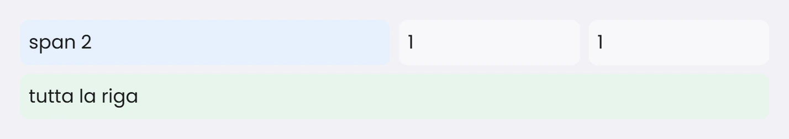

# Pagina e contenitori

[Indice dei componenti](../README.md) · [Guida](../guida.md) · [README](../../README.md)

La struttura di base di una pagina: documento completo con gli asset DPI, contenitore centrato a larghezza massima, raggruppamenti senza markup aggiuntivo e il contenitore `box`, che applica spazi, colori, bordi, flex e griglia tramite classi di utilità `dpi-u-*`.

**Pagina interattiva:** [page](https://davideprioreschi.github.io/dpi-framework/site/components/page.html) · [container](https://davideprioreschi.github.io/dpi-framework/site/components/container.html) · [fragment](https://davideprioreschi.github.io/dpi-framework/site/components/fragment.html) · [box](https://davideprioreschi.github.io/dpi-framework/site/components/box.html)

## Aspetto

**Box: spazi, sfondo e raggio**


**Griglia con le utilità**



## Esempi

Il markup va in una pagina che include gli asset DPI (vedi [Installazione](../guida.md#installazione)).

### Documento HTML di una pagina

```html
<!doctype html>
<html lang="it">
<head>
  <meta charset="utf-8">
  <meta name="viewport" content="width=device-width, initial-scale=1, viewport-fit=cover">
  <title>Titolo della pagina</title>
  <link rel="stylesheet" href="/dpi/dpi.css">
  <link rel="stylesheet" href="/dpi/css/reset.css">   <!-- facoltativo: base tipografica (.dpi-root) -->
  <script src="/dpi/dpi.js" defer></script>
</head>
<body class="dpi-root">
  <a class="dpi-skip-link" href="#main">Vai al contenuto</a>
  <main id="main" class="dpi-container dpi-page dpi-stack" data-dpi-loading>
    <h1 class="dpi-heading dpi-heading--1">Titolo</h1>
    <p class="dpi-text">Contenuto della pagina.</p>
  </main>
</body>
</html>
```

### Larghezza del contenitore

```html
<div class="dpi-container dpi-container--narrow">
  <p class="dpi-text">
    Contenuto in un contenitore stretto, centrato.
  </p>
</div>
```

### Spazi, colore e raggio

```html
<div class="dpi-u-p-lg dpi-u-bg-accent dpi-u-r-lg dpi-u-sh-md">
  <p class="dpi-text">
    Un contenitore con spazio interno, sfondo, raggio e ombra.
  </p>
</div>
```

### Flex e allineamento

```html
<div class="dpi-u-p-md dpi-u-gap-md dpi-u-d-flex dpi-u-ai-center dpi-u-jc-between dpi-u-b-all dpi-u-r-md">
  <p class="dpi-text">
    Sinistra
  </p>
  <p class="dpi-text">
    Destra
  </p>
</div>
```

### Raggruppare senza markup

```html
<p class="dpi-text">
  Uno
</p>
<p class="dpi-text">
  Due
</p>
```

## Classi, attributi ed eventi

- `dpi-container`: contenitore centrato (larghezza massima `--dpi-container-max`).
- `dpi-page`: spaziatura di pagina; `dpi-skip-link`: collegamento «Vai al contenuto».
- `dpi-u-*`: utilità di layout e stile. L'elenco è nella [pagina Utilità](https://davideprioreschi.github.io/dpi-framework/site/utilities/box.html).

<details>
<summary>Tutte le classi e gli attributi usati negli esempi del sito</summary>

**Classi:** `dpi-container`, `dpi-container--narrow`, `dpi-heading`, `dpi-heading--3`, `dpi-link`, `dpi-text`, `dpi-u-ai-center`, `dpi-u-b-all`, `dpi-u-bg-accent`, `dpi-u-bg-muted`, `dpi-u-bg-success`, `dpi-u-cs-2`, `dpi-u-cs-full`, `dpi-u-d-flex`, `dpi-u-d-grid`, `dpi-u-focus-ring`, `dpi-u-gap-md`, `dpi-u-gap-sm`, `dpi-u-gc-4`, `dpi-u-hv-lift`, `dpi-u-jc-between`, `dpi-u-mw-sm`, `dpi-u-p-lg`, `dpi-u-p-md`, `dpi-u-p-sm`, `dpi-u-r-lg`, `dpi-u-r-md`, `dpi-u-r-sm`, `dpi-u-sh-md`, `dpi-u-stretched`, `dpi-u-tr-line`

</details>

## Limiti

- Le utilità usano insiemi finiti di valori (nessuno stile in linea, per restare compatibili con una CSP): non ci sono misure o colori arbitrari.
- Le regole `@container` vanno scritte dall'applicazione.
