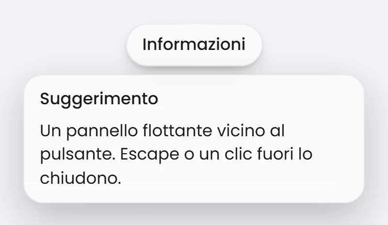
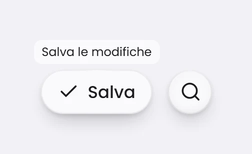

# Popover e tooltip

[Indice dei componenti](../README.md) · [Guida](../guida.md) · [README](../../README.md)

Il `popover` è un pannello flottante ancorato a un pulsante (Popover API); il `tooltip` è un suggerimento breve su hover e focus.

**Pagina interattiva:** [popover](https://davideprioreschi.github.io/dpi-framework/site/components/popover.html) · [tooltip](https://davideprioreschi.github.io/dpi-framework/site/components/tooltip.html)

## Aspetto

**Popover aperto**



**Tooltip**



## Esempi

Il markup va in una pagina che include gli asset DPI (vedi [Installazione](../guida.md#installazione)).

### Popover ancorato

```html
<span class="dpi-popover" data-dpi-popover="dpi-1" data-placement="bottom">
<button class="dpi-btn" popovertarget="dpi-1" aria-haspopup="dialog" type="button">
  Informazioni
</button>
<div class="dpi-popover__panel" id="dpi-1" popover="auto" role="dialog" aria-label="Suggerimento">
  <p class="dpi-popover__title">
    Suggerimento
  </p>
  <p class="dpi-text">
    Un pannello flottante vicino al pulsante. Escape o un clic fuori lo chiudono.
  </p>
</div>
</span>
```

### Suggerimento

```html
<div class="dpi-cluster dpi-cluster--lg">
  <span class="dpi-tooltip dpi-tooltip--top" data-dpi-tooltip="dpi-1-tip">
  <button class="dpi-btn" type="button">
    <span data-dpi-icon="check"></span>Salva
  </button>
  <span class="dpi-tooltip__bubble" role="tooltip" id="dpi-1-tip">Salva le modifiche</span></span><span class="dpi-tooltip dpi-tooltip--bottom" data-dpi-tooltip="dpi-2-tip">
  <button class="dpi-btn dpi-btn--icon-only" title="Cerca" type="button">
    <span data-dpi-icon="search"></span><span class="dpi-visually-hidden">Cerca</span>
  </button>
  <span class="dpi-tooltip__bubble" role="tooltip" id="dpi-2-tip">Cerca nel catalogo</span></span>
</div>
```

## Classi, attributi ed eventi

Popover: Escape e clic fuori chiudono; eventi `dpi:open`, `dpi:close`. Tooltip: collegato con `aria-describedby`, Escape lo nasconde.

<details>
<summary>Tutte le classi e gli attributi usati negli esempi del sito</summary>

**Classi:** `dpi-btn`, `dpi-btn--icon-only`, `dpi-cluster`, `dpi-cluster--lg`, `dpi-popover`, `dpi-popover__panel`, `dpi-popover__title`, `dpi-text`, `dpi-tooltip`, `dpi-tooltip--bottom`, `dpi-tooltip--top`, `dpi-tooltip__bubble`, `dpi-visually-hidden`

**Attributi:** `data-dpi-icon`, `data-dpi-popover`, `data-dpi-tooltip`

</details>

## Limiti

- Il tooltip non è adatto a contenuti essenziali e non si apre con pressione lunga su touch.
