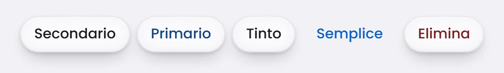
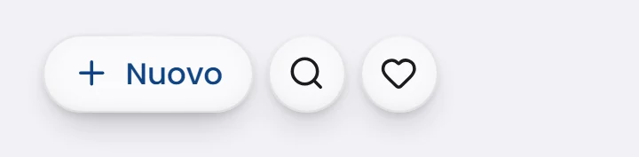
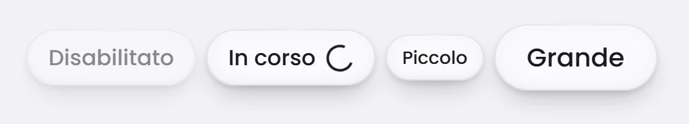
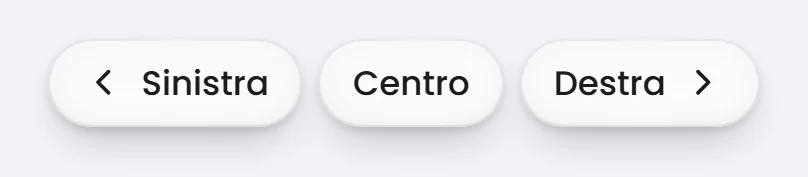

# Pulsanti

[Indice dei componenti](../README.md) · [Guida](../guida.md) · [README](../../README.md)

Il pulsante in vetro e le sue varianti, i gruppi affiancati, il pulsante di chiusura e `actions`, il gruppo di azioni in fondo a dialog, drawer, sheet, card, pannelli e form.

**Pagina interattiva:** [button](https://davideprioreschi.github.io/dpi-framework/site/components/button.html) · [button_group](https://davideprioreschi.github.io/dpi-framework/site/components/button_group.html) · [close_button](https://davideprioreschi.github.io/dpi-framework/site/components/close_button.html) · [actions](https://davideprioreschi.github.io/dpi-framework/site/components/actions.html)

## Aspetto

**Varianti**



**Con icona**



**Stati e dimensioni**



**Gruppo**



### Tema scuro


## Esempi

Il markup va in una pagina che include gli asset DPI (vedi [Installazione](../guida.md#installazione)).

### Varianti

```html
<div class="dpi-cluster">
  <button class="dpi-btn" type="button">
    Secondario
  </button>
  <button class="dpi-btn dpi-btn--primary" type="button">
    Primario
  </button>
  <button class="dpi-btn dpi-btn--tinted" type="button">
    Tinto
  </button>
  <button class="dpi-btn dpi-btn--plain" type="button">
    <span class="dpi-btn__content"><span class="dpi-btn__label">Semplice</span></span>
  </button>
  <button class="dpi-btn dpi-btn--danger" type="button">
    Elimina
  </button>
</div>
```

### Con icona e solo icona

```html
<div class="dpi-cluster">
  <button class="dpi-btn dpi-btn--primary" type="button">
    <span data-dpi-icon="plus"></span>Nuovo
  </button>
  <button class="dpi-btn dpi-btn--icon-only" title="Cerca" type="button">
    <span data-dpi-icon="search"></span><span class="dpi-visually-hidden">Cerca</span>
  </button>
  <button class="dpi-btn dpi-btn--tinted dpi-btn--icon-only" title="Preferiti" type="button">
    <span data-dpi-icon="heart"></span><span class="dpi-visually-hidden">Preferiti</span>
  </button>
</div>
```

### Stati e dimensioni

```html
<div class="dpi-cluster">
  <button class="dpi-btn" type="button" disabled>
    Disabilitato
  </button>
  <button class="dpi-btn" aria-busy="true" type="button">
    In corso
  </button>
  <button class="dpi-btn dpi-btn--sm" type="button">
    Piccolo
  </button>
  <button class="dpi-btn dpi-btn--lg" type="button">
    Grande
  </button>
</div>
```

### Gruppo di pulsanti

```html
<div class="dpi-btn-group" role="group" aria-label="Allineamento">
  <button class="dpi-btn" type="button">
    <span data-dpi-icon="chevron-left"></span>Sinistra
  </button>
  <button class="dpi-btn" type="button">
    Centro
  </button>
  <button class="dpi-btn" type="button">
    Destra<span data-dpi-icon="chevron-right"></span>
  </button>
</div>
```

### Pulsante di chiusura

```html
<button class="dpi-btn dpi-btn--plain dpi-btn--sm dpi-btn--icon-only" title="Chiudi" type="button">
  <span class="dpi-btn__content"><span data-dpi-icon="x" data-dpi-icon-size="sm"></span><span class="dpi-visually-hidden">Chiudi</span></span>
</button>
```

### Azioni in fondo a una scheda

```html
<section class="dpi-card" aria-labelledby="dpi-1-title">
  <div class="dpi-card__body dpi-stack">
    <h3 class="dpi-card__title" id="dpi-1-title">
      Conferma
    </h3>
    <p class="dpi-text">
      Vuoi procedere?
    </p>
    <div class="dpi-cluster dpi-cluster--end">
      <button class="dpi-btn" type="button">
        Annulla
      </button>
      <button class="dpi-btn dpi-btn--primary" type="button">
        Procedi
      </button>
    </div>
  </div>
</section>
```

## Classi, attributi ed eventi

- `dpi-btn` con `--primary`, `--tinted`, `--plain`, `--danger`, `--sm`, `--lg`, `--icon-only`.
- Stati: `disabled`, `aria-busy="true"`.
- Collegamenti dichiarativi: `data-dpi-dialog-open`, `data-dpi-dialog-close`, `data-dpi-action="nome"` (evento `dpi:action`).
- I pulsanti a sola icona sono elastici e devono avere un nome accessibile (`dpi-visually-hidden` o `aria-label`).

<details>
<summary>Tutte le classi e gli attributi usati negli esempi del sito</summary>

**Classi:** `dpi-btn`, `dpi-btn--danger`, `dpi-btn--icon-only`, `dpi-btn--lg`, `dpi-btn--plain`, `dpi-btn--primary`, `dpi-btn--sm`, `dpi-btn--tinted`, `dpi-btn-group`, `dpi-btn__content`, `dpi-btn__label`, `dpi-card`, `dpi-card__body`, `dpi-card__title`, `dpi-cluster`, `dpi-cluster--end`, `dpi-stack`, `dpi-text`, `dpi-visually-hidden`

**Attributi:** `data-dpi-icon`, `data-dpi-icon-size`

</details>

## Limiti

- `button_group` non gestisce selezioni esclusive: usa `segmented` o `chip_group`.
