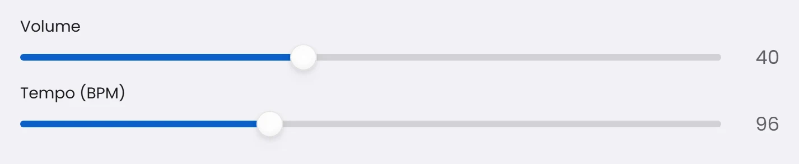

# Cursore

[Indice dei componenti](../README.md) · [Guida](../guida.md) · [README](../../README.md)

Cursore `input type=range` nativo con valore visibile e traccia riempita.

**Pagina interattiva:** [range](https://davideprioreschi.github.io/dpi-framework/site/components/range.html)

## Aspetto

**Cursore**



## Esempi

Il markup va in una pagina che include gli asset DPI (vedi [Installazione](../guida.md#installazione)).

### Cursore

```html
<div class="dpi-stack dpi-stack--sm">
  <div class="dpi-field">
    <label class="dpi-label" for="dpi-1">Volume</label><span class="dpi-range" data-dpi-range>
    <input class="dpi-range__input" type="range" id="dpi-1" name="vol" min="0" max="100" step="1" value="40">
    <output class="dpi-range__output" for="dpi-1">40</output></span>
  </div>
  <div class="dpi-field">
    <label class="dpi-label" for="dpi-2">Tempo (BPM)</label><span class="dpi-range" data-dpi-range>
    <input class="dpi-range__input" type="range" id="dpi-2" name="bpm" min="40" max="200" step="2" value="96">
    <output class="dpi-range__output" for="dpi-2">96</output></span>
  </div>
</div>
```

## Classi, attributi ed eventi

Frecce, Home/End, PagSu/PagGiù nativi; eventi `input` e `change`.

<details>
<summary>Tutte le classi e gli attributi usati negli esempi del sito</summary>

**Classi:** `dpi-field`, `dpi-label`, `dpi-range`, `dpi-range__input`, `dpi-range__output`, `dpi-stack`, `dpi-stack--sm`

**Attributi:** `data-dpi-range`

</details>

## Limiti

- Un solo cursore (non un intervallo).
