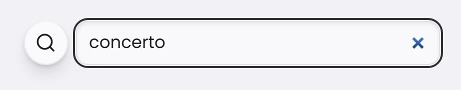

# Ricerca espandibile

[Indice dei componenti](../README.md) · [Guida](../guida.md) · [README](../../README.md)

Una lente a riposo che si apre in un campo di ricerca; Invio esegue il submit nativo. Nelle pagine con bottom bar la ricerca può vivere dentro la barra (vedi [Bottom bar](bottom-bar.md)).

**Pagina interattiva:** [searchbar](https://davideprioreschi.github.io/dpi-framework/site/components/searchbar.html)

## Aspetto

**Ricerca espansa**



## Esempi

Il markup va in una pagina che include gli asset DPI (vedi [Installazione](../guida.md#installazione)).

### Ricerca espandibile

```html
<form class="dpi-searchbar" role="search" data-dpi-searchbar aria-label="Cerca" onsubmit="return false">
  <button class="dpi-btn dpi-btn--icon-only dpi-searchbar__toggle" type="button" aria-expanded="false" title="Cerca" aria-label="Cerca"><span data-dpi-icon="search"></span></button>
  <input class="dpi-input dpi-searchbar__input" type="search" name="q" autocomplete="off" aria-label="Cerca nel sito" placeholder="Cerca…" tabindex="-1">
</form>
```

## Classi, attributi ed eventi

`data-dpi-searchbar`, `data-dpi-open` quando è aperta; API `DPI.searchbar.open(form)` / `close(form)`. Escape richiude; il clic fuori richiude solo se il campo è vuoto.
