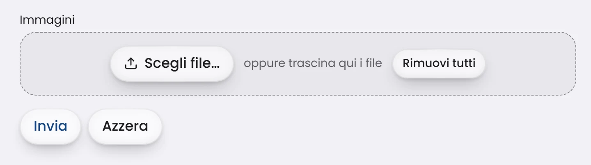

# Scelta file

[Indice dei componenti](../README.md) · [Guida](../guida.md) · [README](../../README.md)

Pulsante, elenco con dimensioni, rimozione e trascinamento sopra l'`input type=file` nativo, che conserva nome, `accept`, `multiple`, `required`, `FormData` e reset.

**Pagina interattiva:** [file](https://davideprioreschi.github.io/dpi-framework/site/components/file.html)

## Aspetto

**Area di trascinamento**



## Esempi

Il markup va in una pagina che include gli asset DPI (vedi [Installazione](../guida.md#installazione)).

### Singolo

```html
<div class="dpi-field">
  <label class="dpi-label" for="f-1">Documento</label>
  <div class="dpi-file" data-dpi-file><input class="dpi-file__input" id="f-1" type="file" name="documento" accept=".pdf,image/*"></div>
</div>
```

### Multiplo

```html
<div class="dpi-field">
  <label class="dpi-label" for="f-2">Allegati</label>
  <div class="dpi-file" data-dpi-file><input class="dpi-file__input" id="f-2" type="file" name="allegati" multiple></div>
</div>
```

### Area di trascinamento

```html
<form class="dpi-stack" onsubmit="return false">
  <div class="dpi-field">
    <label class="dpi-label" for="f-3">Immagini</label>
    <div class="dpi-file" data-dpi-file data-dpi-file-drop><input class="dpi-file__input" id="f-3" type="file" name="immagini" accept="image/*" multiple required></div>
  </div>
  <div class="dpi-cluster"><button class="dpi-btn dpi-btn--primary" type="submit">Invia</button><button class="dpi-btn" type="reset">Azzera</button></div>
</form>
```

### Cartella

```html
<div class="dpi-field">
  <label class="dpi-label" for="f-4">Cartella</label>
  <div class="dpi-file" data-dpi-file data-dpi-file-dir><input class="dpi-file__input" id="f-4" type="file" name="cartella"></div>
</div>
```

## Classi, attributi ed eventi

- Attributi: `data-dpi-file`, `data-dpi-file-drop`, `data-dpi-file-dir`, `data-dpi-file-label` / `-hint` / `-empty`.
- Evento `dpi:file-rejected` (`detail.files`) per i file trascinati non ammessi da `accept`.
- API: `DPI.file.sync(el)`.

## Limiti

- Il trascinamento di cartelle non è supportato.
