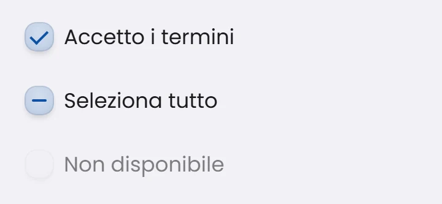
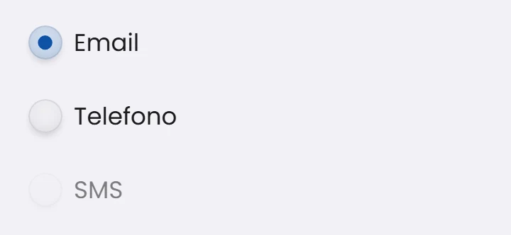
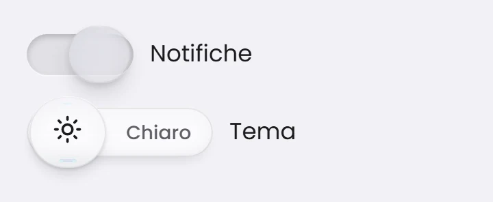
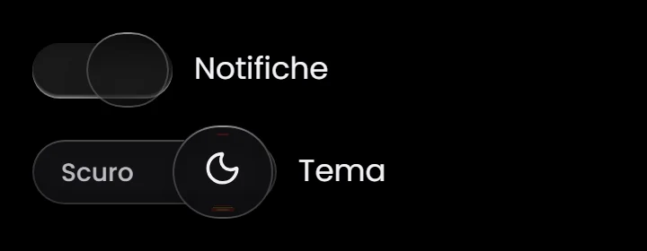

# Caselle, opzioni e interruttori

[Indice dei componenti](../README.md) · [Guida](../guida.md) · [README](../../README.md)

Casella di controllo e opzione native, e interruttore (`role=switch`) con lente di vetro trascinabile. L'interruttore con `data-dpi-theme-toggle` comanda il tema.

**Pagina interattiva:** [checkbox](https://davideprioreschi.github.io/dpi-framework/site/components/checkbox.html) · [radio](https://davideprioreschi.github.io/dpi-framework/site/components/radio.html) · [switch](https://davideprioreschi.github.io/dpi-framework/site/components/switch.html)

## Aspetto

**Caselle**



**Opzioni**



**Interruttori**



### Tema scuro



## Esempi

Il markup va in una pagina che include gli asset DPI (vedi [Installazione](../guida.md#installazione)).

### Casella, stato misto e disabilitata

```html
<div class="dpi-stack dpi-stack--sm">
  <label class="dpi-check">
  <input type="checkbox" name="t1" value="ok" checked>
  <span>Accetto i termini</span></label><label class="dpi-check">
  <input type="checkbox" name="t2" value="1" data-dpi-indeterminate>
  <span>Seleziona tutto</span></label><label class="dpi-check">
  <input type="checkbox" name="t3" value="1" disabled>
  <span>Non disponibile</span></label>
</div>
```

### Gruppo di opzioni

```html
<div class="dpi-stack dpi-stack--sm">
  <label class="dpi-check">
  <input type="radio" name="canale" value="email" checked>
  <span>Email</span></label><label class="dpi-check">
  <input type="radio" name="canale" value="tel">
  <span>Telefono</span></label><label class="dpi-check">
  <input type="radio" name="canale" value="sms" disabled>
  <span>SMS</span></label>
</div>
```

### Interruttore

```html
<div class="dpi-stack dpi-stack--sm">
  <label class="dpi-check dpi-check--switch"><span class="dpi-toggle" data-dpi-toggle data-dpi-glass="droplens">
  <input class="dpi-toggle__input" data-dpi-drop-skip type="checkbox" role="switch" name="notifiche" value="on">
  <span class="dpi-toggle__track" aria-hidden="true"></span><span class="dpi-toggle__knob" aria-hidden="true" data-dpi-drop-skip></span></span><span>Notifiche</span></label><label class="dpi-check dpi-check--switch"><span class="dpi-toggle dpi-toggle--text dpi-toggle--theme" data-dpi-toggle data-dpi-glass="droplens">
  <input class="dpi-toggle__input" data-dpi-drop-skip type="checkbox" role="switch" name="tema" value="on" data-dpi-theme-toggle>
  <span class="dpi-toggle__track" aria-hidden="true"><span class="dpi-toggle__txt dpi-toggle__txt--off">Chiaro</span><span class="dpi-toggle__txt dpi-toggle__txt--on">Scuro</span></span><span class="dpi-toggle__knob" aria-hidden="true" data-dpi-drop-skip><span class="dpi-toggle__ico dpi-toggle__ico--off"><span data-dpi-icon="sun"></span></span><span class="dpi-toggle__ico dpi-toggle__ico--on"><span data-dpi-icon="moon"></span></span></span></span><span>Tema</span></label>
</div>
```

## Classi, attributi ed eventi

Spazio per attivare, evento nativo `change`. Lo stato misto (`indeterminate`) si imposta da JavaScript.

<details>
<summary>Tutte le classi e gli attributi usati negli esempi del sito</summary>

**Classi:** `dpi-check`, `dpi-check--switch`, `dpi-stack`, `dpi-stack--sm`, `dpi-toggle`, `dpi-toggle--text`, `dpi-toggle--theme`, `dpi-toggle__ico`, `dpi-toggle__ico--off`, `dpi-toggle__ico--on`, `dpi-toggle__input`, `dpi-toggle__knob`, `dpi-toggle__track`, `dpi-toggle__txt`, `dpi-toggle__txt--off`, `dpi-toggle__txt--on`

**Attributi:** `data-dpi-drop-skip`, `data-dpi-glass`, `data-dpi-icon`, `data-dpi-indeterminate`, `data-dpi-theme-toggle`, `data-dpi-toggle`

</details>
