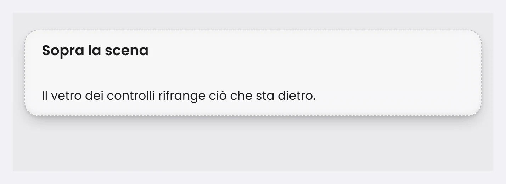

# Scena di fondo

[Indice dei componenti](../README.md) · [Guida](../guida.md) · [README](../../README.md)

Un fondale dichiarato su cui valutare il materiale: con immagine, il vetro può rifrangerne i pixel (solo Chromium); neutro, per valutare forma e riflessi.

**Pagina interattiva:** [scene](https://davideprioreschi.github.io/dpi-framework/site/components/scene.html)

## Aspetto

**Scena di fondo**



## Esempi

Il markup va in una pagina che include gli asset DPI (vedi [Installazione](../guida.md#installazione)).

### Scena di fondo

```html
<div class="dpi-scene dpi-scene--neutral dpi-scene--sm" data-dpi-backdrop="">
  <div class="dpi-scene__content dpi-stack dpi-stack--lg">
    <section class="dpi-card" aria-labelledby="dpi-1-title">
      <div class="dpi-card__body dpi-stack">
        <h3 class="dpi-card__title" id="dpi-1-title">
          Sopra la scena
        </h3>
        <p class="dpi-text">
          Il vetro dei controlli rifrange ciò che sta dietro.
        </p>
      </div>
    </section>
  </div>
</div>
```

<details>
<summary>Tutte le classi e gli attributi usati negli esempi del sito</summary>

**Classi:** `dpi-card`, `dpi-card__body`, `dpi-card__title`, `dpi-scene`, `dpi-scene--neutral`, `dpi-scene--sm`, `dpi-scene__content`, `dpi-stack`, `dpi-stack--lg`, `dpi-text`

**Attributi:** `data-dpi-backdrop`

</details>
