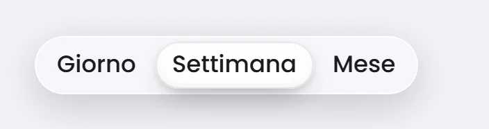

# Controllo segmentato

[Indice dei componenti](../README.md) · [Guida](../guida.md) · [README](../../README.md)

Scelta di una sola fra poche alternative sempre visibili (vista, filtro, tema). Sono radio nativi con un indicatore che scorre. `segment` è la singola opzione.

**Pagina interattiva:** [segmented](https://davideprioreschi.github.io/dpi-framework/site/components/segmented.html) · [segment](https://davideprioreschi.github.io/dpi-framework/site/components/segment.html)

## Aspetto

**Controllo segmentato**



### Tema scuro


## Esempi

Il markup va in una pagina che include gli asset DPI (vedi [Installazione](../guida.md#installazione)).

### Controllo segmentato

```html
<fieldset class="dpi-segmented dpi-glass dpi-glass--pill" data-dpi-glass="button">
  <legend class="dpi-visually-hidden">
    Periodo
  </legend>
  <label class="dpi-segmented__item">
  <input class="dpi-segmented__input" type="radio" name="periodo" value="day">
  <span class="dpi-segmented__label">Giorno</span></label><label class="dpi-segmented__item">
  <input class="dpi-segmented__input" type="radio" name="periodo" value="week" checked>
  <span class="dpi-segmented__label">Settimana</span></label><label class="dpi-segmented__item">
  <input class="dpi-segmented__input" type="radio" name="periodo" value="month">
  <span class="dpi-segmented__label">Mese</span></label>
</fieldset>
```

## Classi, attributi ed eventi

Frecce (radio nativi), evento `change`. Con `data-dpi-theme-pref` sui radio (`auto`, `light`, `dark`) diventa il selettore del tema.

<details>
<summary>Tutte le classi e gli attributi usati negli esempi del sito</summary>

**Classi:** `dpi-glass`, `dpi-glass--pill`, `dpi-segmented`, `dpi-segmented__input`, `dpi-segmented__item`, `dpi-segmented__label`, `dpi-visually-hidden`

**Attributi:** `data-dpi-glass`, `data-dpi-icon`

</details>

## Limiti

- L'indicatore non rifrange e non è trascinabile.
