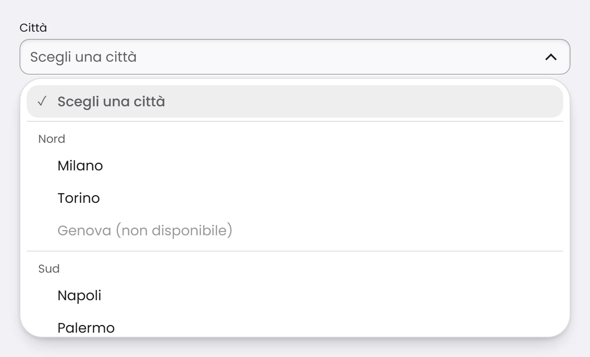
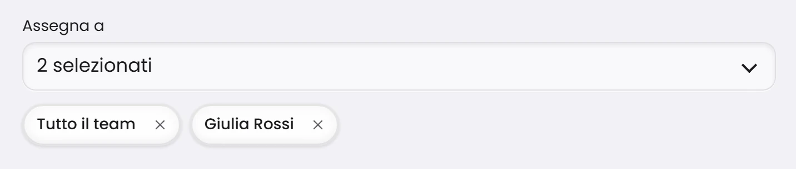

# Menu a tendina (select)

[Indice dei componenti](../README.md) · [Guida](../guida.md) · [README](../../README.md)

La `<select>` nativa con stile DPI; con `data-dpi-select` diventa un elenco proprio (listbox ARIA) che resta collegato al campo nativo: nome, valore, validazione, reset e `FormData` invariati. `option` è la singola opzione.

**Pagina interattiva:** [select](https://davideprioreschi.github.io/dpi-framework/site/components/select.html) · [option](https://davideprioreschi.github.io/dpi-framework/site/components/option.html)

## Aspetto

**Elenco aperto**



**Selezione multipla con chip**



## Esempi

Il markup va in una pagina che include gli asset DPI (vedi [Installazione](../guida.md#installazione)).

### Selezione

```html
<div class="dpi-field">
  <label class="dpi-label" for="dpi-1">Stato</label><select class="dpi-select" id="dpi-1" name="stato"><option value="">—</option><option value="attivo">Attivo</option><option value="sospeso" selected>Sospeso</option><option value="cessato">Cessato</option></select>
</div>
```

### Singola con gruppi e voce disabilitata

```html
<div class="dpi-field">
  <label class="dpi-label" for="s-citta">Città</label>
  <select class="dpi-select" id="s-citta" name="citta" data-dpi-select data-dpi-select-placeholder="Scegli una città">
    <option value="">Scegli una città</option>
    <optgroup label="Nord"><option value="mi">Milano</option><option value="to">Torino</option><option value="ge" disabled>Genova (non disponibile)</option></optgroup>
    <optgroup label="Sud"><option value="na">Napoli</option><option value="pa">Palermo</option></optgroup>
  </select>
</div>
```

### Multipla

```html
<div class="dpi-field">
  <label class="dpi-label" for="s-tag">Etichette</label>
  <select class="dpi-select" id="s-tag" name="tag" multiple data-dpi-select data-dpi-select-placeholder="Nessuna etichetta">
    <option value="a">Amministrazione</option><option value="b" selected>Bozza</option><option value="c">Contratto</option><option value="d">Documento</option>
  </select>
</div>
```

### Multipla con chip rimovibili

```html
<div class="dpi-field">
  <label class="dpi-label" for="s-assegna">Assegna a</label>
  <select class="dpi-select" id="s-assegna" name="assegna" multiple data-dpi-select data-dpi-select-chips
          data-dpi-select-placeholder="Nessuno" data-dpi-select-chips-label="Assegnatari" data-dpi-select-remove-label="Rimuovi {nome} dagli assegnatari"
          data-dpi-select-done="Fatto" data-dpi-select-clear="Nessuno">
    <optgroup label="Gruppi"><option value="@team" selected>Tutto il team</option></optgroup>
    <optgroup label="Team"><option value="1">Luca Verdi</option><option value="2" selected>Giulia Rossi</option><option value="3">Marco Bianchi</option></optgroup>
  </select>
</div>
```

## Classi, attributi ed eventi

- Attributi: `data-dpi-select`, `-placeholder`, `-chips`, `-chips-label`, `-remove-label`, `-done`, `-clear`, `-summary="count|list"`.
- Eventi: `change` nativo, `dpi:select-open`, `dpi:select-close` (`detail.changed`).
- API: `DPI.select.sync(el)`, `DPI.select.isOpen(el)`.
- Tastiera: frecce, Home/End, PagSu/PagGiù, ricerca per iniziale, Invio/Spazio, Escape.

<details>
<summary>Tutte le classi e gli attributi usati negli esempi del sito</summary>

**Classi:** `dpi-field`, `dpi-label`, `dpi-select`

</details>
