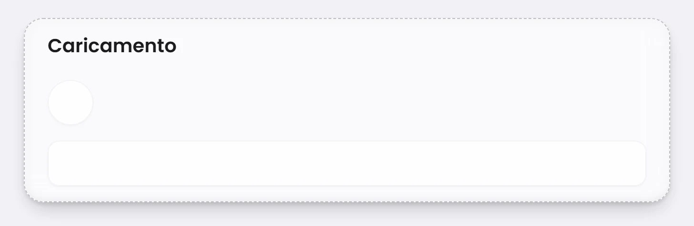

# Skeleton (segnaposto di caricamento)

[Indice dei componenti](../README.md) · [Guida](../guida.md) · [README](../../README.md)

Segnaposto decorativo di un contenuto in arrivo. Per il caricamento automatico dell'intera area DPI si usa `data-dpi-loading` (vedi la [guida](../guida.md#caricamento-e-skeleton)).

**Pagina interattiva:** [skeleton](https://davideprioreschi.github.io/dpi-framework/site/components/skeleton.html)

## Aspetto

**Segnaposto**



## Esempi

Il markup va in una pagina che include gli asset DPI (vedi [Installazione](../guida.md#installazione)).

### Segnaposto

```html
<section class="dpi-card" aria-labelledby="dpi-1-title">
  <div class="dpi-card__body dpi-stack">
    <h3 class="dpi-card__title" id="dpi-1-title">
      Caricamento
    </h3>
    <div class="dpi-cluster dpi-cluster--md">
      <span class="dpi-skeleton" aria-hidden="true"><span class="dpi-skeleton__bar dpi-skeleton__bar--circle dpi-skeleton__bar--w-full dpi-skeleton__bar--h-md"></span></span>
      <div class="dpi-stack dpi-stack--sm">
        <span class="dpi-skeleton" aria-hidden="true"><span class="dpi-skeleton__bar dpi-skeleton__bar--text dpi-skeleton__bar--w-full dpi-skeleton__bar--h-md"></span><span class="dpi-skeleton__bar dpi-skeleton__bar--text dpi-skeleton__bar--w-md dpi-skeleton__bar--h-md"></span></span>
      </div>
    </div>
    <span class="dpi-skeleton" aria-hidden="true"><span class="dpi-skeleton__bar dpi-skeleton__bar--rect dpi-skeleton__bar--w-full dpi-skeleton__bar--h-sm"></span></span>
  </div>
</section>
```

## Classi, attributi ed eventi

Segnala l'attesa con `aria-busy` sul contenitore.

<details>
<summary>Tutte le classi e gli attributi usati negli esempi del sito</summary>

**Classi:** `dpi-card`, `dpi-card__body`, `dpi-card__title`, `dpi-cluster`, `dpi-cluster--md`, `dpi-skeleton`, `dpi-skeleton__bar`, `dpi-skeleton__bar--circle`, `dpi-skeleton__bar--h-md`, `dpi-skeleton__bar--h-sm`, `dpi-skeleton__bar--rect`, `dpi-skeleton__bar--text`, `dpi-skeleton__bar--w-full`, `dpi-skeleton__bar--w-md`, `dpi-stack`, `dpi-stack--sm`

</details>
