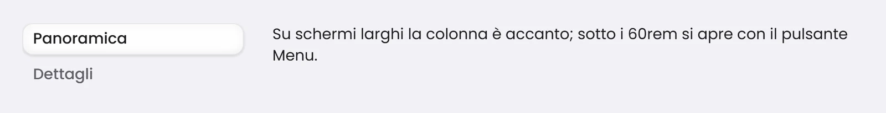
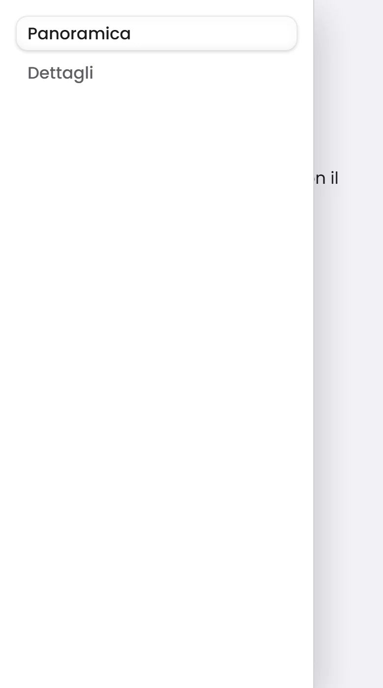

# Vista a due colonne

[Indice dei componenti](../README.md) · [Guida](../guida.md) · [README](../../README.md)

Colonna laterale più contenuto. Sotto i 60rem la colonna laterale diventa un pannello che si apre con un pulsante (Escape e focus gestiti). `sidebar` e `content` si usano solo dentro `split_view`.

**Pagina interattiva:** [split_view](https://davideprioreschi.github.io/dpi-framework/site/components/split_view.html) · [sidebar](https://davideprioreschi.github.io/dpi-framework/site/components/sidebar.html) · [content](https://davideprioreschi.github.io/dpi-framework/site/components/content.html)

## Aspetto

**Su schermo largo**



**Su telefono: colonna aperta a pannello**



## Esempi

Il markup va in una pagina che include gli asset DPI (vedi [Installazione](../guida.md#installazione)).

### Sidebar e contenuto

```html
<div class="dpi-split" data-dpi-split>
  <div class="dpi-split__bar">
    <button class="dpi-btn dpi-btn--sm" type="button">
      <span data-dpi-icon="menu" data-dpi-icon-size="sm"></span>Menu
    </button>
  </div>
  <aside class="dpi-split__side" id="dpi-1-side" aria-label="Navigazione di esempio">
    <nav class="dpi-nav dpi-nav--stack" aria-label="Sezioni" data-dpi-nav>
      <ul class="dpi-nav__list">
        <li class="dpi-nav__item">
          <a class="dpi-nav__link" href="#panoramica" aria-current="page"><span>Panoramica</span></a>
        </li>
        <li class="dpi-nav__item">
          <a class="dpi-nav__link" href="#dettagli"><span>Dettagli</span></a>
        </li>
      </ul>
    </nav>
  </aside>
  <div class="dpi-split__main">
    <p class="dpi-text">
      Su schermi larghi la colonna è accanto; sotto i 60rem si apre con il pulsante Menu.
    </p>
  </div>
</div>
```

## Classi, attributi ed eventi

Eventi: `dpi:open`, `dpi:close` (`component: split_view`). Un link nella colonna la chiude sugli schermi stretti.

<details>
<summary>Tutte le classi e gli attributi usati negli esempi del sito</summary>

**Classi:** `dpi-btn`, `dpi-btn--sm`, `dpi-nav`, `dpi-nav--stack`, `dpi-nav__item`, `dpi-nav__link`, `dpi-nav__list`, `dpi-split`, `dpi-split__bar`, `dpi-split__main`, `dpi-split__side`, `dpi-text`

**Attributi:** `data-dpi-icon`, `data-dpi-icon-size`, `data-dpi-nav`, `data-dpi-split`

</details>

## Limiti

- Un solo livello di sidebar.
