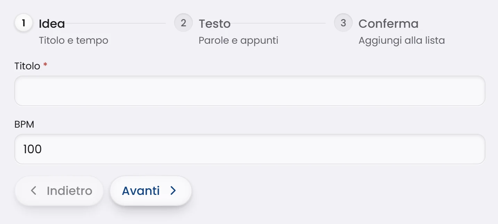
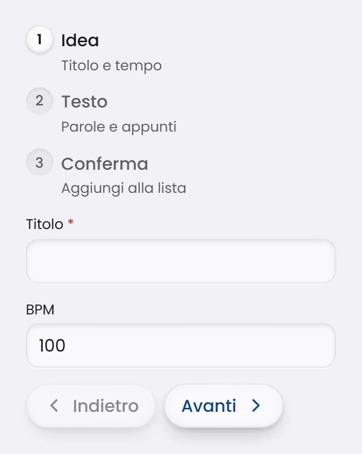
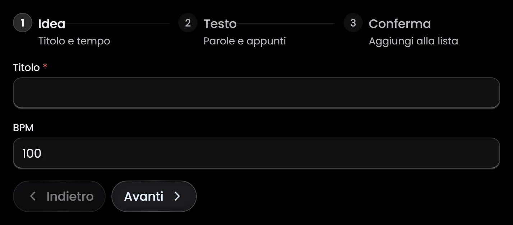

# Procedura a passi

[Indice dei componenti](../README.md) · [Guida](../guida.md) · [README](../../README.md)

Indicatore di avanzamento e, se i passi hanno contenuto, procedura guidata con Indietro, Avanti e Concludi. `step` è il singolo passo.

**Pagina interattiva:** [stepper](https://davideprioreschi.github.io/dpi-framework/site/components/stepper.html) · [step](https://davideprioreschi.github.io/dpi-framework/site/components/step.html)

## Aspetto

**Procedura a passi**



**Su telefono**



### Tema scuro



## Esempi

Il markup va in una pagina che include gli asset DPI (vedi [Installazione](../guida.md#installazione)).

### Procedura con validazione

<details>
<summary>Mostra il codice</summary>

```html
<div class="dpi-stepper dpi-stepper--horizontal" data-dpi-stepper data-dpi-current="1" data-dpi-nav="linear" data-dpi-validate="true" id="dpi-1">
  <ol class="dpi-stepper__list" aria-label="Nuova bozza">
    <li class="dpi-stepper__step dpi-stepper__step--current" data-state="current" aria-current="step">
      <button type="button" class="dpi-stepper__trigger" id="dpi-1-t1" aria-controls="dpi-1-p1">
        <span class="dpi-stepper__marker" aria-hidden="true"><span class="dpi-stepper__num">1</span><span class="dpi-stepper__check"><span data-dpi-icon="check" data-dpi-icon-size="sm"></span></span></span><span class="dpi-stepper__text"><span class="dpi-stepper__label">Idea</span><span class="dpi-stepper__desc">Titolo e tempo</span><span class="dpi-visually-hidden" data-dpi-step-status> (passo corrente)</span></span>
      </button>
    </li>
    <li class="dpi-stepper__step dpi-stepper__step--todo" data-state="todo">
      <button type="button" class="dpi-stepper__trigger" id="dpi-1-t2" aria-controls="dpi-1-p2">
        <span class="dpi-stepper__marker" aria-hidden="true"><span class="dpi-stepper__num">2</span><span class="dpi-stepper__check"><span data-dpi-icon="check" data-dpi-icon-size="sm"></span></span></span><span class="dpi-stepper__text"><span class="dpi-stepper__label">Testo</span><span class="dpi-stepper__desc">Parole e appunti</span><span class="dpi-visually-hidden" data-dpi-step-status> (da fare)</span></span>
      </button>
    </li>
    <li class="dpi-stepper__step dpi-stepper__step--todo" data-state="todo">
      <button type="button" class="dpi-stepper__trigger" id="dpi-1-t3" aria-controls="dpi-1-p3" disabled>
        <span class="dpi-stepper__marker" aria-hidden="true"><span class="dpi-stepper__num">3</span><span class="dpi-stepper__check"><span data-dpi-icon="check" data-dpi-icon-size="sm"></span></span></span><span class="dpi-stepper__text"><span class="dpi-stepper__label">Conferma</span><span class="dpi-stepper__desc">Aggiungi alla lista</span><span class="dpi-visually-hidden" data-dpi-step-status> (da fare)</span></span>
      </button>
    </li>
  </ol>
  <div class="dpi-stepper__panels">
    <div class="dpi-stepper__panel" id="dpi-1-p1" role="group" aria-labelledby="dpi-1-t1" tabindex="-1">
      <div class="dpi-stack">
        <div class="dpi-field">
          <label class="dpi-label" for="dpi-2">Titolo <span class="dpi-required" aria-hidden="true">*</span></label>
          <input class="dpi-input" id="dpi-2" name="titolo" type="text" required>
        </div>
        <div class="dpi-field">
          <label class="dpi-label" for="dpi-3">BPM</label>
          <input class="dpi-input" id="dpi-3" name="bpm" type="number" value="100" min="30" max="260">
        </div>
      </div>
    </div>
    <div class="dpi-stepper__panel" id="dpi-1-p2" role="group" aria-labelledby="dpi-1-t2" tabindex="-1" data-dpi-inactive>
      <div class="dpi-field">
        <label class="dpi-label" for="dpi-4">Primi versi</label><textarea class="dpi-textarea" id="dpi-4" name="versi" rows="4"></textarea>
      </div>
    </div>
    <div class="dpi-stepper__panel" id="dpi-1-p3" role="group" aria-labelledby="dpi-1-t3" tabindex="-1" data-dpi-inactive>
      <p class="dpi-text dpi-text--muted">
        Controlla i dati e concludi.
      </p>
    </div>
  </div>
  <div class="dpi-stepper__controls">
    <span data-dpi-step-act="prev">
    <button class="dpi-btn" type="button" disabled>
      <span data-dpi-icon="chevron-left"></span>Indietro
    </button>
    </span><span data-dpi-step-act="next">
    <button class="dpi-btn dpi-btn--primary" type="button">
      Avanti<span data-dpi-icon="chevron-right"></span>
    </button>
    </span><span data-dpi-step-act="finish" hidden>
    <button class="dpi-btn dpi-btn--primary" type="button">
      <span data-dpi-icon="check"></span>Crea bozza
    </button>
    </span>
  </div>
</div>
```

</details>

### Passi liberi e passo disabilitato

```html
<div class="dpi-stepper dpi-stepper--horizontal" data-dpi-stepper data-dpi-current="1" data-dpi-nav="free" id="dpi-1">
  <ol class="dpi-stepper__list" aria-label="Passi liberi">
    <li class="dpi-stepper__step dpi-stepper__step--current" data-state="current" aria-current="step">
      <button type="button" class="dpi-stepper__trigger" id="dpi-1-t1" aria-controls="dpi-1-p1">
        <span class="dpi-stepper__marker" aria-hidden="true"><span class="dpi-stepper__num">1</span><span class="dpi-stepper__check"><span data-dpi-icon="check" data-dpi-icon-size="sm"></span></span></span><span class="dpi-stepper__text"><span class="dpi-stepper__label">Uno</span><span class="dpi-visually-hidden" data-dpi-step-status> (passo corrente)</span></span>
      </button>
    </li>
    <li class="dpi-stepper__step dpi-stepper__step--todo" data-state="todo">
      <button type="button" class="dpi-stepper__trigger" id="dpi-1-t2" aria-controls="dpi-1-p2">
        <span class="dpi-stepper__marker" aria-hidden="true"><span class="dpi-stepper__num">2</span><span class="dpi-stepper__check"><span data-dpi-icon="check" data-dpi-icon-size="sm"></span></span></span><span class="dpi-stepper__text"><span class="dpi-stepper__label">Due</span><span class="dpi-visually-hidden" data-dpi-step-status> (da fare)</span></span>
      </button>
    </li>
    <li class="dpi-stepper__step dpi-stepper__step--disabled" data-state="disabled">
      <button type="button" class="dpi-stepper__trigger" id="dpi-1-t3" aria-controls="dpi-1-p3" disabled>
        <span class="dpi-stepper__marker" aria-hidden="true"><span class="dpi-stepper__num">3</span><span class="dpi-stepper__check"><span data-dpi-icon="check" data-dpi-icon-size="sm"></span></span></span><span class="dpi-stepper__text"><span class="dpi-stepper__label">Tre</span><span class="dpi-visually-hidden" data-dpi-step-status> (non disponibile)</span></span>
      </button>
    </li>
    <li class="dpi-stepper__step dpi-stepper__step--todo" data-state="todo">
      <button type="button" class="dpi-stepper__trigger" id="dpi-1-t4" aria-controls="dpi-1-p4">
        <span class="dpi-stepper__marker" aria-hidden="true"><span class="dpi-stepper__num">4</span><span class="dpi-stepper__check"><span data-dpi-icon="check" data-dpi-icon-size="sm"></span></span></span><span class="dpi-stepper__text"><span class="dpi-stepper__label">Quattro</span><span class="dpi-visually-hidden" data-dpi-step-status> (da fare)</span></span>
      </button>
    </li>
  </ol>
  <div class="dpi-stepper__panels">
    <div class="dpi-stepper__panel" id="dpi-1-p1" role="group" aria-labelledby="dpi-1-t1" tabindex="-1">
      <p class="dpi-text">
        Primo pannello: con nav=free si può saltare a qualunque passo dall&apos;indicatore.
      </p>
    </div>
    <div class="dpi-stepper__panel" id="dpi-1-p2" role="group" aria-labelledby="dpi-1-t2" tabindex="-1" data-dpi-inactive>
      <p class="dpi-text">
        Secondo pannello.
      </p>
    </div>
    <div class="dpi-stepper__panel" id="dpi-1-p3" role="group" aria-labelledby="dpi-1-t3" tabindex="-1" data-dpi-inactive>
      <p class="dpi-text">
        Non raggiungibile.
      </p>
    </div>
    <div class="dpi-stepper__panel" id="dpi-1-p4" role="group" aria-labelledby="dpi-1-t4" tabindex="-1" data-dpi-inactive>
      <p class="dpi-text">
        Quarto pannello.
      </p>
    </div>
  </div>
</div>
```

### Solo indicatore

```html
<div class="dpi-stepper dpi-stepper--horizontal" data-dpi-stepper data-dpi-current="2" data-dpi-nav="none" id="dpi-1">
  <ol class="dpi-stepper__list" aria-label="Registrazione">
    <li class="dpi-stepper__step dpi-stepper__step--done" data-state="done">
      <span class="dpi-stepper__marker" aria-hidden="true"><span class="dpi-stepper__num">1</span><span class="dpi-stepper__check"><span data-dpi-icon="check" data-dpi-icon-size="sm"></span></span></span><span class="dpi-stepper__text"><span class="dpi-stepper__label">Account</span><span class="dpi-stepper__desc">Dati di accesso</span><span class="dpi-visually-hidden" data-dpi-step-status> (completato)</span></span>
    </li>
    <li class="dpi-stepper__step dpi-stepper__step--current" data-state="current" aria-current="step">
      <span class="dpi-stepper__marker" aria-hidden="true"><span class="dpi-stepper__num">2</span><span class="dpi-stepper__check"><span data-dpi-icon="check" data-dpi-icon-size="sm"></span></span></span><span class="dpi-stepper__text"><span class="dpi-stepper__label">Profilo</span><span class="dpi-stepper__desc">Come ti chiami</span><span class="dpi-visually-hidden" data-dpi-step-status> (passo corrente)</span></span>
    </li>
    <li class="dpi-stepper__step dpi-stepper__step--todo" data-state="todo">
      <span class="dpi-stepper__marker" aria-hidden="true"><span class="dpi-stepper__num">3</span><span class="dpi-stepper__check"><span data-dpi-icon="check" data-dpi-icon-size="sm"></span></span></span><span class="dpi-stepper__text"><span class="dpi-stepper__label">Conferma</span><span class="dpi-stepper__desc">Controlla e invia</span><span class="dpi-visually-hidden" data-dpi-step-status> (da fare)</span></span>
    </li>
  </ol>
  <div class="dpi-stepper__controls">
    <span data-dpi-step-act="prev">
    <button class="dpi-btn" type="button">
      <span data-dpi-icon="chevron-left"></span>Indietro
    </button>
    </span><span data-dpi-step-act="next">
    <button class="dpi-btn dpi-btn--primary" type="button">
      Avanti<span data-dpi-icon="chevron-right"></span>
    </button>
    </span><span data-dpi-step-act="finish" hidden>
    <button class="dpi-btn dpi-btn--primary" type="button">
      <span data-dpi-icon="check"></span>Concludi
    </button>
    </span>
  </div>
</div>
```

## Classi, attributi ed eventi

Eventi `dpi:step`, `dpi:step-invalid`, `dpi:step-finish`.

<details>
<summary>Tutte le classi e gli attributi usati negli esempi del sito</summary>

**Classi:** `dpi-btn`, `dpi-btn--primary`, `dpi-field`, `dpi-input`, `dpi-label`, `dpi-required`, `dpi-stack`, `dpi-stepper`, `dpi-stepper--horizontal`, `dpi-stepper__check`, `dpi-stepper__controls`, `dpi-stepper__desc`, `dpi-stepper__label`, `dpi-stepper__list`, `dpi-stepper__marker`, `dpi-stepper__num`, `dpi-stepper__panel`, `dpi-stepper__panels`, `dpi-stepper__step`, `dpi-stepper__step--current`, `dpi-stepper__step--disabled`, `dpi-stepper__step--done`, `dpi-stepper__step--todo`, `dpi-stepper__text`, `dpi-stepper__trigger`, `dpi-text`, `dpi-text--muted`, `dpi-textarea`, `dpi-visually-hidden`

**Attributi:** `data-dpi-current`, `data-dpi-icon`, `data-dpi-icon-size`, `data-dpi-inactive`, `data-dpi-nav`, `data-dpi-step-act`, `data-dpi-step-status`, `data-dpi-stepper`, `data-dpi-validate`

</details>

## Limiti

- La validazione dei dati resta all'applicazione.
