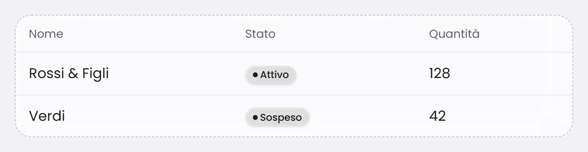
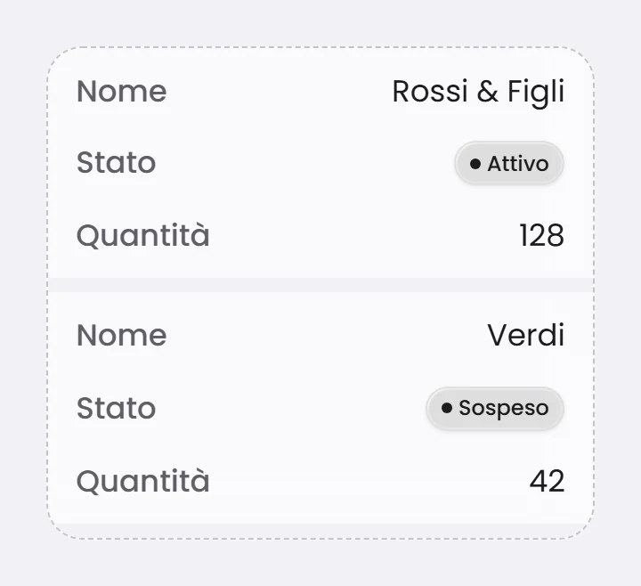
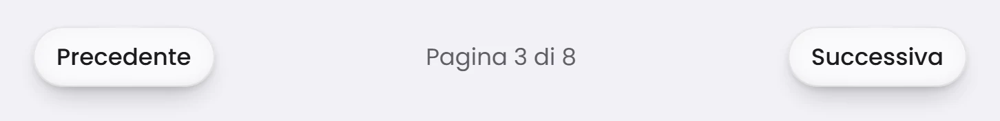
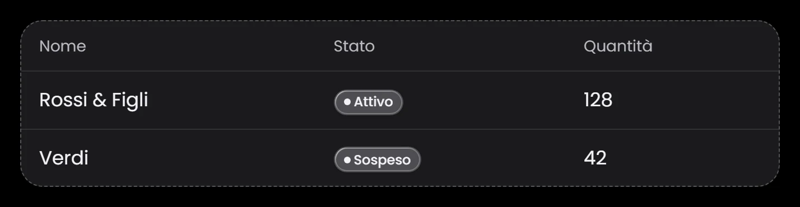

# Tabelle e paginazione

[Indice dei componenti](../README.md) · [Guida](../guida.md) · [README](../../README.md)

Tabella semantica che sotto i 640px trasforma ogni riga in una scheda con etichette (`data-label`), con paginazione a link reali che funziona senza JavaScript. `column` descrive una colonna della tabella.

**Pagina interattiva:** [table](https://davideprioreschi.github.io/dpi-framework/site/components/table.html) · [column](https://davideprioreschi.github.io/dpi-framework/site/components/column.html) · [pagination](https://davideprioreschi.github.io/dpi-framework/site/components/pagination.html)

## Aspetto

**Tabella**



**Su telefono ogni riga diventa una scheda**



**Paginazione**



### Tema scuro



## Esempi

Il markup va in una pagina che include gli asset DPI (vedi [Installazione](../guida.md#installazione)).

### Tabella con cornice tratteggiata

```html
<div class="dpi-table-wrap dpi-table-wrap--dashed">
  <table class="dpi-table dpi-table--stack">
    <caption class="dpi-visually-hidden">
      Elenco di esempio
    </caption>
    <thead>
      <tr>
        <th scope="col">
          Nome
        </th>
        <th scope="col">
          Stato
        </th>
        <th scope="col" class="dpi-table__num">
          Quantità
        </th>
      </tr>
    </thead>
    <tbody>
      <tr>
        <td data-label="Nome">
          Rossi &amp; Figli
        </td>
        <td data-label="Stato">
          <span class="dpi-badge">Attivo</span>
        </td>
        <td data-label="Quantità" class="dpi-table__num">
          128
        </td>
      </tr>
      <tr>
        <td data-label="Nome">
          Verdi
        </td>
        <td data-label="Stato">
          <span class="dpi-badge">Sospeso</span>
        </td>
        <td data-label="Quantità" class="dpi-table__num">
          42
        </td>
      </tr>
    </tbody>
  </table>
</div>
```

### Cornice continua e righe alternate

```html
<div class="dpi-table-wrap dpi-table-wrap--solid">
  <table class="dpi-table dpi-table--stack dpi-table--striped">
    <caption class="dpi-visually-hidden">
      Cornice continua
    </caption>
    <thead>
      <tr>
        <th scope="col">
          Nome
        </th>
        <th scope="col" class="dpi-table__num">
          Quantità
        </th>
      </tr>
    </thead>
    <tbody>
      <tr>
        <td data-label="Nome">
          Alfa
        </td>
        <td data-label="Quantità" class="dpi-table__num">
          1
        </td>
      </tr>
      <tr>
        <td data-label="Nome">
          Beta
        </td>
        <td data-label="Quantità" class="dpi-table__num">
          2
        </td>
      </tr>
      <tr>
        <td data-label="Nome">
          Gamma
        </td>
        <td data-label="Quantità" class="dpi-table__num">
          3
        </td>
      </tr>
    </tbody>
  </table>
</div>
```

### Paginazione

```html
<nav class="dpi-pagination" aria-label="Paginazione">
  <a class="dpi-btn" rel="prev" href="#?page=2">Precedente</a><span class="dpi-pagination__info" aria-current="page">Pagina 3 di 8</span><a class="dpi-btn" rel="next" href="#?page=4">Successiva</a>
</nav>
```

## Classi, attributi ed eventi

- `dpi-table-wrap--dashed` / `--solid`; `dpi-table--stack` (schede su schermi stretti), `dpi-table--striped`.
- `dpi-table__num`: colonne numeriche. Su ogni `<td>` va l'attributo `data-label`.

<details>
<summary>Tutte le classi e gli attributi usati negli esempi del sito</summary>

**Classi:** `dpi-badge`, `dpi-btn`, `dpi-pagination`, `dpi-pagination__info`, `dpi-table`, `dpi-table--stack`, `dpi-table--striped`, `dpi-table-wrap`, `dpi-table-wrap--dashed`, `dpi-table-wrap--solid`, `dpi-table__num`, `dpi-visually-hidden`

</details>

## Limiti

- Nessun ordinamento né selezione di righe incorporati.
