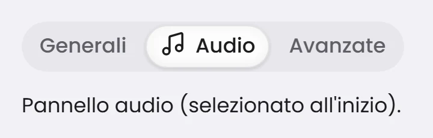
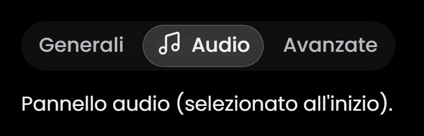

# Linguette

[Indice dei componenti](../README.md) · [Guida](../guida.md) · [README](../../README.md)

Pannelli alternativi nella stessa pagina. `tab` è la linguetta con il suo pannello. Senza JavaScript tutti i pannelli restano visibili.

**Pagina interattiva:** [tabs](https://davideprioreschi.github.io/dpi-framework/site/components/tabs.html) · [tab](https://davideprioreschi.github.io/dpi-framework/site/components/tab.html)

## Aspetto

**Linguette**



### Tema scuro



## Esempi

Il markup va in una pagina che include gli asset DPI (vedi [Installazione](../guida.md#installazione)).

### Linguette con pannelli

```html
<div class="dpi-tabs dpi-tabs--underline" data-dpi-tabs>
  <div class="dpi-tabs__list" role="tablist" aria-label="Impostazioni">
    <button class="dpi-tabs__tab" type="button" role="tab" id="dpi-1-t0" aria-controls="dpi-1-p0" aria-selected="false" tabindex="-1" data-value="gen">
      <span>Generali</span>
    </button>
    <button class="dpi-tabs__tab" type="button" role="tab" id="dpi-1-t1" aria-controls="dpi-1-p1" aria-selected="true" tabindex="0" data-value="audio">
      <span data-dpi-icon="music"></span><span>Audio</span>
    </button>
    <button class="dpi-tabs__tab" type="button" role="tab" id="dpi-1-t2" aria-controls="dpi-1-p2" aria-selected="false" tabindex="-1" data-value="adv">
      <span>Avanzate</span>
    </button>
  </div>
  <div class="dpi-tabs__panel" role="tabpanel" id="dpi-1-p0" aria-labelledby="dpi-1-t0" tabindex="0" data-dpi-inactive>
    <p class="dpi-text">
      Pannello generale.
    </p>
  </div>
  <div class="dpi-tabs__panel" role="tabpanel" id="dpi-1-p1" aria-labelledby="dpi-1-t1" tabindex="0">
    <p class="dpi-text">
      Pannello audio (selezionato all&apos;inizio).
    </p>
  </div>
  <div class="dpi-tabs__panel" role="tabpanel" id="dpi-1-p2" aria-labelledby="dpi-1-t2" tabindex="0" data-dpi-inactive>
    <p class="dpi-text">
      Pannello avanzato.
    </p>
  </div>
</div>
```

## Classi, attributi ed eventi

`data-dpi-tabs`; frecce, Home/End. Evento `dpi:tab` (`value`, `index`).

<details>
<summary>Tutte le classi e gli attributi usati negli esempi del sito</summary>

**Classi:** `dpi-tabs`, `dpi-tabs--underline`, `dpi-tabs__list`, `dpi-tabs__panel`, `dpi-tabs__tab`, `dpi-text`

**Attributi:** `data-dpi-icon`, `data-dpi-inactive`, `data-dpi-tabs`

</details>
