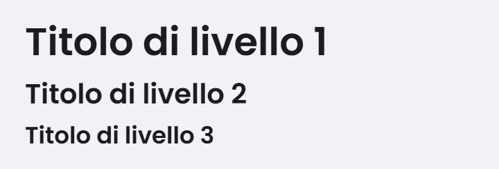
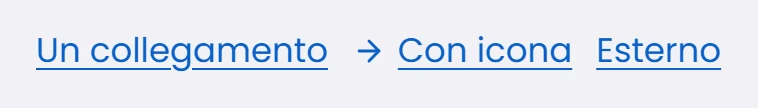
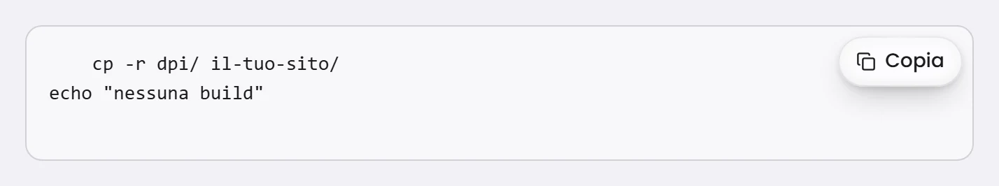

# Titoli, testo, link, icone e codice

[Indice dei componenti](../README.md) · [Guida](../guida.md) · [README](../../README.md)

Gli elementi di testo: titoli, paragrafi, collegamenti, blocchi di testo lungo, icone (Lucide, incluse nel pacchetto) e codice con pulsante Copia. La tipografia richiede `css/reset.css` e `class="dpi-root"` sul `<body>`.

**Pagina interattiva:** [heading](https://davideprioreschi.github.io/dpi-framework/site/components/heading.html) · [text](https://davideprioreschi.github.io/dpi-framework/site/components/text.html) · [link](https://davideprioreschi.github.io/dpi-framework/site/components/link.html) · [prose](https://davideprioreschi.github.io/dpi-framework/site/components/prose.html) · [icon](https://davideprioreschi.github.io/dpi-framework/site/components/icon.html) · [code](https://davideprioreschi.github.io/dpi-framework/site/components/code.html)

## Aspetto

**Titoli**



**Collegamenti**



**Blocco di codice**



## Esempi

Il markup va in una pagina che include gli asset DPI (vedi [Installazione](../guida.md#installazione)).

### Livelli dei titoli

```html
<div class="dpi-stack dpi-stack--sm">
  <h1 class="dpi-heading dpi-heading--1">
    Titolo di livello 1
  </h1>
  <h2 class="dpi-heading dpi-heading--2">
    Titolo di livello 2
  </h2>
  <h3 class="dpi-heading dpi-heading--3">
    Titolo di livello 3
  </h3>
</div>
```

### Tono e dimensione

```html
<div class="dpi-stack dpi-stack--sm">
  <p class="dpi-text">
    Testo normale
  </p>
  <p class="dpi-text dpi-text--muted">
    Testo attenuato
  </p>
  <p class="dpi-text dpi-text--sm">
    Testo piccolo
  </p>
</div>
```

### Collegamenti

```html
<div class="dpi-cluster dpi-cluster--md">
  <a class="dpi-link" href="#">Un collegamento</a><a class="dpi-link" href="#"><span data-dpi-icon="arrow-right" data-dpi-icon-size="sm"></span>Con icona</a><a class="dpi-link" href="https://example.com" target="_blank" rel="noopener noreferrer">Esterno</a>
</div>
```

### Testo lungo

```html
<div class="dpi-prose">
  <h2 class="dpi-heading dpi-heading--2">
    Un titolo
  </h2>
  <p class="dpi-text">
    Il contenitore prose dà alla colonna una misura di lettura di circa 68 caratteri e un ritmo regolare tra i blocchi.
  </p>
  <p class="dpi-text">
    Un secondo paragrafo, con la stessa spaziatura.
  </p>
</div>
```

### Icone del registro

```html
<div class="dpi-cluster dpi-cluster--md">
  <span data-dpi-icon="house"></span><span data-dpi-icon="bell" data-dpi-icon-label="Notifiche"></span><span data-dpi-icon="search" data-dpi-icon-size="lg"></span>
</div>
```

### Blocco di codice con Copia

```js
    cp -r dpi/ il-tuo-sito/
echo "nessuna build"
```

## Classi, attributi ed eventi

- Icone: `<span data-dpi-icon="nome"></span>`; con `data-dpi-icon-label` l'icona ha un nome accessibile, altrimenti è decorativa. Dimensioni con `data-dpi-icon-size`. [Elenco delle icone](https://davideprioreschi.github.io/dpi-framework/site/icons.html).
- `data-dpi-copy` collega il pulsante Copia al testo da copiare.
- Scala del testo: `--dpi-text-xs` … `--dpi-text-2xl`, interlinea `--dpi-leading`.

<details>
<summary>Tutte le classi e gli attributi usati negli esempi del sito</summary>

**Classi:** `dpi-btn`, `dpi-btn--sm`, `dpi-cluster`, `dpi-cluster--md`, `dpi-code`, `dpi-code__copy`, `dpi-code__pre`, `dpi-heading`, `dpi-heading--1`, `dpi-heading--2`, `dpi-heading--3`, `dpi-link`, `dpi-prose`, `dpi-stack`, `dpi-stack--sm`, `dpi-text`, `dpi-text--muted`, `dpi-text--sm`

**Attributi:** `data-dpi-copy`, `data-dpi-icon`, `data-dpi-icon-label`, `data-dpi-icon-size`

</details>
