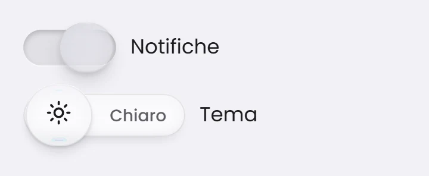

# Guida

[README](../README.md) · [Indice dei componenti](README.md) · [Guide interattive](https://davideprioreschi.github.io/dpi-framework/site/guide.html)

- [Installazione](#installazione)
- [Contratto pubblico](#contratto-pubblico)
- [Layout](#layout)
- [Tema](#tema)
- [Personalizzazione](#personalizzazione)
- [Materiale a vetro](#materiale-a-vetro)
- [JavaScript ed eventi](#javascript-ed-eventi)
- [Contenuto dinamico](#contenuto-dinamico)
- [Caricamento e skeleton](#caricamento-e-skeleton)
- [Componenti propri](#componenti-propri)
- [Accessibilità](#accessibilità)
- [Limiti](#limiti)

## Installazione

Copia la cartella `dpi/` nel tuo sito, oppure usa gli indirizzi pubblicati (vedi il [README](../README.md#avvio-rapido)).

```html
<script src="dpi/theme-init.js"></script>
<link rel="stylesheet" href="dpi/dpi.css">
<link rel="stylesheet" href="dpi/css/reset.css">
<script src="dpi/dpi.js" defer></script>
```

```html
<body class="dpi-root">
```

| File | A cosa serve | Obbligatorio |
| --- | --- | --- |
| `dpi.css` | Stili dei componenti (importa i fogli in `css/`) | Sì |
| `dpi.js` | Comportamenti, icone e motore ottico, in un unico script classico | Per le interazioni |
| `css/reset.css` | Base tipografica dentro `.dpi-root` | No, ma senza il testo resta con il font del browser |
| `theme-init.js` | Ripristina il tema salvato prima del primo disegno | No |

Se usi una Content Security Policy: gli script e gli stili sono file esterni e non servono codice o stili in linea scritti da te.

## Contratto pubblico

| Cosa | Forma | Esempio |
| --- | --- | --- |
| Classi | `dpi-` (BEM semplificato) | `dpi-btn`, `dpi-btn__content`, `dpi-btn--primary` |
| Comportamenti e collegamenti | `data-dpi-*` | `data-dpi-dialog-open="id"` |
| Variabili CSS | `--dpi-*` | `--dpi-accent` |
| Eventi | `dpi:*` | `dpi:open`, `dpi:action` |
| JavaScript | `window.DPI` | `DPI.init(elemento)` |

Non si usano gestori in linea (`onclick`): il framework ascolta eventi delegati. Pulsanti (`dpi-btn`) e schede (`dpi-card`) ricevono da soli il materiale; per gli altri componenti va copiato il markup completo mostrato nelle pagine.

Senza JavaScript restano utilizzabili link, form, `details/summary` e controlli nativi. Le sovrapposizioni (per esempio il dialog) richiedono JavaScript.

## Layout

- `dpi-container` centra il contenuto (larghezza massima `--dpi-container-max`, predefinita 64rem).
- `dpi-stack` e `dpi-cluster` per colonna e riga; `dpi-auto-grid` e `dpi-cols` per le griglie.
- Soglie usate: 40rem (griglie a colonne fisse, tabelle a schede, stepper verticale) e 60rem (colonna laterale di `split_view`).
- Utilità `dpi-u-*`: [pagina Utilità](https://davideprioreschi.github.io/dpi-framework/site/utilities/box.html).
- Livelli: `--dpi-z-sticky` 100, `--dpi-z-dropdown` 200, `--dpi-z-overlay` 300, `--dpi-z-modal` 400, `--dpi-z-toast` 500.
- Scrittura da destra a sinistra (`dir="rtl"`): supporto parziale, non verificato.

## Tema

La **preferenza** è l'attributo `data-dpi-theme` su `<html>` (`light`, `dark`; assente o `auto` = segue il sistema). Il **tema effettivo** è esposto in `data-dpi-theme-effective`.

- Un gruppo di radio con `data-dpi-theme-pref` (`auto`, `light`, `dark`) sceglie la preferenza.
- Un checkbox con `data-dpi-theme-toggle` riflette il tema effettivo.
- La scelta è salvata in `localStorage` (chiave `dpi-theme`); `theme-init.js` la ripristina prima del primo disegno.
- Da codice: `DPI.theme.apply('dark')`, `DPI.theme.preference()`, `DPI.theme.effective()`; evento `dpi:theme-change`.

| Chiaro | Scuro |
| --- | --- |
|  |  |

## Personalizzazione

Ogni valore visivo è una variabile `--dpi-*`, definita in [`dpi/css/tokens.css`](../dpi/css/tokens.css). Si ridefinisce sulla pagina o su un contenitore:

```css
.sezione-evidenza {
  --dpi-accent: #7a2bd1;
  --dpi-radius-md: 4px;
  --dpi-focus-width: 3px;
}
```

| Gruppo | Variabili principali |
| --- | --- |
| Colori | `--dpi-bg`, `--dpi-surface`, `--dpi-surface-2`, `--dpi-text`, `--dpi-text-muted`, `--dpi-line`, `--dpi-accent`, `--dpi-on-accent` |
| Stati | `--dpi-danger`, `--dpi-success`, `--dpi-warning`, `--dpi-info` e le varianti `-soft` |
| Tipografia | `--dpi-font`, `--dpi-font-mono`, `--dpi-text-xs` … `--dpi-text-2xl`, `--dpi-leading` |
| Spazi | `--dpi-space-1` … `--dpi-space-8`, `--dpi-gutter`, `--dpi-container-max` |
| Controlli | `--dpi-control-h`, `--dpi-control-h-sm`, `--dpi-control-h-lg`, `--dpi-control-border` |
| Forma | `--dpi-radius-sm`, `--dpi-radius-md`, `--dpi-radius-lg`, `--dpi-radius-pill`, `--dpi-shadow-sm/md/lg` |
| Focus e movimento | `--dpi-focus`, `--dpi-focus-width`, `--dpi-dur-fast`, `--dpi-dur`, `--dpi-ease` |
| Vetro | `--dpi-glass-tint`, `--dpi-glass-border`, `--dpi-glass-blur`, `--dpi-glass-shadow` |

I colori predefiniti usano `light-dark()`: per mantenere i due temi, ridefiniscili allo stesso modo, per esempio `light-dark(#7a2bd1, #c59bff)`. Controlla il contrasto dei colori che scegli.

Palette già pronte: `data-dpi-skin="violet"` oppure `data-dpi-skin="forest"` su pagina, scena o card.

## Materiale a vetro

- **Rifrazione reale**: solo Chromium, per le superfici che la prevedono.
- **Firefox e WebKit**: resa alternativa con sfocatura, velo e riflesso, senza deformazione dello sfondo.
- **Opaco**: con `prefers-reduced-transparency`, `forced-colors` o `data-dpi-surface="solid"` su `<html>`.
- Il materiale a rifrazione ha un costo di disegno: si può spegnere per componente con `data-dpi-glass="off"`.

## JavaScript ed eventi

`dpi.js` è uno script classico autonomo (nessun modulo, nessun import dinamico, nessun `eval` né `fetch`). Inizializza da solo i componenti presenti nella pagina.

```js
DPI.init(elemento);                    // inizializza un frammento
DPI.theme.apply('dark');               // auto | light | dark
DPI.toast.show({ message: 'Salvato', tone: 'success' });
DPI.icon('plus');                      // elemento SVG di un'icona
```

| Eventi | Quando |
| --- | --- |
| `dpi:action` | Azione dichiarata con `data-dpi-action` (`detail.name`, `detail.source`) |
| `dpi:open`, `dpi:close` | Dialog, sheet, menu, popover, azioni espandibili (`detail.component`) |
| `dpi:tab`, `dpi:step`, `dpi:step-invalid`, `dpi:step-finish`, `dpi:slide` | Linguette, passi, carosello |
| `dpi:calendar-select`, `dpi:calendar-navigate`, `dpi:combobox-select`, `dpi:otp-complete`, `dpi:chip-remove` | Controlli di selezione |
| `dpi:map-ready`, `dpi:map-marker`, `dpi:map-fallback` | Mappa |
| `dpi:theme-change` | Cambio di tema |
| `dpi:bar-select`, `dpi:bar-drag` | Bottom bar |

```js
document.addEventListener('dpi:action', (e) => {
  console.log(e.detail.name, e.detail.source);
});
```

## Contenuto dinamico

Dopo aver inserito markup nella pagina, chiama `DPI.init` sul contenitore. Chiamarlo più volte non duplica nulla.

```js
contenitore.innerHTML = html;
DPI.init(contenitore);
```

L'HTML inserito con `innerHTML` deve essere tuo o già sanificato.

## Caricamento e skeleton

Marca con `data-dpi-loading` il contenitore del contenuto, di solito `<main>`:

```html
<main class="dpi-container" data-dpi-loading>
  …contenuto…
</main>
```

- Il contenuto resta impaginato ma nascosto finché componenti, font e immagini iniziali visibili sono pronti.
- Lo skeleton resta almeno **1500 ms**, anche se la pagina è pronta prima; il limite di sicurezza è di 6 secondi.
- Solo il contenitore marcato è coinvolto.
- Sui link interni e sull'invio dei form, se la risposta tarda, compare uno skeleton di navigazione. `data-dpi-no-loading` su un link lo esclude.
- `data-dpi-loading="off"` disattiva.

```js
DPI.loading.configure({ minDuration: 0 });          // nessuna durata minima

// operazione iniziale da attendere durante il primo caricamento
document.addEventListener('dpi:loading-collect', (e) => e.detail.wait(fetch('/api/dati')));
```

`DPI.loading.fragment(elemento, promessa)` applica lo stesso comportamento a un caricamento parziale. Per segnaposto disegnati da te c'è il componente [skeleton](componenti/skeleton.md).

## Componenti propri

- Usa un prefisso tuo per le classi (non `dpi-`) e gli stili basati sulle variabili `--dpi-*`.
- Metti il comportamento in uno script caricato con `defer` dopo `dpi.js`, collegato con attributi `data-*`.
- Dopo aver inserito markup DPI dinamicamente, chiama `DPI.init(frammento)`.

## Accessibilità

Cosa fa il framework:

- usa elementi nativi dove esistono (`button`, `a`, `input`, `select`, `details`, `dialog`, `progress`, `fieldset`);
- mostra un focus visibile uniforme per la tastiera;
- rispetta `prefers-reduced-motion`, `prefers-reduced-transparency` e `forced-colors`.

Cosa resta a chi scrive il markup: etichette dei campi, testi alternativi, un nome accessibile per i pulsanti a sola icona (`dpi-visually-hidden` o `aria-label`), i ruoli ARIA mostrati negli esempi e il contrasto dei colori personalizzati.

**Non verificato** con screen reader reali e non è dichiarata la conformità a uno standard (per esempio WCAG).

## Limiti

- Safari su macOS e iOS reali, screen reader e dispositivi touch reali: non verificati.
- Apertura delle pagine con doppio clic (`file://`): non verificata.
- Integrazione con bundler (Vite, Webpack, Parcel): non provata; il pacchetto è pensato per essere incluso come file statici.
- Versione `0.1.0`: l'interfaccia pubblica può ancora cambiare e gli indirizzi pubblicati seguono sempre l'ultima versione.
- I limiti dei singoli componenti sono nelle rispettive pagine.
